# Flujos del sistema

## 1. Propósito y criterio de separación

Este documento describe cómo circula la información durante los procesos del sistema. Se rige por `1_organizacion.md`, `2_criterios_del_sistema.md` y `3_modelo_relacional.md`: estos documentos definen el funcionamiento, las reglas y la estructura de los datos.

Cada flujo representa una única intención de un actor humano (administrador, profesor, usuario del portal, etc.) y produce un único resultado principal. Crear, consultar, modificar, reprogramar, cancelar, completar y cambiar estados se documentan como operaciones diferentes, aunque compartan datos o validaciones.

Un flujo puede invocar otro por su identificador. Las decisiones internas se reservan para variantes de una misma operación, no para combinar operaciones independientes.

Cada flujo indica objetivo, actor, entradas o precondiciones, recorrido, alternativas, resultado, datos involucrados y un diagrama resumido.

Lo que el sistema hace por sí solo, sin que ningún actor lo pida en el momento (tareas periódicas de Celery, el envío de notificaciones), no es un flujo: nadie tiene la intención de "ejecutarlo" en ese instante, ocurre como consecuencia de otra cosa. Esos procesos se documentan aparte, en la sección 4, y se referencian desde los flujos que los disparan.

---

## Criterio temporal común

Todos los flujos de este documento aplican los límites temporales definidos en `2_criterios_del_sistema.md`, sección 2.0. En síntesis: la operación comienza el **01/08/2026**; las clases y bloqueos llegan como máximo hasta un año después de la fecha local actual; las clases admiten carga histórica, los bloqueos exigen inicio futuro y ninguna anulación puede afectar un turno iniciado; las reservas nuevas o reprogramadas exigen inicio futuro y fecha entre hoy y catorce días después, inclusive; la generación de clases abarca hasta 62 días; las consultas de actividad de clases y uso de pases, hasta 366 días; las contrataciones pueden cubrir hasta el mes siguiente; los movimientos de caja usan únicamente fecha de registro del servidor; los feriados llegan hasta cinco años; y una fecha de nacimiento debe corresponder a una persona de hasta 120 años. Las validaciones son de servidor y los límites visibles de los campos no las reemplazan.

---

## Criterio común de auditoría

Las operaciones aplican criterios, 2.14. Los triggers de PostgreSQL registran cada modificación funcional, anulación y eliminación permitida en `log_auditoria`, con clave, valores anteriores y actuales, fecha y hora, actor, cuenta de base de datos y origen. Django comunica únicamente el contexto local de la operación. Sus entradas comparten un UUID y se confirman o revierten junto con los datos de negocio. Las escrituras SQL directas también quedan registradas, sin un usuario web ficticio. Los campos propios de auditoría de las entidades se conservan.

El cierre de `sesiones_caja` y las anulaciones en `movimientos_fondos` participan del mecanismo común. La inmutabilidad de caja se valida en servicios; los triggers de auditoría registran cambios, incluidas escrituras SQL, pero no impiden modificar esas tablas.

Las altas, las consultas y las vistas previas sin cambios sobre registros existentes no agregan entradas. Preparar nuevos turnos tampoco genera auditoría. Los cambios y restablecimientos de contraseña tienen acciones de auditoría específicas, sin contraseñas, hashes ni indicadores artificiales. Se conservan únicamente diferencias reales no sensibles; los objetos pueden quedar vacíos. La actualización técnica del hash tiene su propia acción. El administrador consulta Auditoría desde la navegación o el inicio administrativo, recorre sus páginas y despliega los valores anteriores y actuales. El servidor valida el acceso y sólo admite GET; no hay operaciones de edición o eliminación del historial.

## 2. Índice de flujos

| Área | Identificador | Proceso |
|---|---|---|
| Disponibilidad | FL-01 | Consultar disponibilidad de canchas |
| Usuarios | FL-02 | Registrar un usuario |
| Usuarios | FL-03 | Consultar un usuario |
| Usuarios | FL-04 | Modificar el correo de un usuario |
| Usuarios | FL-05 | Cambiar el estado de un usuario |
| Usuarios | FL-69 | Restablecer la contraseña de un usuario |
| Usuarios | FL-06 | Registrarse |
| Usuarios | FL-07 | Asignar o quitar un rol a un usuario |
| Sedes y canchas | FL-08 | Consultar sedes y canchas |
| Sedes y canchas | FL-09 | Registrar una sede |
| Sedes y canchas | FL-10 | Actualizar una sede |
| Sedes y canchas | FL-11 | Cambiar el estado de una sede |
| Sedes y canchas | FL-12 | Registrar una cancha |
| Sedes y canchas | FL-13 | Actualizar una cancha |
| Sedes y canchas | FL-14 | Cambiar el estado de una cancha |
| Sedes y canchas | FL-57 | Consultar el horario de funcionamiento de una sede |
| Sedes y canchas | FL-58 | Configurar el horario de funcionamiento de una sede |
| Planes y pases | FL-15 | Consultar planes y pases |
| Planes y pases | FL-16 | Registrar un plan o un pase |
| Planes y pases | FL-17 | Actualizar un plan o un pase |
| Planes y pases | FL-18 | Cambiar el estado de un plan o un pase |
| Contrataciones | FL-19 | Consultar un plan o pase contratado |
| Contrataciones | FL-20 | Registrar un plan o pase para un usuario |
| Contrataciones | FL-21 | Anular un plan o pase contratado |
| Planilla y generación de clases | FL-23 | Consultar la planilla de una cancha |
| Planilla y generación de clases | FL-24 | Crear un turno de planilla |
| Planilla y generación de clases | FL-25 | Modificar un turno de planilla |
| Planilla y generación de clases | FL-26 | Quitar un turno de planilla |
| Planilla y generación de clases | FL-27 | Registrar o quitar un feriado |
| Planilla y generación de clases | FL-28 | Generar clases para un período |
| Planilla y generación de clases | FL-29 | Regenerar clases para un período |
| Planilla y generación de clases | FL-30 | Eliminar manualmente una clase generada |
| Agenda | FL-31 | Consultar la agenda diaria |
| Agenda | FL-32 | Consultar la agenda semanal |
| Agenda | FL-33 | Consultar el detalle de una clase |
| Clases | FL-34 | Crear una clase concreta |
| Clases | FL-35 | Actualizar los datos, participantes y cancha de una clase |
| Clases | FL-37 | Cancelar una clase |
| Clases | FL-38 | Completar una clase |
| Asistencia | FL-39 | Registrar la asistencia de una clase |
| Reservas | FL-40 | Crear una reserva propia |
| Reservas | FL-41 | Reprogramar una reserva |
| Reservas | FL-42 | Finalizar una reserva de emergencia |
| Caja y movimientos | CJ-01 | Abrir caja |
| Caja y movimientos | FL-43 | Registrar un movimiento |
| Caja y movimientos | FL-44 | Anular un movimiento |
| Caja y movimientos | CJ-04 | Cerrar caja |
| Acceso | FL-45 | Iniciar sesión normalmente |
| Acceso | FL-46 | Recuperar contraseña |
| Acceso | FL-59 | Cambiar contraseña |
| Acceso | FL-68 | Iniciar sesión con cambio obligatorio de contraseña |
| Precios de reservas | FL-47 | Consultar el precio de reservas de una sede |
| Precios de reservas | FL-48 | Establecer el precio de reservas de una sede |
| Precios de reservas | FL-49 | Actualizar el precio de reservas de una sede |
| Reservas | FL-51 | Crear una reserva para un usuario |
| Reservas | FL-52 | Modificar invitados identificados de una reserva con pase |
| Consultas | FL-53 | Consultar el uso de un pase |
| Consultas | FL-54 | Consultar actividad de clases de un usuario |
| Reservas | FL-55 | Consultar reservas |
| Caja y movimientos | FL-56 | Consultar sesiones y movimientos |
| Reservas | FL-60 | Cancelar una reserva propia |
| Reservas | FL-61 | Cancelar una reserva (administrador) |
| Bloqueos | FL-63 | Bloquear un turno |
| Bloqueos | FL-64 | Bloquear varios turnos en lote |
| Bloqueos | FL-65 | Liberar un bloqueo |
| Bloqueos | FL-66 | Anular y liberar eventos en lote |
| Bloqueos | FL-67 | Consultar bloqueos |

Procesos automáticos (no son flujos, ver sección 4): 4.1 Vencimiento de planes y pases contratados, 4.2 Notificaciones por email, 4.3 Finalización automática de clases y reservas vencidas, 4.5 Aviso de vencimiento próximo de una contratación, 4.6 Recordatorio de la próxima clase asignada.

---

## 3. Flujos

Las actividades utilizan turnos concretos de una hora. `eventos.turno_id` referencia el único turno de cada reserva, clase o bloqueo; `eventos` guarda su estado, observaciones y auditoría. La fecha, cancha, inicio y fin se obtienen del turno y la duración es siempre una hora. Cada registro tiene identidad y estado independientes, incluso si se crea o anula junto con otros mediante una operación administrativa masiva. Cancelar una actividad o liberar un bloqueo deja su evento Anulado; completar una clase o finalizar una reserva lo deja Finalizado.

### 3.1 Disponibilidad

#### FL-01. Consultar disponibilidad de una cancha

- **Objetivo:** identificar turnos disponibles para registrar una actividad.
- **Actor:** Administrador o usuario con rol Reservas; la administración utiliza también esta consulta para clases y bloqueos.
- **Entradas:** sede, cancha y fecha.

Recorrido:

1. El actor selecciona sede, cancha y fecha.
2. El sistema consulta las franjas de funcionamiento y obtiene o prepara los turnos de una hora que corresponden a esa cancha y fecha, sin duplicarlos.
3. Consulta los eventos que referencian esos turnos Programados o Finalizados y muestra su ocupación. Los eventos Anulados se conservan en la historia, sin impedir reutilizar el turno.
4. Para reservar, ofrece sólo turnos futuros y libres de instalaciones activas, dentro de las franjas y del límite de catorce días.
5. En turnos futuros, la administración puede crear una reserva, crear una clase o bloquear si están libres; si los ocupa una reserva o clase, puede anular la actividad para liberar o iniciar el bloqueo con anulación completa; si los ocupa un bloqueo, puede anularlo para liberar su turno. Cada acción aplica sus permisos y condiciones. El portal ofrece únicamente las acciones autorizadas sobre reservas propias. Consultar no registra ni modifica actividades.

Alternativas:

- Un día sin franjas no ofrece disponibilidad para reservas.
- El Administrador aplica los mismos límites de reservas que el portal. Las reservas, clases y bloqueos deben quedar íntegramente dentro de una franja de funcionamiento, sin excepciones administrativas.
- La existencia de un turno no significa que esté ocupado.
- La confirmación vuelve a comprobar la ocupación dentro de la transacción.

- **Resultado:** turnos disponibles u ocupados, o impedimento de consulta. Preparar turnos no registra una actividad.
- **Datos:** sedes, canchas, horarios, turnos, eventos.

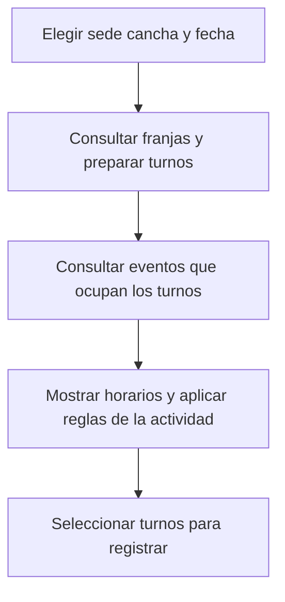

### 3.2 Usuarios

No existe un flujo separado de "registrar usuario": las cuentas no administrativas gestionadas por la academia se registran mediante **FL-02**, con credenciales de acceso propias y con Público y Reservas otorgados automáticamente en la misma operación. Los roles Profesor y Alumno pueden asignarse ya en ese mismo alta o en cualquier momento posterior mediante **FL-07**; Alumno, además, puede otorgarse automáticamente (ver **FL-20**). Las cuentas administrativas se crean mediante `crear_administrador` y sólo reciben Administrador. Las asignaciones referencian el catálogo fijo `roles`, sin flujos para crear, modificar o eliminar sus cinco registros.

El perfil propio permite consultar la información y cambiar únicamente la contraseña mediante **FL-59**. La edición administrativa de datos personales se limita al correo (**FL-04**); el restablecimiento de la contraseña de otra cuenta se realiza mediante **FL-69**. Nombre, apellido, nombre de usuario, celular, fecha de nacimiento y observaciones se cargan en el alta y no tienen un flujo de edición. El estado y los roles utilizan **FL-05** y **FL-07** por separado.

#### FL-02. Registrar un usuario

- **Objetivo:** crear un usuario activo con credenciales de acceso, Público y Reservas, y opcionalmente Profesor o Alumno.
- **Actor:** administrador.
- **Entradas:** nombre, apellido, celular, email y fecha de nacimiento obligatorios; contraseña ingresada o sugerida por el sistema; observaciones opcionales; roles adicionales opcionales (Profesor, Alumno o ambos). El nombre de usuario se genera automáticamente y no es editable.

Recorrido:

1. El administrador completa nombre, apellido, celular, email y fecha de nacimiento.
2. Al escribir nombre y apellido, el sistema muestra el nombre de usuario formado por el apellido normalizado y la inicial del nombre. Consulta si ya existe y, si hace falta, agrega el primer número disponible desde `1`. El campo no se puede editar. El administrador puede pedir una contraseña alfanumérica aleatoria o ingresar una propia; en ambos casos se aplican los validadores de contraseña configurados en Django.
3. El administrador puede marcar, opcionalmente, los roles Profesor o Alumno para otorgar junto con el alta.
4. Al confirmar, el sistema valida los campos obligatorios, que la fecha de nacimiento esté dentro del rango permitido y que nombre y apellido no contengan números. Genera nuevamente el nombre de usuario disponible y comprueba la unicidad del email sin distinguir mayúsculas de minúsculas.
5. Django genera el hash PBKDF2-SHA256 de la contraseña; la base nunca recibe la contraseña en texto plano.
6. En una transacción, el sistema crea el usuario con estado **Activo** y `debe_cambiar_contrasena = true`, le asigna automáticamente **Público** y **Reservas** y, si se marcaron, los roles Profesor o Alumno seleccionados. Cada asignación guarda una clave foránea al catálogo `roles`.
7. Muestra el nombre de usuario definitivo y la contraseña provisoria en texto plano una única vez, para que el administrador se los comunique a la persona.

Alternativas:

- El celular puede pertenecer a un tercero y no es único. El email y el nombre de usuario, en cambio, son siempre obligatorios y únicos sin distinguir mayúsculas de minúsculas. Si otro usuario ocupa el nombre mostrado antes de guardar, se asigna el siguiente sufijo disponible.
- La persona debe reemplazar la contraseña provisoria en su primer inicio de sesión mediante **FL-68**. Si no la recuerda, puede establecer una propia mediante recuperación (**FL-46**).
- Administrador, Público y Reservas no pueden elegirse en este paso: Administrador se crea mediante el comando de gestión `crear_administrador`; Público y Reservas se asignan automáticamente.
- No marcar ningún rol adicional no impide asignarlo después mediante **FL-07**.
- Si se cancela antes de confirmar, no se crea el usuario.
- Este flujo es siempre un paso previo e independiente: ninguna otra operación (como crear una reserva o registrar un plan o pase contratado) lo invoca ni registra un usuario nuevo dentro de su propio trámite. El usuario debe existir antes.

- **Resultado:** nuevo usuario activo con contraseña provisoria pendiente de reemplazo, Público, Reservas y los roles adicionales seleccionados.
- **Datos:** usuarios, usuarios_roles.

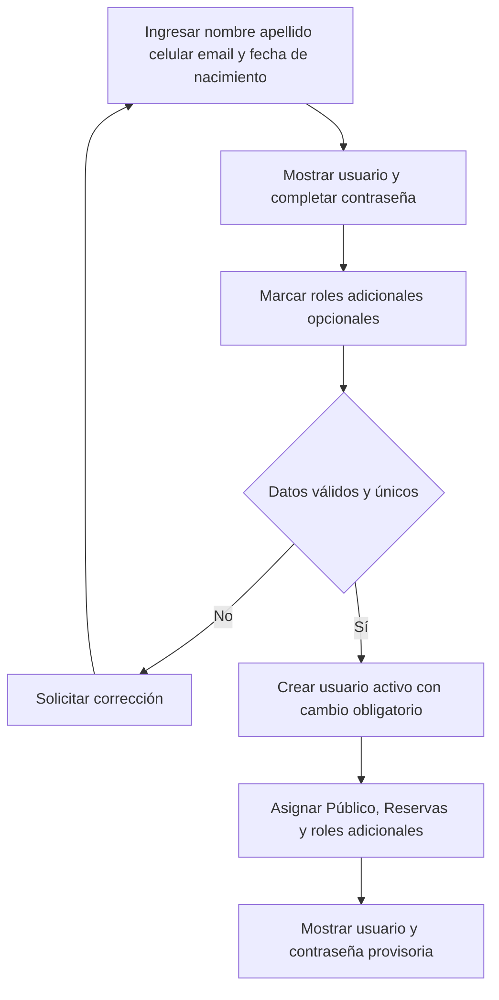

#### FL-03. Consultar un usuario

- **Objetivo:** localizar y visualizar la información de un usuario.
- **Actor:** administrador.
- **Entradas:** nombre, apellido, celular, email, nombre de usuario, rol, estado u otro criterio disponible.

Recorrido:

1. El administrador ingresa criterios de búsqueda.
2. El sistema muestra coincidencias activas e inactivas e identifica con una estrella a quienes tienen el rol Administrador.
3. El administrador selecciona un usuario.
4. El sistema muestra sus datos, roles y estado, nunca el hash de contraseña.

Alternativas:

- Si no hay coincidencias, informa que no se encontraron usuarios.
- Compartir celular no se considera duplicación.
- Filtrar por rol permite, por ejemplo, listar todos los usuarios con rol Alumno o Profesor.

- **Resultado:** detalle del usuario sin modificarlo.
- **Datos:** usuarios, usuarios_roles.

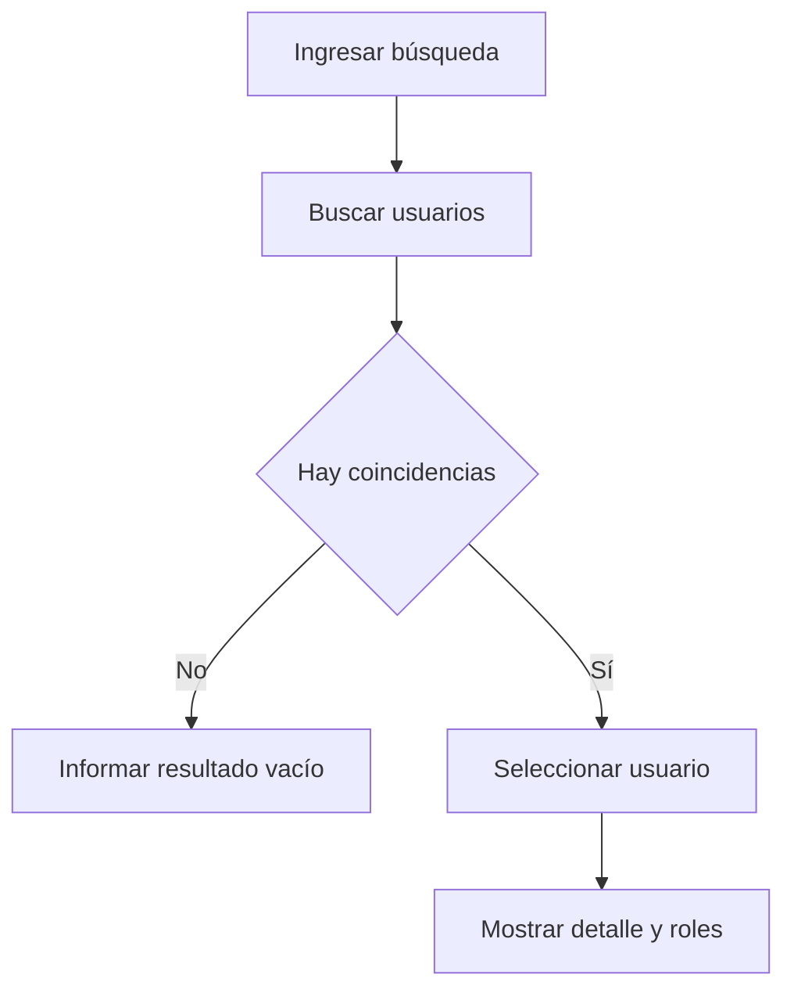

#### FL-04. Modificar el correo de un usuario

- **Objetivo:** modificar el correo de un usuario existente.
- **Actor:** administrador.
- **Precondición:** usuario localizado mediante **FL-03**.
- **Entrada:** nuevo correo.

Recorrido:

1. El sistema identifica al usuario mediante su nombre, apellido y nombre de usuario, y presenta el correo actual.
2. El administrador ingresa el nuevo correo.
3. El sistema valida el formato, que no quede vacío y que no pertenezca a otro usuario, sin distinguir mayúsculas de minúsculas.
4. Guarda el correo y actualiza la fecha de última modificación.

Alternativas:

- Este flujo no modifica los demás datos personales, el nombre de usuario, la contraseña, el estado ni los roles.
- Si el correo no es válido o ya está registrado, se informa el error sin modificar la cuenta.
- Cancelar la modificación conserva el correo anterior.

- **Resultado:** usuario con el correo actualizado.
- **Datos:** usuarios.

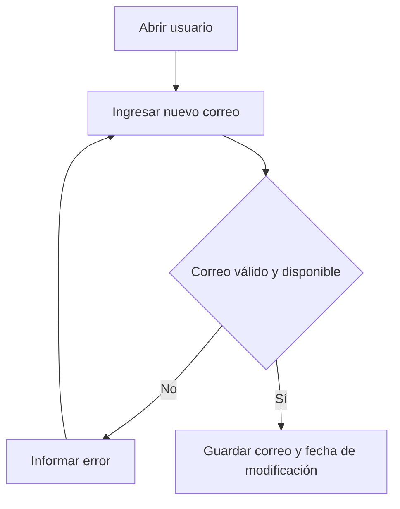

#### FL-05. Cambiar el estado de un usuario

- **Objetivo:** activar o inactivar un usuario sin eliminar su historia.
- **Actor:** administrador.
- **Precondición:** usuario localizado mediante **FL-03**.
- **Entrada:** nuevo estado.

Recorrido:

1. El administrador solicita cambiar el estado.
2. El sistema muestra el estado actual y el solicitado.
3. El administrador confirma.
4. El sistema valida que el actor no esté desactivando su propia cuenta y, si el usuario es administrador, que permanezca al menos otro administrador activo.
5. Si la cuenta queda inactiva, el sistema registra el momento actual en `fecha_baja`; si queda activa, limpia ese campo. Actualiza el estado, la fecha de baja y la fecha de última modificación dentro de la misma transacción de validación.

Alternativas:

- La inactivación no elimina clases, reservas, asistencias, contrataciones de planes y pases, sesiones de caja, movimientos ni roles asignados.
- Reactivar la cuenta limpia `fecha_baja`; el campo representa la baja vigente, no un historial de cambios de estado.
- Un usuario inactivo no podrá iniciar sesión ni ser asignado como profesor activo, aunque conserve credenciales cargadas.
- Ningún usuario con permiso para cambiar estados puede desactivar su propia cuenta.
- El último administrador activo no puede ser desactivado. Las filas de los administradores activos se bloquean durante la validación para que dos operaciones concurrentes no puedan eludir esta regla.
- El estado ya aplicado no genera cambios.

- **Resultado:** usuario activo sin fecha de baja, o usuario inactivo con la fecha de baja registrada.
- **Datos:** usuarios.

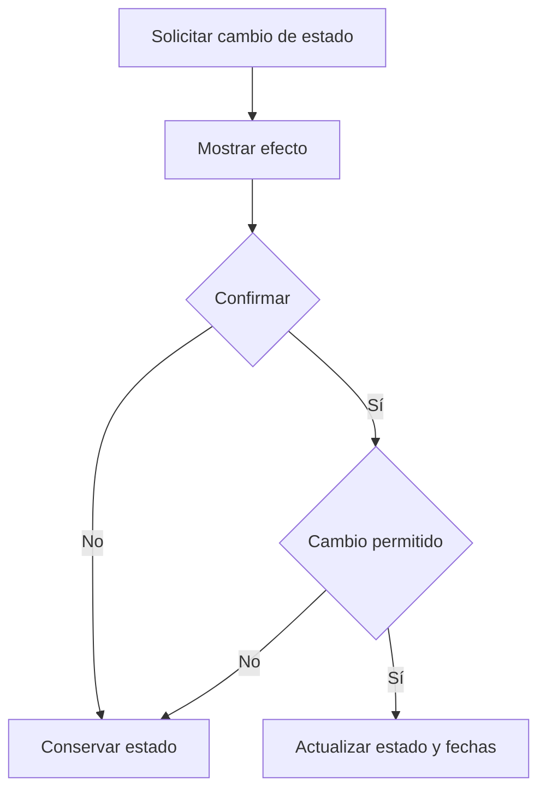

#### FL-69. Restablecer la contraseña de un usuario

- **Objetivo:** reemplazar administrativamente una contraseña desconocida por una nueva contraseña provisoria.
- **Actor:** administrador.
- **Precondición:** usuario localizado mediante **FL-03**.
- **Entrada:** confirmación del restablecimiento.

Recorrido:

1. El administrador solicita restablecer la contraseña desde el detalle del usuario.
2. El sistema informa que la contraseña actual dejará de funcionar y solicita confirmación.
3. Genera una contraseña alfanumérica aleatoria que cumple los validadores configurados.
4. En una transacción, guarda solamente su hash PBKDF2-SHA256 de Django, activa `debe_cambiar_contrasena` y actualiza la fecha de última modificación.
5. Muestra la contraseña provisoria en texto plano una única vez para que el administrador se la comunique a la persona.
6. En el próximo inicio de sesión se ejecuta **FL-68**.

Alternativas:

- Cancelar la confirmación conserva la contraseña vigente.
- Ningún administrador puede restablecer su propia contraseña. Para su cuenta debe utilizar **FL-59** o, si no puede iniciar sesión, **FL-46**.
- La operación no modifica el correo, los datos personales, el estado ni los roles.
- La contraseña provisoria no se almacena ni puede volver a consultarse en texto plano.

- **Resultado:** contraseña restablecida y cambio obligatorio pendiente.
- **Datos:** usuarios.

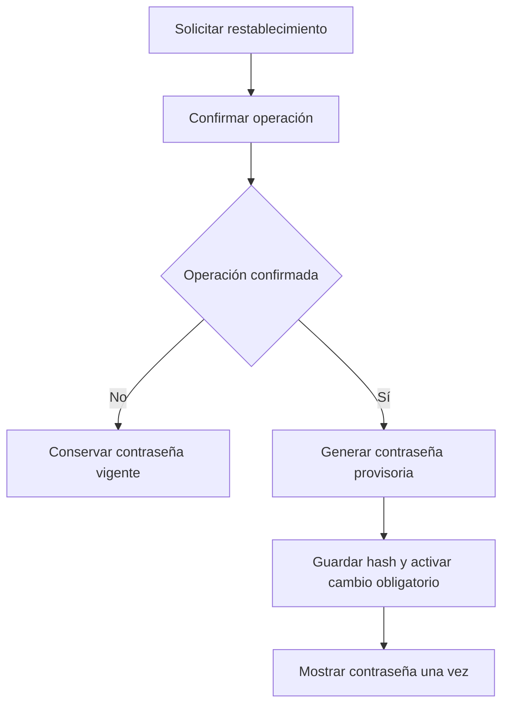

#### FL-06. Registrarse

- **Objetivo:** crear una cuenta de usuario con credenciales propias, igual que **FL-02** pero autogestionada desde el portal.
- **Actor:** público, sin cuenta previa.
- **Entradas:** nombre, apellido, celular, email, fecha de nacimiento y contraseña, todos obligatorios. El nombre de usuario se genera automáticamente y no es editable.

Recorrido:

1. La persona completa sus datos personales y contraseña desde el portal. Al escribir nombre y apellido, ve el nombre de usuario generado según la regla de **FL-02**.
2. Al confirmar, el sistema valida los campos obligatorios, que la fecha de nacimiento esté dentro del rango permitido y que nombre y apellido no contengan números. Genera nuevamente el nombre de usuario disponible y comprueba la unicidad del email sin distinguir mayúsculas de minúsculas.
3. Django genera el hash PBKDF2-SHA256 de la contraseña.
4. En una transacción, crea el usuario **Activo** y le asigna automáticamente **Público** y **Reservas**, igual que en **FL-02**.
5. Envía la confirmación de alta por email (ver 4.2).
6. Muestra el nombre de usuario definitivo para que la persona pueda iniciar sesión.

Alternativas:

- Si el email ya pertenece a un usuario existente (por ejemplo, registrado antes por la administración mediante **FL-02**), el alta se rechaza informando que la cuenta ya existe; la persona podrá iniciar sesión con esas credenciales o recuperar la contraseña (**FL-46**) en vez de registrarse de nuevo. Si otro usuario ocupa el nombre mostrado antes de guardar, se asigna el siguiente sufijo disponible.
- La base nunca recibe la contraseña en texto plano.
- El autorregistro guarda `debe_cambiar_contrasena = false`: la persona eligió y confirmó su propia contraseña, por lo que no debe reemplazarla en su primer inicio de sesión.

- **Resultado:** nuevo usuario activo con Público, Reservas y sesión iniciable.
- **Datos:** usuarios, usuarios_roles.

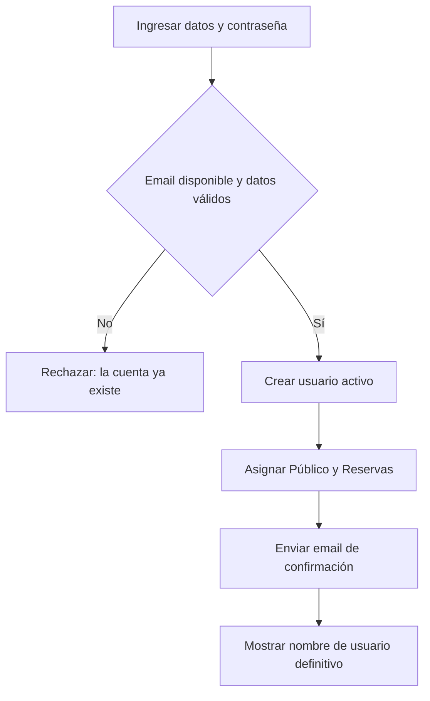

#### FL-07. Asignar o quitar un rol a un usuario

- **Objetivo:** otorgar o retirar Reservas, Profesor o Alumno a un usuario no administrador, conservando la coherencia con sus actividades y contrataciones.
- **Actor:** administrador.
- **Precondición:** usuario localizado mediante **FL-03**.
- **Entrada:** rol (Reservas, Profesor o Alumno) y acción (asignar o quitar).

Recorrido:

1. El administrador localiza al usuario.
2. El sistema muestra los roles vigentes del usuario.
3. El administrador elige Reservas, Profesor o Alumno y confirma asignarlo o quitarlo.
4. Si solicita quitarlo, comprueba que no existan relaciones que bloqueen el retiro: reservas propias Programadas para Reservas, contrataciones de planes Activas para Alumno o asignaciones activas como profesor en clases Programadas para Profesor.
5. Si la operación está permitida, actualiza `usuarios_roles`. La comprobación y el retiro se realizan en una misma operación transaccional, coordinada con la creación o reactivación de las relaciones involucradas.

Alternativas:

- **Público no se puede quitar.** Se asigna automáticamente en el alta de cuentas no administrativas. Administrador se gestiona exclusivamente mediante comandos ejecutados por el desarrollador y no puede combinarse con otros roles. Su perfil no ofrece la modificación de roles y el servidor rechaza solicitudes sobre esas cuentas. Este flujo tampoco permite crear, renombrar ni eliminar registros del catálogo `roles`.
- Reservas sigue asignándose automáticamente en el alta (**FL-02**, **FL-06**), pero puede retirarse si no hay reservas propias programadas y otorgarse nuevamente mediante este flujo.
- Si el usuario tiene reservas programadas, se rechaza el retiro de Reservas. Si tiene un plan contratado Activo, se rechaza el retiro de Alumno; un pase contratado no impide retirar ese rol. Si tiene clases programadas con una asignación activa como profesor, se rechaza el retiro de Profesor.
- Ante un rechazo, se informa la causa, se conserva el rol y no se cancelan ni modifican las relaciones que lo bloquean. Los estados registrados determinan el bloqueo; una fecha pasada por sí sola no lo libera.
- El rol Alumno también puede otorgarse automáticamente mediante **FL-20**, además de por este flujo; ambas vías conviven sin conflicto.
- Quitar Reservas, Profesor o Alumno no elimina el historial de reservas, contrataciones, clases ni asistencia. Las reservas y clases canceladas o completadas y las contrataciones Vencidas o Anuladas no bloquean por sí solas el retiro.
- Asignar un rol ya vigente, o quitar uno que el usuario no tiene, no genera cambios.

- **Resultado:** asignación actualizada, o retiro rechazado conservando el rol y sus relaciones.
- **Datos:** usuarios_roles, roles, reservas, planes_usuarios, pases_usuarios, clases_profesores, clases y eventos, turnos.

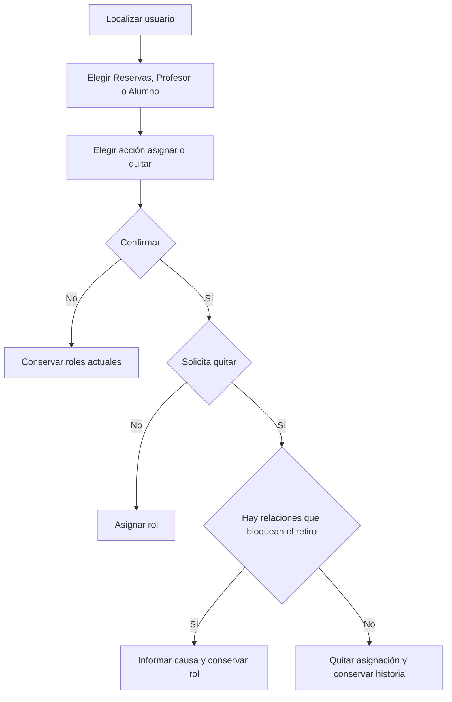

### 3.3 Sedes y canchas

#### FL-08. Consultar sedes y canchas

- **Objetivo:** visualizar las sedes y sus canchas asociadas.
- **Actor:** administrador.
- **Entradas:** sede seleccionada y filtros opcionales por nombre o estado de la sede.

Recorrido:

1. El administrador accede a la consulta.
2. El sistema muestra las sedes.
3. Al seleccionar una sede, muestra todas sus canchas, activas e inactivas, con sus superficies y estados.

Alternativas:

- Una sede sin canchas muestra una lista vacía.
- La consulta de sedes puede incluir registros inactivos.

- **Resultado:** jerarquía de sedes y canchas sin modificaciones.
- **Datos:** sedes y canchas.

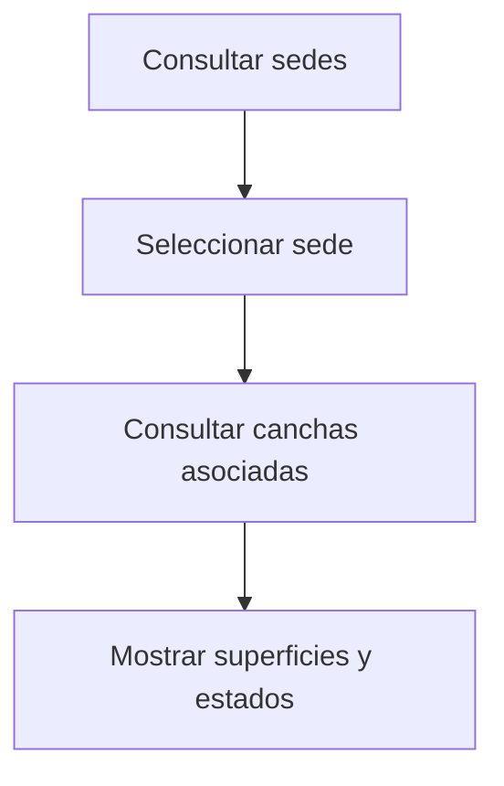

#### FL-09. Registrar una sede

- **Objetivo:** crear una sede activa.
- **Actor:** administrador.
- **Entradas:** nombre y dirección obligatorios; observaciones opcionales.

Recorrido:

1. El administrador completa los datos.
2. El sistema valida que el nombre no esté vacío ni repetido, sin distinguir mayúsculas de minúsculas.
3. Crea la sede con estado **Activa**.

Alternativas:

- Registrar la sede no crea canchas ni horario de funcionamiento automáticamente: hasta configurarlo mediante **FL-58**, la sede queda sin franjas y no funciona ningún día.

- **Resultado:** nueva sede activa.
- **Datos:** sedes.

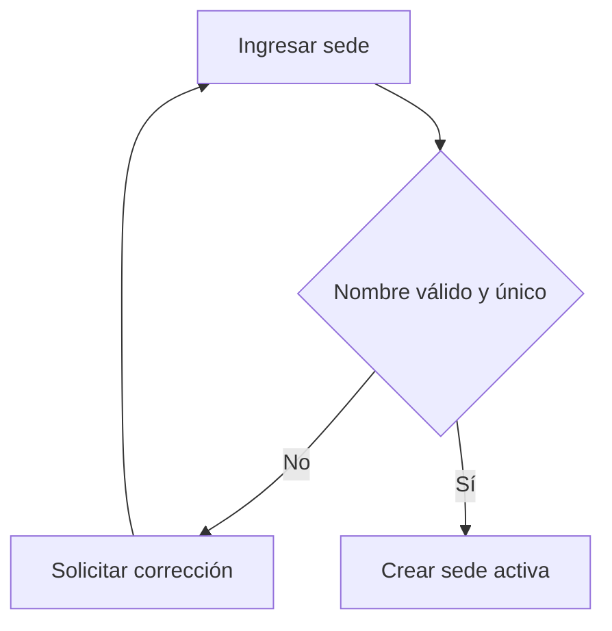

#### FL-10. Actualizar una sede

- **Objetivo:** modificar nombre, dirección u observaciones de una sede.
- **Actor:** administrador.
- **Precondición:** sede seleccionada mediante **FL-08**.

Recorrido:

1. El sistema presenta los datos actuales.
2. El administrador realiza cambios.
3. El sistema valida que el nombre sea único sin distinguir mayúsculas de minúsculas.
4. Guarda la sede.

Alternativas:

- Este flujo no cambia el estado ni modifica canchas.

- **Resultado:** sede actualizada.
- **Datos:** sedes.

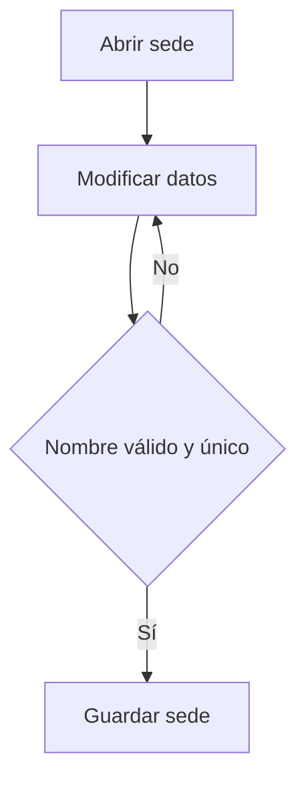

#### FL-11. Cambiar el estado de una sede

- **Objetivo:** activar o inactivar una sede conservando su historia.
- **Actor:** administrador.
- **Precondición:** sede seleccionada mediante **FL-08**.

Recorrido:

1. El administrador solicita el nuevo estado.
2. El sistema muestra las canchas asociadas y el impacto operativo.
3. El administrador confirma.
4. El sistema bloquea la sede dentro de una transacción. Si se solicita inactivarla, comprueba que ninguna de sus canchas tenga reservas Programadas; si las hay, conserva el estado e informa el impedimento.
5. Si la operación está permitida, establece el estado solicitado. Repetir la solicitud no invierte la acción.

Alternativas:

- La operación no elimina ni cambia automáticamente el estado de sus canchas.
- Una sede inactiva no se ofrece para nuevas actividades.
- Una reserva en curso o vencida que siga Programada también impide inactivar. Las futuras pueden cancelarse según sus reglas; las demás sólo pueden finalizarse después del turno, automáticamente o mediante **FL-42**. Las canceladas y completadas no impiden inactivar.
- La reactivación se permite aunque haya reservas Programadas. Editar los datos de la sede no modifica su estado.

- **Resultado:** sede activa o inactiva.
- **Datos:** sedes, canchas, turnos y reservas con sus detalles para informar impacto y validar la desactivación.

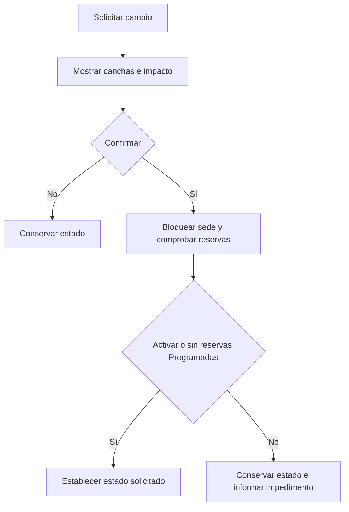

#### FL-12. Registrar una cancha

- **Objetivo:** crear una cancha activa dentro de una sede.
- **Actor:** administrador.
- **Entradas:** sede, nombre, superficie; observaciones opcionales.
- **Precondición:** sede activa seleccionada mediante **FL-08**.

Recorrido:

1. El administrador completa los datos.
2. El sistema valida superficie y nombre único dentro de la sede sin distinguir mayúsculas de minúsculas.
3. Crea la cancha con estado **Activa**.

Alternativas:

- La superficie debe ser **Cemento** o **Polvo de ladrillo**.

- **Resultado:** nueva cancha activa.
- **Datos:** sedes y canchas.

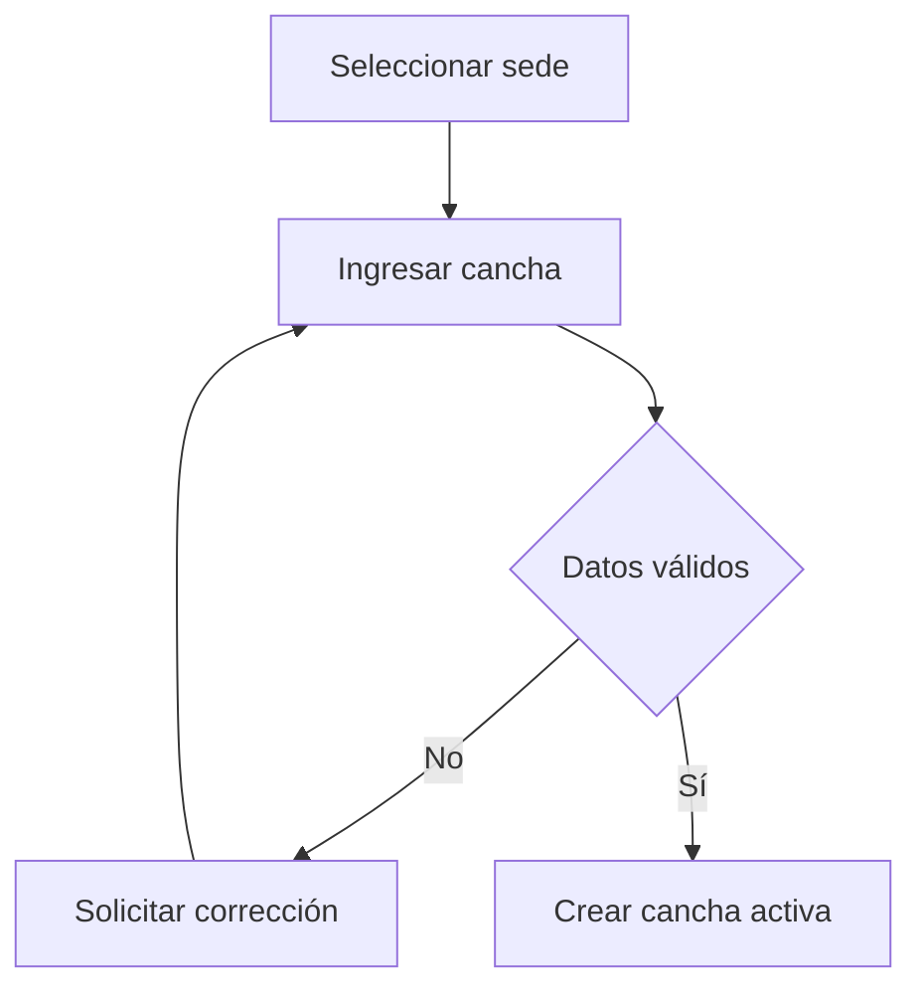

#### FL-13. Actualizar una cancha

- **Objetivo:** modificar nombre, superficie u observaciones de una cancha.
- **Actor:** administrador.
- **Precondición:** cancha seleccionada mediante **FL-08**.

Recorrido:

1. El sistema presenta los datos actuales.
2. El administrador realiza cambios.
3. El sistema valida superficie y nombre único dentro de la sede sin distinguir mayúsculas de minúsculas.
4. Guarda la cancha.

Alternativas:

- Este flujo no cambia el estado de la cancha.
- La sede de contexto determina el ámbito del nombre.

- **Resultado:** cancha actualizada.
- **Datos:** canchas y sedes.

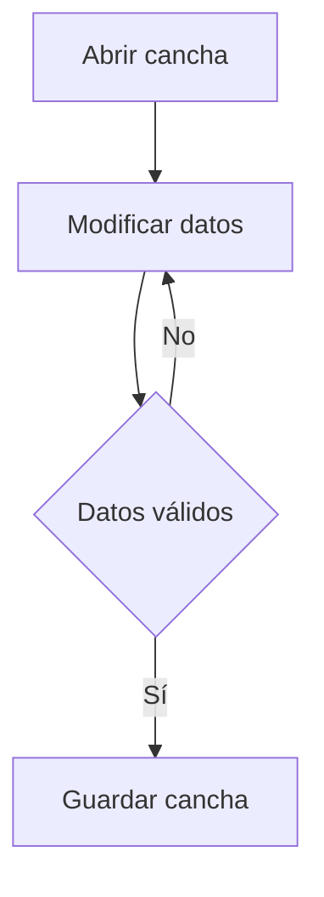

#### FL-14. Cambiar el estado de una cancha

- **Objetivo:** activar o inactivar una cancha conservando su historia.
- **Actor:** administrador.
- **Precondición:** cancha seleccionada mediante **FL-08**.

Recorrido:

1. El administrador solicita el nuevo estado.
2. El sistema muestra el impacto sobre nuevas actividades.
3. El administrador confirma.
4. El sistema bloquea primero la sede y después la cancha dentro de una transacción. Si se solicita inactivarla, comprueba que no tenga reservas Programadas; si las hay, conserva el estado e informa el impedimento.
5. Si la operación está permitida, establece el estado solicitado. Repetir la solicitud no invierte la acción.

Alternativas:

- Una cancha inactiva no se ofrece para nuevas clases, reservas o turnos de planilla.
- Las actividades históricas conservan la referencia.
- Las reservas en curso o vencidas que sigan Programadas también impiden inactivar. Las canceladas y completadas no lo impiden.
- La reactivación está permitida aunque haya reservas Programadas. No activa la sede ni habilita nuevas reservas si la sede sigue inactiva. Editar los datos de la cancha no modifica su estado.

- **Resultado:** cancha activa o inactiva.
- **Datos:** sede, cancha, turnos y reservas con sus detalles para validar la desactivación.

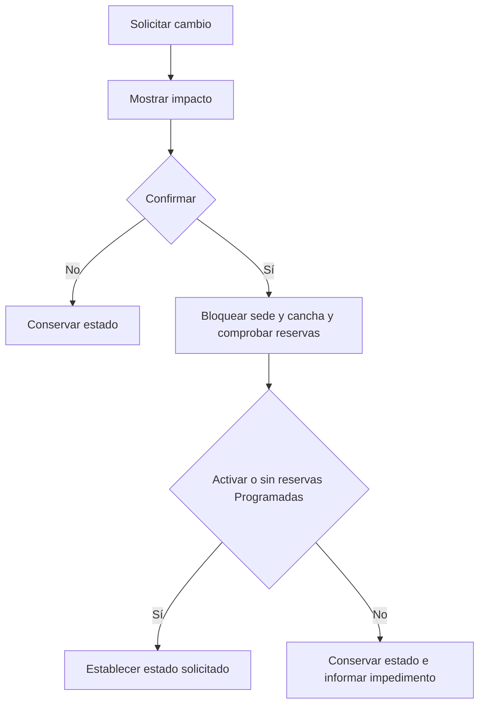

#### FL-57. Consultar el horario de funcionamiento de una sede

- **Objetivo:** visualizar los días y franjas horarias en los que una sede funciona.
- **Actores:** administrador; cualquier persona, sin necesidad de cuenta, desde el portal.
- **Entradas:** sede.

Recorrido:

1. El actor selecciona una sede, entre las activas mediante **FL-08** o directamente en el portal.
2. El sistema muestra los siete días de la semana con sus franjas habilitadas, cuando las tiene.
3. Un día sin franjas configuradas se muestra sin funcionamiento.

Alternativas:

- Esta consulta muestra el horario general de la sede, no la ocupación real de cada cancha; para disponibilidad concreta ver **FL-01**.
- Este horario rige tanto para clases como para reservas, aunque con distinta exigencia según quién actúa (ver **FL-28**, **FL-34**, **FL-40** y **FL-51**).

- **Resultado:** horario semanal de funcionamiento de la sede consultado sin modificaciones.
- **Datos:** sedes y horarios de sede.

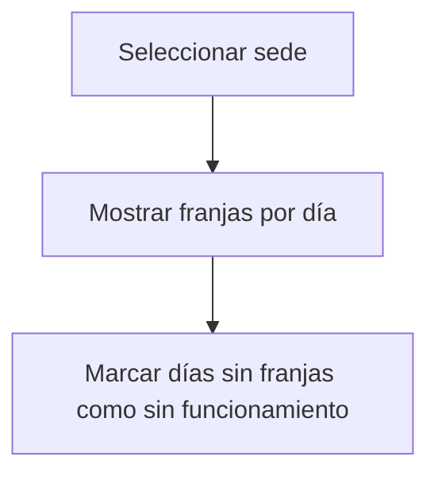

#### FL-58. Configurar el horario de funcionamiento de una sede

- **Objetivo:** definir o modificar hasta dos franjas horarias de funcionamiento para uno o varios días de la semana.
- **Actor:** administrador.
- **Precondición:** sede localizada mediante **FL-08**.
- **Entradas:** días de la semana seleccionados y una o dos franjas horarias, o la indicación de dejarlos sin funcionamiento.

Recorrido:

1. El administrador selecciona la sede mediante **FL-57** y marca los días que quiere modificar. Puede seleccionar lunes a viernes, fin de semana o toda la semana mediante accesos rápidos. Si abre la edición de un día, se precargan ese día y sus franjas.
2. Ingresa las horas de inicio y fin de la primera franja mediante campos numéricos de 0 a 23. Los minutos permanecen fijos en cero. Puede habilitar una segunda franja.
3. El sistema valida que todos los horarios sean en punto, que cada franja tenga el fin posterior al inicio y que, si hay dos, exista al menos una hora sin funcionamiento entre el fin de la primera y el inicio de la segunda. Se rechazan horarios con minutos o segundos distintos de cero y franjas contiguas o superpuestas.
4. El sistema comprueba que las actividades Programadas cuyo turno no terminó permanezcan dentro de las franjas propuestas. Si se cumple, el administrador aplica el horario y el sistema guarda la misma configuración en todos los días seleccionados, reemplazando sus franjas anteriores en una única transacción. Los días no seleccionados conservan su configuración.

Alternativas:

- La acción «Marcar como sin funcionamiento» elimina las franjas de los días seleccionados sin exigir horas de inicio ni fin, para reservas, clases y bloqueos, siempre que no deje fuera actividades Programadas cuyo turno no terminó.
- Este horario es independiente de la planilla (ver **FL-23** a **FL-26**): configurarlo no crea, modifica ni elimina turnos de planilla. Sí afecta la generación de clases (**FL-28**, **FL-29**) y la creación o el cambio de cancha de clases, la creación o reprogramación de reservas y el registro de bloqueos, que lo validan en el momento (ver **FL-34**, **FL-35**, **FL-40**, **FL-51**).
- Antes de guardar, comprueba las reservas, clases y bloqueos Programados de los días seleccionados cuyo turno no terminó. Rechaza tanto la modificación como la eliminación de franjas si deja alguna actividad fuera del horario propuesto. La comprobación y el guardado bloquean la sede en una única transacción. Los eventos Anulados, Finalizados o con turno terminado no impiden el cambio y conservan su historia.

- **Resultado:** horario de funcionamiento de la sede actualizado para los días seleccionados.
- **Datos:** sedes, horarios de sede, canchas, turnos y eventos.

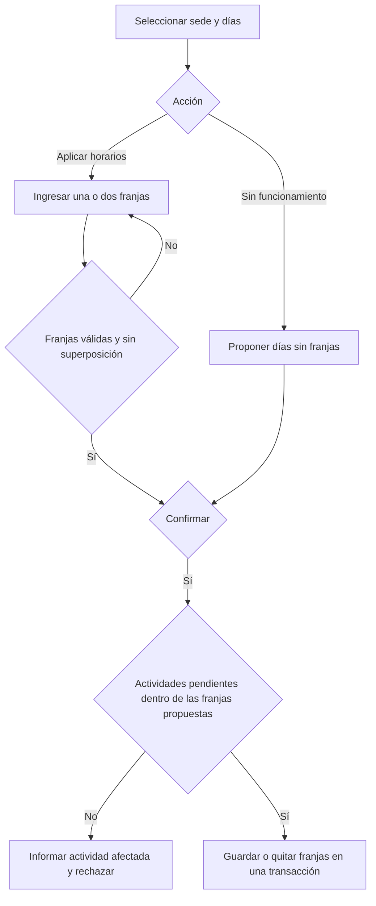

### 3.4 Catálogos de planes y pases

#### FL-15. Consultar planes y pases

- **Objetivo:** consultar productos del catálogo.
- **Actores:** Administrador, con acceso a activos e inactivos; usuario autenticado con rol Público, limitado a activos.
- **Entradas:** catálogo de planes o pases y filtros por nombre, configuración o estado cuando el actor lo permite.

Recorrido:

1. El actor elige el catálogo y los filtros.
2. El sistema consulta `planes` o `pases`, según lo seleccionado.
3. Muestra nombre, descripción, configuración y precio vigente, con acceso al detalle.

Alternativas:

- El portal sólo ofrece productos Activos.
- El pase Libre y el de Fin de semana son productos distintos.
- Los nombres se validan dentro de cada catálogo, no entre ambas tablas.

- **Resultado:** listado y detalle de productos, sin modificar datos.
- **Datos:** planes o pases.

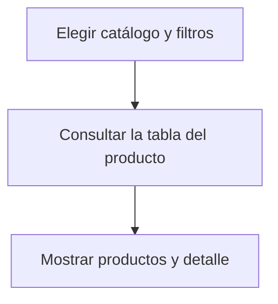

#### FL-16. Registrar un plan o un pase

- **Objetivo:** registrar un producto completo en su catálogo.
- **Actor:** Administrador.
- **Entradas:** nombre, descripción y precio; configuración específica del plan o pase.

Recorrido:

1. Selecciona el catálogo y completa los datos.
2. Para un plan, indica modalidad, frecuencia semanal y cantidad de clases por encuentro. Para un pase, indica variante, límite diario y adicional por invitado.
3. Valida nombre disponible entre productos Activos del mismo catálogo, importes y configuración.
4. Registra una fila Activa en `planes` o `pases`.

Alternativas:

- Frecuencia de plan entre uno y siete, con una o dos clases de una hora por encuentro.
- Límite diario de pase positivo; Libre habilita todos los días y Fin de semana sólo sábado y domingo.
- Los precios no pueden ser negativos.

- **Resultado:** producto Activo en el catálogo correspondiente.
- **Datos:** planes o pases.

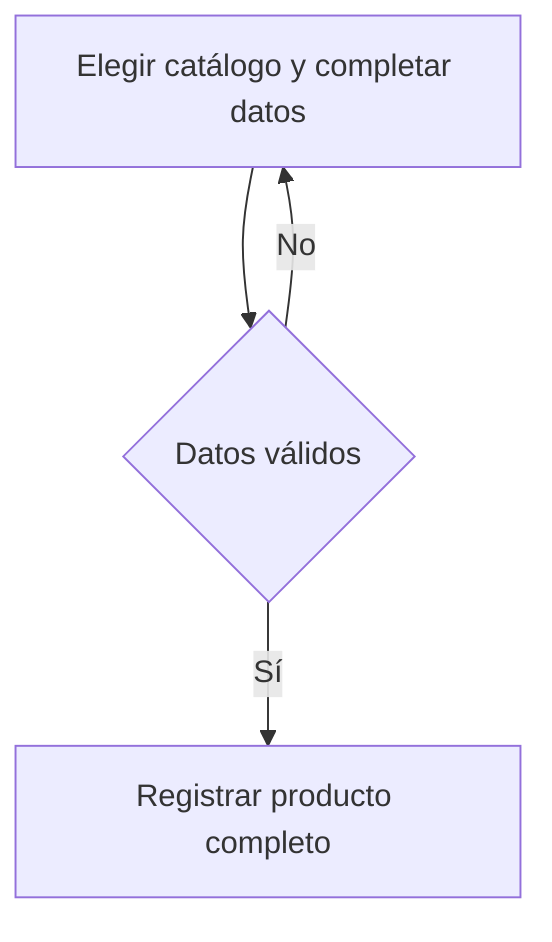

#### FL-17. Actualizar un plan o un pase

- **Objetivo:** modificar los datos comerciales de un producto.
- **Actor:** Administrador.
- **Precondición:** producto localizado mediante **FL-15**.

Recorrido:

1. El sistema informa si tiene contrataciones históricas.
2. El Administrador modifica nombre, descripción y precios vigentes.
3. Si no tiene contrataciones históricas, puede modificar también su configuración estructural.
4. Valida y guarda los cambios en su tabla, actualizando la fecha de modificación.

Alternativas:

- Con contrataciones históricas no se cambia modalidad, frecuencia o duración del plan, ni variante o límite diario del pase.
- Una configuración estructural distinta se registra como otro producto.
- Cambiar el precio vigente no modifica importes acordados ni movimientos monetarios registrados.
- El adicional de invitados se conserva en cada reserva que lo aplica.

- **Resultado:** producto actualizado, conservando los datos aplicados a operaciones existentes.
- **Datos:** planes y planes_usuarios, o pases y pases_usuarios.

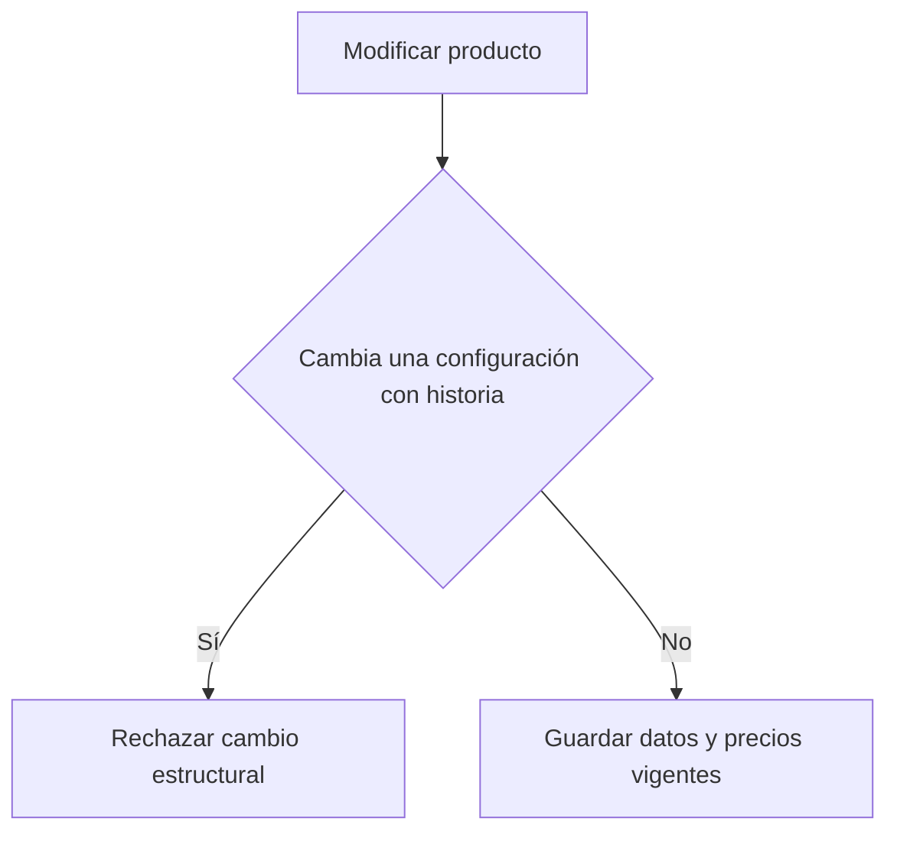

#### FL-18. Cambiar el estado de un plan o un pase

- **Objetivo:** activar o desactivar un producto sin alterar sus contrataciones.
- **Actor:** Administrador.
- **Precondición:** producto localizado mediante **FL-15**.
- **Entrada:** estado solicitado y confirmación.

Recorrido:

1. Solicita activar o desactivar el producto.
2. Confirma el efecto sobre nuevas contrataciones.
3. El sistema establece el estado y actualiza la marca de modificación en la tabla correspondiente.

Alternativas:

- Desactivar no anula contrataciones existentes.
- Un producto Inactivo no admite nuevas contrataciones.
- Repetir el estado aplicado no invierte la operación.
- Activar un producto del catálogo no asigna roles a usuarios.

- **Resultado:** producto con el estado solicitado.
- **Datos:** planes o pases.

```mermaid
flowchart TD
    A[Solicitar estado del producto] --> B{Confirmar}
    B -->|No| C[Conservar estado]
    B -->|Sí| D[Establecer estado solicitado]
```

### 3.5 Contrataciones de planes y pases

#### FL-19. Consultar un plan o pase contratado

- **Objetivo:** consultar una contratación mensual y sus cobros o usos.
- **Actores:** Administrador, sobre todas; titular autenticado, sólo sobre las propias.
- **Entradas:** tipo de contratación y filtros por usuario, producto, mes o estado.

Recorrido:

1. El sistema consulta `planes_usuarios` o `pases_usuarios` y limita el alcance según el actor.
2. El actor selecciona una contratación.
3. Muestra producto, mes, período calculado, importe acordado, estado, auditoría y cobros vinculados vigentes desde movimientos.
4. Para pases, muestra también las reservas donde se aplicó como organizador o invitado.

Alternativas:

- Consultar un pase propio no exige Alumno.
- El titular consulta sus contrataciones en modo de sólo lectura.
- La consulta comercial excluye toda anulación, incluso posterior al cierre de caja. No calcula deuda ni indicadores de pago y no utiliza los totales históricos del cierre.
- La consulta histórica utiliza la contratación concreta.

- **Resultado:** detalle autorizado, sin modificar datos.
- **Datos:** usuarios, planes, pases, planes_usuarios, pases_usuarios, movimientos_fondos, reservas e invitados.

```mermaid
flowchart TD
    A[Elegir tipo y filtros] --> B[Consultar contrataciones autorizadas]
    B --> C[Mostrar período importes auditoría y usos]
```

#### FL-20. Registrar un plan o pase para un usuario

- **Objetivo:** registrar una contratación mensual desde la administración.
- **Actor:** Administrador.
- **Entradas:** usuario, producto Activo, mes cubierto, fecha efectiva de alta, importe acordado y observaciones.

Recorrido:

1. Selecciona al usuario, un plan o pase y el mes.
2. Muestra el período calculado y propone el precio vigente.
3. El Administrador establece el importe final cuando corresponde un ajuste y confirma.
4. En una transacción, bloquea al usuario y verifica que no exista otra contratación no Anulada del mismo tipo para ese mes.
5. Registra una fila en `planes_usuarios` o `pases_usuarios`, con su producto obligatorio, mes, importe aplicado y responsable. Si el mes terminó nace Vencida; en otro caso, Activa.
6. Si registra un plan Activo, falta Alumno y el titular no es administrador, asigna el rol en la misma transacción.

Alternativas:

- Puede combinar un plan y un pase, pero no duplicar el mismo tipo en un mes, incluidos registros Vencidos.
- El mes se encuentra entre agosto de 2026 y el mes siguiente al actual.
- Renovar para otro mes crea una contratación nueva.
- Un pase no otorga Alumno y su vigencia se verifica para cada fecha de uso.
- El ingreso se registra por separado mediante **FL-43**; el importe aplicado no representa lo abonado.

- **Resultado:** contratación registrada con precio acordado e historia conservada.
- **Datos:** usuarios, planes o pases, planes_usuarios o pases_usuarios y usuarios_roles cuando corresponde.

```mermaid
flowchart TD
    A[Elegir usuario producto y mes] --> B[Revisar período e importe acordado]
    B --> C{Confirmar}
    C -->|Sí| D[Bloquear usuario y validar exclusividad]
    D --> E[Registrar contratación en su tabla]
    E --> F{Plan Activo de titular no administrador}
    F -->|Sí| G[Asignar Alumno si falta]
    F -->|No| H[Terminar]
    G --> H
```

#### FL-21. Anular un plan o pase contratado

- **Objetivo:** impedir nuevas aplicaciones de una contratación, conservando su historia.
- **Actor:** Administrador.
- **Precondición:** contratación Activa localizada mediante **FL-19**.
- **Entrada:** motivo obligatorio y confirmación.

Recorrido:

1. Consulta usos e ingresos de la contratación.
2. Ingresa el motivo y confirma.
3. En una transacción, bloquea la fila en su tabla, verifica estado Activo y establece Anulado.
4. Registra administrador, momento y motivo de anulación, actualizando la fecha de modificación.

Alternativas:

- Conserva producto, titular, mes, precio aplicado e ingresos.
- No anula automáticamente clases, reservas, cobros o coberturas de pase registradas ni devuelve dinero. Si corresponde reintegrar, la administración registra un Egreso de categoría devoluciones mediante FL-43.
- Un pase Anulado no cubre aplicaciones nuevas.
- No se retira Alumno automáticamente.
- El registro Anulado permite contratar un reemplazo para ese mes, conservando ambos.
- Repetir una anulación no sobrescribe su auditoría.

- **Resultado:** contratación Anulada.
- **Datos:** planes_usuarios o pases_usuarios, movimientos_fondos y reservas relacionadas.

```mermaid
flowchart TD
    A[Solicitar anulación de contratación] --> B[Revisar impacto e ingresar motivo]
    B --> C{Confirmar}
    C -->|Sí| D[Bloquear y comprobar estado]
    D --> E[Anular y registrar auditoría]
```

### 3.6 Planilla y generación de clases

La planilla semanal de una cancha es única y viva (ver `1_organizacion.md`, 2.1 y `2_criterios_del_sistema.md`, 2.1): no existen versiones por período, ni un estado de "en preparación" o "confirmada". Editar la planilla no crea ni modifica clases por sí solo; generar clases para un período (**FL-28**) es la única operación que lee la planilla y crea clases concretas a partir de ella.

Los profesores previstos deben ser usuarios activos con rol Profesor. Los participantes previstos deben ser usuarios activos; la selección propone Alumno por defecto y permite ampliar a cualquier usuario activo, incluidos profesores. Participar no exige ni otorga Alumno, no requiere un plan y no genera cargos. Una persona no se asigna a una misma celda en ambas funciones. La modalidad es opcional: individual y grupal admiten varios participantes. Más de seis participantes previstos en modalidad grupal genera una advertencia confirmable, sin imponer un cupo rígido.

#### FL-23. Consultar la planilla de una cancha

- **Objetivo:** visualizar los turnos vigentes de la planilla semanal de una cancha.
- **Actor:** administrador.
- **Entradas:** sede y luego cancha.

Recorrido:

1. El administrador selecciona una sede y luego una de sus canchas activas.
2. El sistema muestra la grilla semanal con los turnos vigentes: día, horario, modalidad, profesores y alumnos previstos.
3. El administrador puede seleccionar un turno para ejecutar **FL-25** o **FL-26**, o crear uno nuevo mediante **FL-24**.

Alternativas:

- Una cancha sin turnos muestra la grilla vacía.

- **Resultado:** grilla semanal consultada sin modificaciones.
- **Datos:** canchas, turnos de planilla y sus profesores y usuarios previstos.

```mermaid
flowchart TD
    A[Seleccionar sede y cancha] --> B[Mostrar grilla semanal]
    B --> C{Selecciona turno}
    C -->|Sí| D[Ofrecer FL-25 o FL-26]
    C -->|No| E[Ofrecer FL-24]
```

#### FL-24. Crear un turno de planilla

- **Objetivo:** ocupar una celda de la planilla semanal de una cancha.
- **Actor:** administrador.
- **Precondición:** cancha activa seleccionada mediante **FL-23**.
- **Entradas:** día de la semana, horario, modalidad opcional, observaciones opcionales, profesores y alumnos previstos.

Recorrido:

1. El administrador selecciona una celda vacía (día y horario) de la cancha.
2. Ingresa modalidad, observaciones y profesores y alumnos previstos.
3. El sistema valida que no exista ya un turno para esa cancha, día y horario, y comprueba las condiciones de profesores y participantes previstas en esta sección.
4. Presenta las advertencias de cantidad cuando corresponden y guarda el turno y sus asignaciones en una transacción.

Alternativas:

- Un turno puede guardarse sin profesor previsto; la generación de clases (**FL-28**) omitirá e informará los turnos sin profesor al momento de generar.
- No puede haber dos turnos para la misma cancha, día y horario.

- **Resultado:** nuevo turno visible en la grilla.
- **Datos:** turnos de planilla y sus profesores y usuarios previstos.

```mermaid
flowchart TD
    A[Seleccionar celda vacía] --> B[Ingresar datos y asignaciones]
    B --> C{Celda disponible}
    C -->|No| D[Informar duplicación]
    C -->|Sí| E[Guardar turno]
```

#### FL-25. Modificar un turno de planilla

- **Objetivo:** cambiar modalidad, observaciones, profesores o alumnos previstos de un turno, sin moverlo.
- **Actor:** administrador.
- **Precondición:** turno seleccionado mediante **FL-23**.

Recorrido:

1. El sistema muestra los datos del turno.
2. El administrador modifica modalidad, observaciones, profesores o alumnos previstos.
3. Valida las condiciones de profesores y participantes, presenta las advertencias de cantidad cuando corresponden y guarda los cambios en una transacción.

Alternativas:

- La cancha, el día y el horario de un turno guardado no se modifican; para reubicarlo se ejecutan **FL-26** y luego **FL-24**.
- Los cambios no alteran clases ya generadas: para que una clase generada refleje el cambio hace falta regenerar el período (**FL-29**).

- **Resultado:** turno actualizado.
- **Datos:** turnos de planilla y sus profesores y usuarios previstos.

```mermaid
flowchart TD
    A[Abrir turno] --> B[Modificar datos o asignaciones]
    B --> C{Datos válidos}
    C -->|No| B
    C -->|Sí| D[Guardar turno]
```

#### FL-26. Quitar un turno de planilla

- **Objetivo:** retirar una celda de la planilla.
- **Actor:** administrador.
- **Precondición:** turno seleccionado mediante **FL-23**.

Recorrido:

1. El administrador solicita quitar el turno.
2. El sistema muestra sus profesores y alumnos previstos, y advierte si ya generó clases.
3. El administrador confirma.
4. El sistema elimina el turno y sus asignaciones.

Alternativas:

- Las clases ya generadas desde ese turno no se eliminan: conservan su historia y quedan sin turno de origen.

- **Resultado:** celda libre en la planilla.
- **Datos:** turnos de planilla, sus asignaciones, y clases (desvinculación de origen).

```mermaid
flowchart TD
    A[Solicitar quitar turno] --> B[Mostrar datos y clases ya generadas]
    B --> C{Confirmar}
    C -->|No| D[Conservar turno]
    C -->|Sí| E[Eliminar turno de la grilla]
```

#### FL-27. Registrar o quitar un feriado

- **Objetivo:** registrar una fecha del calendario común de feriados o quitar una existente.
- **Actor:** administrador.
- **Entradas:** fecha y descripción para registrar; feriado seleccionado para quitar.

Recorrido de registro:

1. Valida el acceso, la fecha entre el 01/08/2026 y cinco años calendario después de hoy y la ausencia de otro feriado en esa fecha.
2. Si la fecha es posterior a hoy, prepara la vista previa de todas las clases Programadas de ese día, incluidas las manuales, en todas las sedes. Informa sus profesores y participantes y el motivo común «Clase anulada por registro de feriado».
3. El administrador confirma. El sistema coordina la operación con la creación y generación de clases, bloquea los turnos y eventos afectados y vuelve a comprobar el conjunto revisado.
4. En una única transacción registra el feriado y anula las clases revisadas, conservando asignaciones, actor, momento y motivo. Libera los turnos sin crear bloqueos ni modificar reservas. Si cambian las condiciones, revierte todo y exige revisar nuevamente.

Recorrido de retiro:

1. El administrador selecciona el feriado y confirma quitarlo.
2. El sistema elimina la fecha del calendario. No reactiva clases Anuladas ni genera clases nuevas.

Alternativas:

- Registrar un feriado de hoy o pasado no anula ni modifica clases existentes.
- Generar o regenerar omite las fechas feriadas. Se admite crear una clase manual después del registro del feriado, respetando disponibilidad y horarios; esa excepción permanece Programada.
- El feriado no se limita a una sede. Una fecha duplicada se rechaza sin cambios.

- **Resultado:** calendario actualizado y, al registrar una fecha futura, clases revisadas Anuladas con historia preservada.
- **Datos:** feriados, usuarios y roles del actor, clases, profesores, participantes, eventos, turnos y auditoría.

```mermaid
flowchart TD
    A[Seleccionar operación y fecha] --> B{Registrar}
    B -->|Sí| C[Validar fecha y duplicación]
    C --> D{Fecha posterior a hoy}
    D -->|Sí| E[Revisar clases programadas y confirmar]
    E --> F[Revalidar y registrar feriado con anulaciones atómicas]
    D -->|No| G[Registrar sin modificar clases]
    B -->|No| H[Confirmar retiro y quitar feriado sin reactivar clases]
```


#### FL-28. Generar clases para un período

- **Objetivo:** crear clases concretas de una sede a partir de su planilla vigente.
- **Actor:** administrador.
- **Entradas:** sede y rango de fechas dentro del calendario de clases, de hasta 62 días corridos inclusive.

Recorrido:

1. Valida el acceso, la sede y el rango. Expande las celdas de planilla a las fechas que coinciden con su día de semana y ordena las candidatas por fecha, hora e identificadores de sede y cancha.
2. Evalúa cada candidata completa: horario íntegro dentro de una franja habilitada, instalaciones activas, al menos un profesor previsto y condiciones de asignación de todos sus usuarios. Omite feriados, turnos ocupados por eventos no Anulados y candidatas cuyos profesores o participantes tienen asignaciones activas a otra clase no Anulada en la misma fecha y hora, sin importar sede, cancha o función.
3. Compara también las candidatas válidas de esta ejecución. La primera válida conserva sus asignaciones; una posterior en conflicto se omite completa. No elimina usuarios para crear una clase parcial ni aborta las demás candidatas.
4. Presenta las clases a crear, cada candidata omitida con su motivo y la advertencia por más de seis participantes previstos en modalidad grupal. Las coincidencias con reservas no generan advertencia ni son motivo de omisión.
5. Solicita dos confirmaciones explícitas y sucesivas: la generación no admite deshacer; para quitar las clases generadas corresponde eliminarlas manualmente cuando sea válido o regenerar el período.
6. Al confirmar, bloquea usuarios en orden de identificador y coordina sede, canchas y calendario de feriados. Obtiene o crea los turnos concretos, los bloquea y vuelve a evaluar el conjunto revisado. Si cambia, revierte y exige una nueva revisión.
7. Crea en una transacción los eventos Programados de tipo clase, sus especializaciones con `es_generada = true` y referencia a la celda, y sus asignaciones. Las observaciones se copian al evento.
8. La notificación por email a profesores se describe en el proceso 4.2.

Alternativas:

- Los usuarios inactivos, profesores sin rol Profesor, celdas sin profesor, asignaciones en ambas funciones, instalaciones inactivas y turnos fuera de horario originan omisiones informadas.
- Las asignaciones inactivas y clases Anuladas no generan conflictos. Una clase Finalizada conserva la ocupación y las asignaciones que correspondan.
- Las reservas no Anuladas ocupan su turno e impiden generar en él. Una coincidencia de usuario con una reserva en otra cancha no impide generar.
- Una clase omitida no ocupa el turno ni reserva sus usuarios para las candidatas posteriores.
- Volver a generar sin regeneración no duplica clases: los turnos ya ocupados se omiten.
- La modalidad individual admite varios participantes; no se aplica un máximo bloqueante por modalidad.

- **Resultado:** clases generadas y lista de omisiones, sin cambios parciales ante un error de confirmación.
- **Datos:** usuarios y roles, planilla y vínculos previstos, feriados, sedes, canchas, horarios, turnos, eventos, clases y asignaciones.

```mermaid
flowchart TD
    A[Validar sede y período] --> B[Expandir y ordenar candidatas]
    B --> C[Evaluar candidatas completas y omitir conflictos]
    C --> D[Presentar clases válidas, omisiones y advertencias]
    D --> E{Primera confirmación}
    E -->|No| F[Conservar datos]
    E -->|Sí| G{Segunda confirmación}
    G -->|No| F
    G -->|Sí| H[Bloquear y revalidar conjunto]
    H --> I{Coincide con la revisión}
    I -->|No| D
    I -->|Sí| J[Crear eventos, clases y asignaciones en una transacción]
```


#### FL-29. Regenerar clases para un período

- **Objetivo:** reflejar cambios de la planilla en un período que ya fue generado, sin perder historia.
- **Actor:** administrador.
- **Precondición:** período previamente generado mediante **FL-28**.
- **Entradas:** sede y rango de fechas ya generados.

Recorrido:

1. El administrador selecciona sede y el período a regenerar.
2. El sistema identifica las clases de ese período en estado **Programada** generadas por la planilla.
3. Calcula la vista previa de generación excluyendo de ocupación y asignaciones las clases generadas Programadas que propone eliminar. Las clases conservadas siguen participando en los conflictos. Muestra cuántas eliminará y recreará, las omisiones y las advertencias; las clases Finalizadas, Anuladas o manuales no se tocan.
4. El administrador confirma las dos advertencias explícitas de irreversibilidad de **FL-28**.
5. En una transacción, coordina los bloqueos y revalida tanto el conjunto a eliminar como el conjunto a generar. Si cambió lo revisado, revierte y exige nueva vista previa. Elimina las dependencias, clases y eventos permitidos, conserva los turnos concretos y crea las nuevas clases según **FL-28**.

Alternativas:

- Se aplican las mismas omisiones por ocupación, feriados, horario, instalaciones, condiciones de usuarios y conflictos de profesores o participantes entre clases. Más de seis participantes previstos en modalidad grupal genera advertencia; las coincidencias con reservas no generan advertencias ni omisiones por usuario.
- Una clase **Finalizada**, **Anulada** o creada manualmente nunca se elimina por este flujo.
- Un turno cuya clase generada anteriormente fue cancelada se trata como libre: la generación puede crear ahí una clase nueva, ya que un evento Anulado no ocupa el turno. La clase cancelada no se toca ni se elimina; ambas coexisten como historia independiente.

- **Resultado:** clases programadas del período actualizadas según la planilla vigente, historia preservada.
- **Datos:** turnos de planilla, feriados, eventos, turnos y clases.

```mermaid
flowchart TD
    A[Seleccionar sede y período generado] --> B[Identificar clases programadas generadas]
    B --> C[Mostrar eliminables y protegidas]
    C --> D{Confirmar}
    D -->|No| E[Cancelar]
    D -->|Sí| F[Eliminar clases permitidas]
    F --> G[Repetir generación FL-28]
```

#### FL-30. Eliminar manualmente una clase generada

- **Objetivo:** quitar una clase puntual generada por la planilla y creada por error, sin regenerar todo el período.
- **Actor:** administrador.
- **Precondición:** clase localizada mediante **FL-33**, con `es_generada = true`, sin asistencia registrada ni completar.

Recorrido:

1. El administrador solicita eliminar la clase.
2. El sistema verifica que esté **Programada**, generada por la planilla (`es_generada = true`) y sin asistencia registrada.
3. El administrador confirma.
4. En una transacción bloquea y revalida la clase y su evento, elimina sus datos dependientes y ambos registros, y conserva el turno concreto. La eliminación queda auditada.

Alternativas:

- Una clase **Finalizada**, **Anulada** o con asistencia registrada no puede eliminarse por este flujo.
- Una clase creada manualmente (`es_generada = false`) tampoco puede eliminarse por este flujo: solo puede cancelarse (**FL-37**), para conservar el registro de que un administrador la creó a propósito.

- **Resultado:** clase eliminada, turno liberado.
- **Datos:** clases y eventos, turnos.

```mermaid
flowchart TD
    A[Solicitar eliminar clase] --> B{Programada, generada y sin asistencia}
    B -->|No| C[Impedir eliminación]
    B -->|Sí| D{Confirmar}
    D -->|Sí| E[Eliminar clase y evento]
```

### 3.7 Agenda unificada

#### FL-31. Consultar la agenda diaria

- **Objetivo:** visualizar la ocupación de todas las canchas de una sede durante una fecha.
- **Actores:** administrador; usuario del portal según sus relaciones con cada actividad.
- **Entradas:** sede y fecha; selección opcional de cancha y hora para consultar un turno. Para clases, filtros opcionales por profesor o estado.

Recorrido:

1. Selecciona sede y fecha. La agenda permite avanzar o retroceder un día y volver a Hoy, dentro del calendario operativo.
2. El sistema valida el acceso y los criterios, consulta horarios, canchas y eventos no Anulados de la fecha y aplica los permisos.
3. Muestra columnas por cancha y filas por hora, distinguiendo libres, reservas, clases y bloqueos. Conserva actividades fuera del horario vigente y agrupa pausas comunes sin actividad. Destaca la hora actual sólo en el margen con Ahora.
4. Seleccionar una celda carga el panel y actualiza el resaltado sin recargar la página ni cambiar la posición de la grilla. Cerrar el detalle utiliza el mismo mecanismo. La consulta mantiene las validaciones de acceso y selección; un fallo conserva el contenido anterior y se informa, y una respuesta desactualizada no reemplaza la última selección. El panel muestra los datos y las acciones autorizadas. Permite registrar mediante **FL-51**, **FL-34** o **FL-63**, consultar una actividad o anularla para liberar o bloquear. Las operaciones no admitidas no se ofrecen.
5. Puede pasar a **FL-32** conservando fecha y cancha seleccionada. Consultar no escribe eventos ni prepara turnos persistidos.

Alternativas:

- El portal muestra las actividades ajenas como No disponible, sin tipo, identidad, participantes ni observaciones. Las relaciones propias permiten las consultas autorizadas; dictar una clase y asistir a ella conceden permisos diferentes. Las operaciones administrativas no se ofrecen en el portal.
- Sin canchas se muestra un estado vacío. Sin horarios ni actividades no se inventan espacios reservables.
- Las instalaciones inactivas conservan su historia y no admiten nuevas actividades. La ausencia de precio no impide consultar; impide registrar reservas normales.
- Las fechas, canchas o selecciones inválidas se rechazan sin ejecutar acciones.
- La selección de turno y toda acción posterior vuelven a validar permisos, ocupación y límites temporales. La anulación confirma el identificador de la reserva; no actúa sobre una reserva distinta que ocupe ese turno.

- **Resultado:** agenda diaria y detalle del turno seleccionado, sin modificar actividades.
- **Datos:** usuarios, roles, sedes, canchas, horarios, turnos, eventos, reservas, clases, profesores asignados y bloqueos.

```mermaid
flowchart TD
    A[Seleccionar sede y fecha] --> B[Validar acceso y calendario]
    B --> C[Consultar horarios y ocupación autorizada]
    C --> D[Mostrar canchas y horas]
    D --> E[Seleccionar turno y mostrar detalle y acciones]
```

#### FL-32. Consultar la agenda semanal

- **Objetivo:** visualizar la ocupación de una cancha durante una semana.
- **Actores:** administrador; usuario del portal según sus relaciones con cada actividad.
- **Entradas:** sede, cancha, fecha de referencia y selección opcional de hora; para clases, filtros opcionales por profesor o estado.

Recorrido:

1. Selecciona sede y cancha; cambiar de sede limpia cancha y turno. Se propone la primera cancha disponible de la sede cuando no se indicó una.
2. Selecciona una fecha de referencia. El sistema obtiene su semana de lunes a domingo y permite navegar por semanas o volver a Hoy.
3. Valida el calendario y consulta la ocupación y horarios de cada día, con las mismas reglas de acceso y representación de **FL-31**.
4. Muestra días en columnas y horas en filas. Las fechas fuera de los límites del calendario permanecen sin acciones; conserva las actividades fuera del horario actual de la sede.
5. Permite consultar la actividad seleccionada y pasar a la vista diaria de esa fecha manteniendo la cancha. La presentación y la interacción de la vista semanal están pendientes de definición.

Alternativas:

- Se aplican la privacidad y los permisos de **FL-31**: cualquier titular puede consultar sus clases como participante sin exigir Alumno; sólo un profesor autorizado tiene acciones de docencia y no accede a datos de actividades ajenas.
- Una cancha que no pertenece a la sede o una fecha inválida rechaza la consulta.
- La consulta no requiere una tarifa ni crea eventos o turnos persistidos; las operaciones de reserva conservan el límite de catorce días.

- **Resultado:** agenda semanal y detalle del turno seleccionado, sin modificaciones.
- **Datos:** usuarios, roles, sedes, canchas, horarios, turnos, eventos, reservas, clases, profesores asignados y bloqueos.

```mermaid
flowchart TD
    A[Seleccionar sede cancha y fecha] --> B[Validar acceso y calendario]
    B --> C[Obtener semana y ocupación autorizada]
    C --> D[Mostrar días y horas]
    D --> E[Seleccionar turno y mostrar detalle y acciones]
```

#### FL-33. Consultar el detalle de una clase

- **Objetivo:** visualizar toda la información disponible de una clase concreta.
- **Actores:** administrador; profesor asignado para dictar; titular autenticado que participa en la clase o tiene asistencia registrada, limitado a su propia información. No se exige rol Alumno para la consulta personal.
- **Entrada:** clase seleccionada desde una agenda o actividad personal.

Recorrido:

1. El sistema verifica el permiso del usuario.
2. Obtiene fecha, horario, sede, cancha, estado, origen, modalidad y observaciones.
3. Obtiene profesores, alumnos asignados y asistencia.
4. Muestra las acciones permitidas según rol y estado.

Alternativas:

- Un usuario sin relación con la clase ni permiso administrativo no accede a su detalle. Un profesor que asiste como participante tiene sólo permisos de consulta personal, sin acciones de docencia.
- El administrador consulta toda la información. El profesor asignado para dictar consulta los datos necesarios de su clase; el participante consulta la clase, su propia asignación y su asistencia, sin acceder a datos personales ajenos.
- Modificar y anular son acciones administrativas. Sólo el administrador o un profesor activo con rol Profesor y asignación activa para dictar pueden finalizar y registrar asistencia.

- **Resultado:** detalle consultado sin modificaciones.
- **Datos:** eventos, turnos, clases, turnos de origen, profesores, usuarios y asistencias.

```mermaid
flowchart TD
    A[Seleccionar clase] --> B{Usuario autorizado}
    B -->|No| C[Impedir acceso]
    B -->|Sí| D[Cargar datos y participantes]
    D --> E[Mostrar detalle y acciones permitidas]
```

### 3.8 Clases concretas

Las operaciones se rigen por criterios, 2.0, 2.1 y 2.12. Se admiten fechas desde el 01/08/2026 hasta un año calendario después de hoy, en Buenos Aires. Las clases duran una hora y comienzan en punto entre 00:00 y 22:00. La creación histórica conserva el procesamiento de finalización por horario.

Profesores nuevos o reactivados requieren cuenta activa y rol Profesor. Los participantes nuevos o reactivados requieren cuenta activa, sin exigir Alumno, contratación ni cobro. La selección propone Alumno por defecto y permite buscar cualquier usuario activo. Cada clase conserva al menos una asignación activa de profesor. Individual y grupal admiten varios participantes; la cantidad no impone un máximo bloqueante.

Una persona no puede tener asignaciones activas a clases no Anuladas en la misma fecha y hora, aunque cambien sede, cancha o función; tampoco puede dictar y participar en la misma clase. Los conflictos entre clases bloquean el guardado. Las asignaciones inactivas y las clases Anuladas no generan esos conflictos.

La coincidencia con una reserva no Anulada que la persona organiza o en la que figura como invitada identificada genera advertencia confirmable. Más de seis participantes activos en modalidad grupal también genera advertencia confirmable. Las advertencias no convierten en válidos los conflictos bloqueantes. La confirmación se vincula al actor y al conjunto revisado; si cambia, exige revisión.

#### FL-34. Crear una clase concreta

- **Objetivo:** crear una clase concreta de una hora fuera de la planilla.
- **Actor:** administrador.
- **Entradas:** fecha, hora de inicio, sede, cancha, al menos un profesor, alumnos opcionales, modalidad y observaciones opcionales.

Recorrido:

1. El administrador completa el turno y los participantes.
2. El sistema calcula la hora de fin exactamente una hora después del inicio.
3. Valida calendario, profesores, participantes, ausencia de asignaciones simultáneas a otras clases no Anuladas e instalaciones activas. Exige que el turno quede íntegramente dentro de una franja de funcionamiento (**FL-57**); no hay excepciones. Presenta las advertencias confirmables previstas en esta sección.
4. Al confirmar, bloquea usuarios en orden de identificador, sede y cancha; obtiene o crea el turno concreto, lo bloquea y revalida acceso, asignaciones, advertencias y ocupación. En una transacción crea el evento Programado, clase y asignaciones; las observaciones pertenecen al evento. Una revisión que cambió exige nueva confirmación y no deja cambios parciales.
5. Envía una notificación por email a cada profesor asignado (ver 4.2).

Alternativas:

- Un turno ocupado obliga a elegir otro; el evento existente no se desplaza.
- La clase puede crearse sin alumnos, pero debe tener al menos un profesor activo.
- Superar seis alumnos en modalidad grupal genera advertencia, no bloqueo.
- Un profesor o participante con asignación activa a otra clase no Anulada en la misma fecha y hora impide confirmar, sin importar sede, cancha o función.
- Las coincidencias con reservas no Anuladas del organizador o invitado identificado generan advertencia confirmable tanto para profesores como para participantes.
- Un turno fuera del horario de funcionamiento de la sede impide crear la clase, sin excepciones administrativas.
- Las clases generadas desde la planilla se crean mediante **FL-28**, no mediante este flujo; esa generación notifica una sola vez por profesor y por corrida, no clase por clase. Una clase creada por este flujo queda marcada como no generada por planilla.

- **Resultado:** una clase concreta de una hora en estado **Programada**.
- **Datos:** eventos, turnos, clases, horarios de sede, profesores y usuarios asignados.

```mermaid
flowchart TD
    A[Completar turno y participantes] --> B[Calcular una hora de duración]
    B --> C{Datos válidos y turno libre}
    C -->|No| A
    C -->|Sí| F{Dentro del horario de funcionamiento}
    F -->|Sí| D[Crear evento clase y asignaciones]
    F -->|No| A
    D --> E[Notificar a los profesores asignados]
```

#### FL-35. Actualizar los datos, participantes y cancha de una clase

- **Objetivo:** modificar modalidad, observaciones, profesores, alumnos o la cancha de una clase programada, sin cambiar su día ni horario.
- **Actor:** administrador.
- **Precondición:** clase programada localizada mediante **FL-33**.
- **Entradas:** modalidad, observaciones, asignaciones actualizadas y, opcionalmente, una nueva sede y cancha (mismo día y horario).

Recorrido:

1. El sistema muestra datos, participantes y turno actuales.
2. El administrador realiza cambios.
3. Valida que quede al menos un profesor con asignación activa y comprueba las condiciones de cada alta o reactivación de profesor o participante. Rechaza asignaciones simultáneas a otras clases no Anuladas y personas en ambas funciones. Presenta las advertencias confirmables de coincidencia con reservas y cantidad grupal, según las reglas comunes.
4. Si se indicó una nueva sede o cancha, exige que el turno original no haya comenzado, que las instalaciones de destino estén activas y que el turno de destino, con el mismo día y horario, esté disponible, excluyendo el evento actual de esa comprobación. Exige que el turno quede íntegramente dentro de una franja de funcionamiento de la sede (**FL-57**) para ese día; si no se cumple, rechaza la operación.
5. Coordina los bloqueos de usuarios en orden de identificador, instalaciones, turnos y evento, y revalida permisos, estado, asignaciones y advertencias antes de guardar. Guarda modalidad y asignaciones en sus relaciones específicas y observaciones en el evento. Si cambió la cancha, actualiza `eventos.turno_id` al turno de la nueva cancha en la misma fecha y hora; bloquea origen y destino, valida la disponibilidad y conserva el turno original. Actualiza la fecha de modificación del evento. Día y hora no cambian.
6. Si se agregó un profesor que no estaba asignado antes, le envía una notificación por email (ver 4.2).

Alternativas:

- Una clase grupal con más de seis alumnos genera una advertencia.
- Este flujo no permite cambiar el día ni el horario de la clase: para eso se cancela (**FL-37**) y se crea una nueva (**FL-34**), sin ninguna vinculación entre ambas — a diferencia de las reservas, donde reprogramar sí vincula la nueva con la cancelada. No existe una "reprogramación de clases" como operación propia; es una decisión deliberada.
- Un conflicto de cancha o instalaciones de destino inactivas rechaza el traslado. Un conflicto de asignaciones entre clases exige corregir las asignaciones; cambiar de cancha no lo resuelve. Ninguna actividad existente se desplaza.
- Un cambio de cancha que ubique el turno fuera del horario de funcionamiento de la sede impide guardar, igual que en **FL-34**.
- Una clase cancelada o completada conserva su historia y no se edita mediante este flujo.
- Quitar un profesor o un alumno no genera notificación.
- Reactivar la asignación de un alumno que estaba inactiva resetea a `false` su marca de recordatorio enviado (ver 4.6), para que vuelva a recibirlo si la clase sigue programada para el día siguiente en una corrida posterior.

- **Resultado:** datos, participantes y, si correspondía, cancha actualizados, con el mismo día y horario.
- **Datos:** clases, eventos, turnos, profesores y usuarios asignados, y horarios de sede.

```mermaid
flowchart TD
    A[Abrir clase programada] --> B[Modificar datos, participantes o cancha]
    B --> C{Profesores y participantes sin conflictos entre clases}
    C -->|No| D[Solicitar corrección]
    D --> B
    C -->|Sí| E{Asignaciones válidas}
    E -->|No| D
    E -->|Sí| F{Cambia la cancha}
    F -->|No| J[Guardar]
    F -->|Sí| G{Sede y cancha activas y turno disponible}
    G -->|No| D
    G -->|Sí| H{Dentro del horario de funcionamiento}
    H -->|Sí| J
    H -->|No| D
    J --> K[Notificar a profesores agregados]
```

#### FL-37. Cancelar una clase

- **Objetivo:** registrar que una clase programada no se dictará.
- **Actor:** administrador.
- **Precondición:** clase en estado **Programada** cuyo turno no haya comenzado.
- **Entrada:** motivo obligatorio en texto libre.

Recorrido:

1. El administrador solicita cancelar la clase.
2. Ingresa el motivo y confirma.
3. Bloquea el turno y el evento, comprueba acceso, estado Programado e inicio futuro y registra estado Anulado, administrador, momento y motivo de cancelación en el evento.
4. La cancelación libera el turno de la clase, conserva su referencia histórica al turno y no crea un bloqueo.
5. Envía la notificación de cancelación a los alumnos asignados (ver 4.2).

Alternativas:

- Una clase iniciada o pasada no se anula, aunque siga Programada.
- Cancelar no elimina la clase ni crea otra actividad o bloqueo.
- Una clase completada no puede cancelarse: solo puede cancelarse una clase **Programada**, y una clase programada nunca tiene asistencia efectiva registrada (ver **FL-39**), así que la cancelación nunca compite con asistencia ya cargada.

- **Resultado:** clase cancelada con motivo e historia preservada y turno liberado.
- **Datos:** eventos, turnos y clases.

```mermaid
flowchart TD
    A[Solicitar cancelación] --> B[Ingresar motivo]
    B --> C{Confirmar}
    C -->|No| D[Conservar programada]
    C -->|Sí| E[Cancelar evento]
    E --> I[Liberar turno]
    I --> F[Notificar a los alumnos asignados]
```

#### FL-38. Completar una clase

- **Objetivo:** registrar la finalización de una clase y habilitar el registro de asistencia.
- **Actores:** administrador o usuario activo con rol Profesor y asignación activa para dictar la clase.
- **Precondiciones:** evento de clase Programado y turno terminado.

Recorrido:

1. El actor solicita completar la clase.
2. El sistema comprueba su autorización y el fin calculado del turno.
3. Al confirmar, bloquea el turno y el evento, y repite las comprobaciones.
4. En una transacción, cambia el evento a Finalizado, registra `eventos.finalizado_en` y `clases.finalizado_por_id`, y actualiza la fecha de modificación del evento.
5. Ofrece registrar la asistencia mediante **FL-39**.

Alternativas:

- Un profesor inactivo o no asignado no puede completar la clase.
- Una clase Anulada o Finalizada no se modifica ni permite sobrescribir la auditoría.
- La asistencia puede registrarse posteriormente y no es condición previa para finalizar.
- La tarea automática utiliza las mismas condiciones de estado y horario; deja vacío el responsable de clase. Si otra operación finalizó primero, no se sobrescriben sus datos.
- La finalización indica que terminó el horario; la asistencia se acredita mediante sus registros específicos.

- **Resultado:** evento de clase Finalizado, con responsable manual y momento de procesamiento.
- **Datos:** usuarios, clases, profesores asignados, eventos y turnos.

```mermaid
flowchart TD
    A[Solicitar completar la clase] --> B{Actor autorizado y turno terminado}
    B -->|No| C[Rechazar]
    B -->|Sí| D{Confirmar}
    D -->|Sí| E[Bloquear y validar nuevamente]
    E --> F[Finalizar evento y registrar responsable de clase]
    F --> G[Ofrecer registrar asistencia]
```

### 3.9 Asistencia

#### FL-39. Registrar la asistencia de una clase

- **Objetivo:** guardar la participación efectiva de usuarios en una clase ya dictada.
- **Actores:** administrador; usuario activo con rol Profesor y asignación activa para dictar la clase.
- **Precondiciones:** clase en estado **Finalizada** (ver **FL-38**), accesible mediante **FL-33** o desde el propio **FL-38**.
- **Entradas:** usuario, estado presente, ausente o sin registrar y observaciones opcionales.

Recorrido:

1. El sistema muestra los alumnos asignados y sus estados actuales.
2. El administrador o profesor marca cada alumno como presente, ausente o sin registrar.
3. Puede buscar y registrar asistencia de un usuario sin asignación previa, sin exigir rol Alumno ni contratación.
4. Al confirmar, bloquea y revalida el acceso, la clase Finalizada y todas las filas antes de guardar en una transacción estados, responsable, momento y observaciones. Presente y ausente requieren responsable y momento; Sin registrar no se interpreta como ausencia. La corrección actualiza la marca de modificación y conserva los cambios en auditoría.

Alternativas:

- Un profesor sólo registra asistencia en sus clases.
- La asistencia solo puede registrarse una vez que la clase quedó **Finalizada**; mientras está **Programada** no admite estados presente ni ausente.
- Agregar asistencia no incorpora al alumno a futuros turnos.
- El sistema no clasifica la asistencia como recuperación.
- Los cambios posteriores de asistencia se realizan repitiendo este flujo sobre la misma clase.
- Si alguna fila contiene un valor inválido, no se guarda ninguna de las filas.
- Puede finalizar y registrar asistencia en una sola transacción: se validan las condiciones de ambas operaciones y cualquier error revierte todo. La finalización automática no marca presentes ni ausentes.

- **Resultado:** asistencia de la clase actualizada.
- **Datos:** clases, eventos, profesores asignados, usuarios y asistencias.

```mermaid
flowchart TD
    A[Abrir asistencia] --> B{Evento de clase Finalizado y actor autorizado}
    B -->|No| C[Impedir registro]
    B -->|Sí| D[Marcar estados]
    D --> E{Agregar alumno no asignado}
    E -->|Sí| F[Buscar alumno]
    E -->|No| G[Confirmar]
    F --> G
    G --> H[Guardar asistencia]
```

### 3.10 Reservas

#### FL-40. Crear una reserva propia

- **Objetivo:** registrar una reserva propia de un turno de una hora, normal o con pase.
- **Actor:** usuario con rol Reservas.
- **Entradas:** sede, cancha, fecha, turno y observaciones opcionales; decisión de usar pase cuando corresponda, cantidad de invitados e invitados identificados.
- **Precondición:** cuenta activa, acceso vigente y sin cambio obligatorio de contraseña pendiente.

Recorrido:

1. El usuario elige sede, cancha y fecha; el organizador es el usuario autenticado.
2. El sistema exige fecha entre hoy y catorce días después y prepara los turnos futuros y libres dentro de las franjas de funcionamiento.
3. Busca un pase vigente que cubra la fecha y habilite ese día. Si lo hay, permite decidir si utilizarlo; de lo contrario, continúa como reserva normal.
4. Selecciona un único turno de una hora dentro de una franja de funcionamiento de la sede.
5. En el camino normal, calcula el total con la tarifa vigente de la sede. En el camino con pase, verifica las horas disponibles considerando los turnos de reservas no Anuladas como organizador o invitado cubierto; debe quedar al menos una hora disponible para cubrir la reserva.
6. Si utiliza pase, informa la cantidad total de invitados e identifica opcionalmente usuarios existentes. El sistema evalúa sus pases y calcula los adicionales de quienes no tienen cobertura suficiente, incluidos los no identificados.
7. Muestra la selección, el precio o pase aplicado y el total, y solicita confirmación mediante el modal compartido.
8. Dentro de una transacción, vuelve a validar acceso, turno, precio o pase, instalaciones y calendario. Bloquea el turno y comprueba su ocupación compartida en Eventos.
9. Registra la reserva, un evento Programado que referencia el turno y los invitados cuando corresponda. En una reserva normal copia la tarifa validada en `precio_por_turno_aplicado`; con pase conserva la contratación y el adicional unitario por invitados.
10. Envía la confirmación al organizador y las invitaciones informativas a los invitados identificados.

Alternativas:

- No permite elegir otro organizador.
- Sin tarifa configurada no se confirma una reserva normal. Un cambio de sede obliga a recalcular; un cambio de precio desde la selección exige revisar el nuevo total y confirmar nuevamente.
- Las instalaciones deben estar activas y el turno debe ser futuro, libre y quedar contenido en una franja de funcionamiento. No hay excepciones de fecha ni horario.
- Sin al menos una hora disponible de pase puede continuar como reserva normal.
- La superposición de participación personal produce la advertencia definida en los criterios del sistema; la ocupación de cancha rechaza la selección.
- En reservas normales no se registran invitados. En reservas con pase, el organizador no puede repetirse como invitado.
- Los invitados identificados no necesitan tener pase; la cobertura depende de vigencia, día habilitado y horas suficientes.
- La invitación no requiere aceptación para confirmar la reserva.
- Los cobros se registran administrativamente con una sesión de caja abierta; el portal no registra movimientos monetarios. Si corresponde reintegrar un pago, la administración registra un Egreso de categoría devoluciones por FL-43. Cancelar o reprogramar no genera reintegros ni anula cobros automáticamente.
- Cancelar el modal o presionar Escape no registra la reserva. Si cambia la disponibilidad al confirmar, se rechaza toda la operación.
- No se crean reservas recurrentes.

- **Resultado:** una reserva propia y un evento Programado que referencia su único turno, con invitados sólo cuando utiliza pase.
- **Datos:** usuarios, roles, sedes, canchas, horarios, turnos, eventos, reservas, tarifa de sede, pases, contrataciones de planes y pases e invitados.

```mermaid
flowchart TD
    A[Elegir sede cancha y fecha] --> B{Calendario válido}
    B -->|No| C[Solicitar corrección]
    B -->|Sí| D[Ofrecer turnos y opción de pase]
    D --> E[Seleccionar un turno]
    E --> F[Calcular precio o cobertura e invitados]
    F --> G{Confirmar}
    G -->|Sí| H[Bloquear y validar selección completa]
    H --> I{Selección válida}
    I -->|No| C
    I -->|Sí| J[Registrar evento con turno reserva e invitados]
    J --> K[Notificar confirmación e invitaciones]
```

#### FL-41. Reprogramar una reserva

- **Objetivo:** crear una nueva reserva vinculada a una cancelada por el administrador, para el turno acordado con el organizador.
- **Actor:** administrador.
- **Precondición:** reserva cancelada por el administrador (ver **FL-61**), no por el propio organizador, y aún no reprogramada; localizada mediante **FL-55**.
- **Entrada:** nuevo turno acordado (fecha, hora, sede, cancha) y, si corresponde, la decisión de usar o no un pase vigente, igual que en **FL-51**.

Recorrido:

1. El administrador acuerda con el organizador el nuevo turno, inmediatamente después de cancelar (**FL-61**) o más tarde, sobre una reserva ya cancelada.
2. Ejecuta **FL-51** para crear la nueva reserva, con el mismo organizador de la reserva cancelada, que resuelve por sí sola si corresponde precio normal o pase y ya envía la confirmación al organizador (y, si aplica, las invitaciones) como parte de su propio recorrido.
3. El sistema vincula la nueva reserva a la cancelada mediante `reprogramada_desde_id`.

Alternativas:

- Una reserva cancelada por el propio organizador (autoservicio, ver **FL-60**) nunca puede reprogramarse.
- Una reserva cancelada no puede reprogramarse dos veces.
- La reserva original no se modifica: conserva su evento Anulado y el motivo registrado.
- Reprogramar o desistir de la reprogramación no devuelve dinero ni anula cobros automáticamente. Si corresponde reintegrar, la administración registra por FL-43 un Egreso de categoría devoluciones, independiente de la reserva y sin modificar sus cobros.
- Los movimientos vinculados de la reserva cancelada no se anulan ni se modifican automáticamente.
- Este flujo no envía notificaciones propias: la confirmación de la nueva reserva ya la envía **FL-51** en el paso 2. Evita un segundo email idéntico.

- **Resultado:** reserva cancelada vinculada a una nueva reserva programada para el turno acordado.
- **Datos:** reservas (la cancelada y la nueva), eventos, turnos.

```mermaid
flowchart TD
    A[Localizar reserva cancelada por el administrador] --> B{Ya reprogramada}
    B -->|Sí| C[Impedir reprogramación]
    B -->|No| D[Acordar nuevo turno]
    D --> E[Ejecutar FL-51 para el mismo organizador]
    E --> F[Vincular como reprogramación]
```

#### FL-42. Finalizar una reserva de emergencia

- **Objetivo:** finalizar una reserva vencida cuando se necesita operar sin la tarea automática.
- **Actor:** administrador.
- **Precondición:** reserva Programada cuyo turno terminó.
- **Entrada:** reserva seleccionada y confirmación.

Recorrido:

1. El administrador abre el detalle de la reserva y solicita finalizarla.
2. Confirma la operación en el modal.
3. En una transacción, el sistema comprueba el acceso vigente del administrador, bloquea el turno y el evento de la reserva y valida nuevamente el estado y el fin del turno.
4. Cambia el evento de la reserva a Finalizado y guarda `finalizado_en` con el momento de procesamiento, sin responsable de finalización.

Alternativas:

- Una reserva con evento Anulado o Finalizado, o cuyo turno no terminó, no se modifica.
- Si coincide con la tarea automática, sólo la primera operación registra la finalización; la otra no sobrescribe su fecha.
- Funciona directamente sobre la base de datos, sin depender de Celery ni Redis.
- Conserva la referencia al turno, el precio y la ocupación histórica. No acredita asistencia ni pago.

- **Resultado:** evento de reserva Finalizado o rechazo de la operación.
- **Datos:** usuarios, usuarios_roles, reservas, eventos y turnos.

```mermaid
flowchart TD
    A[Solicitar finalizar una reserva] --> B{Confirmar}
    B -->|No| C[Conservar la reserva]
    B -->|Sí| D[Bloquear y validar acceso estado y fin del turno]
    D --> E{Condiciones válidas}
    E -->|No| F[Rechazar sin modificar]
    E -->|Sí| G[Registrar estado Finalizado y momento]
```

La finalización automática se describe en el proceso interno 4.3 y utiliza las mismas condiciones de estado y horario.

### 3.11 Caja y movimientos

`movimientos_fondos` es la única fuente monetaria y `sesiones_caja` agrupa sus registros. El acceso exige usuario autenticado, activo, sin cambio obligatorio de contraseña y con rol Administrador; la marca `is_superuser` por sí sola no habilita acceso. Opera el responsable fijo que abrió la sesión. Otros administradores pueden consultar. No hay reasignación de responsable.

Los medios son efectivo, transferencia, tarjeta y QR. Todos los movimientos usan monto positivo en pesos con dos decimales y Decimal, concepto obligatorio y fecha de registro del servidor en `America/Argentina/Buenos_Aires`, sin fecha real editable. Los estados del movimiento son Vigente y Anulado; los de la sesión, Abierta y Cerrada. Los formularios se revelan bajo demanda, las listas usan filas compactas y un menú por registro, y se ofrecen solo acciones válidas para el estado y el actor. El estado vacío presenta un texto breve y una acción principal.

Se admiten pagos parciales por varios ingresos vinculados al mismo origen. El sistema no calcula deuda, pendiente, excedente ni estado de pago, no compara el acumulado con el precio aplicado y no solicita confirmación ni motivo de sobrepago. Los cobros son manuales; no hay pasarela de pagos.

Apertura, registro, anulación y cierre se confirman dentro de `transaction.atomic`. Registro, anulación y cierre bloquean la sesión con `select_for_update`; una anulación de un movimiento de otra sesión bloquea también esa sesión de origen. Cada servicio vuelve a validar acceso, responsabilidad, estado y condiciones al confirmar. Las escrituras usan POST con protección CSRF, las consultas no modifican datos y un error revierte toda la operación y su auditoría.

#### CJ-01. Abrir caja

- **Objetivo:** iniciar la sesión de la única caja.
- **Actor:** Administrador con acceso vigente.
- **Entrada:** efectivo inicial no negativo y motivo de apertura cuando difiere del último contado.
- **Precondición:** ninguna sesión abierta.

Recorrido:

1. Solicita Abrir caja y consulta el contado del último cierre como referencia.
2. Declara efectivo inicial. Si difiere, se muestra un aviso y solicita explicación breve; si coincide o es la primera apertura, el motivo queda vacío.
3. Al confirmar, el servicio verifica acceso, importe, último cierre y motivo, e intenta crear la sesión en una transacción.
4. Guarda responsable fijo, momento del servidor, inicial y motivo y muestra la sesión abierta.

Alternativas:

- El índice único parcial impide aperturas simultáneas; si otra solicitud abrió primero, se informa la sesión existente.
- No se pide saldo bancario ni se crea un ingreso por el fondo inicial.
- La sesión puede atravesar medianoche y no se cierra automáticamente. Cancelar no crea registros.

- **Resultado:** sesión Abierta.
- **Datos:** usuarios y sesiones_caja.

```mermaid
flowchart TD
    A[Solicitar apertura] --> B[Declarar efectivo inicial]
    B --> C{Difiere del último contado}
    C -->|Sí| D[Explicar diferencia]
    C -->|No o primera apertura| E[Confirmar]
    D --> E
    E --> F{Datos válidos y sin sesión abierta}
    F -->|Sí| G[Crear sesión con responsable fijo]
    F -->|No| H[Informar y conservar formulario]
```

#### FL-43. Registrar un movimiento

- **Objetivo:** registrar un ingreso, egreso, aporte o retiro.
- **Actor:** responsable de la sesión abierta.
- **Entradas:** clase, concepto, monto positivo y medio; referencia para no efectivo; categoría y destinatario para Egreso; vínculo comercial opcional para Ingreso.
- **Precondición:** sesión abierta a cargo del actor y operación efectivamente realizada.

Recorrido:

1. Solicita Registrar movimiento y elige clase.
2. Completa concepto, monto y medio. Para Ingreso puede seleccionar una reserva o contratación concreta confirmada; como máximo un vínculo comercial por movimiento y concepto obligatorio aun sin vínculo.
3. Para Egreso completa categoría y destinatario de texto. Para transferencia, tarjeta o QR agrega una referencia y verifica la recepción para un ingreso, el pago realizado para un egreso o la aprobación de la operación con tarjeta. Aporte y Retiro usan efectivo y concepto explicativo. Si registra un reintegro, elige Egreso y categoría devoluciones.
4. Confirma con el UUID conservado del formulario. El servicio bloquea la sesión, revalida acceso, responsabilidad, estado y datos y registra el movimiento Vigente con fecha del servidor.
5. Muestra el movimiento y el resumen actualizado.

Alternativas:

- Se admite como máximo un vínculo comercial por Ingreso y varios ingresos para el mismo origen. No se compara el acumulado con el precio ni se calcula deuda.
- No se cobran contrataciones Anuladas ni reservas con evento Anulado. No se crea ni renueva el origen al registrar un cobro.
- Egreso usa categorías alquiler, servicios, profesores, insumos, mantenimiento, publicidad, comisiones, otros o devoluciones. Registra pagos realizados, no compromisos futuros. Registrar pagos a profesores no calcula salarios ni honorarios.
- Una devolución es dinero efectivamente reintegrado a un cliente. Se registra como Egreso de categoría devoluciones por cualquiera de los cuatro medios, con concepto, destinatario y referencia si no es efectivo. No tiene vínculo ni tope contra un ingreso y no modifica automáticamente cobros, contratación ni reserva. En los resúmenes se presenta separada de gastos operativos. Si es efectivo, resta al esperado como cualquier egreso en efectivo.
- Cancelar o reprogramar una reserva, o anular una contratación, no genera un reintegro ni anula cobros automáticamente. Si corresponde devolver, la administración ejecuta este flujo y registra el egreso efectivo. Anular una carga mediante FL-44 no representa ese reintegro.
- Una salida de efectivo no supera lo disponible. Un aporte necesario se registra primero como otra operación. Aporte y Retiro no son cobros ni gastos operativos. Retirar efectivo para depositarlo no crea un ingreso por transferencia.
- No se permite fecha editable, edición de datos originales ni eliminación. El UUID único se conserva al reenviar el formulario: con los mismos datos y actor devuelve el registro existente; con otro contenido o actor se rechaza. No se exige que coincida con el UUID del contexto de auditoría.
- Reserva o contratación y cobro se confirman por separado. Si falla este registro, el origen permanece confirmado.
- Los medios digitales no alteran el efectivo esperado. El módulo no verifica saldo bancario ni acreditaciones de tarjetas.

- **Resultado:** movimiento Vigente en la sesión abierta.
- **Datos:** sesiones_caja, movimientos_fondos, usuarios y origen comercial cuando corresponde.

```mermaid
flowchart TD
    A[Solicitar movimiento] --> B[Completar clase concepto monto y medio]
    B --> C[Completar datos condicionales]
    C --> D{Confirmar}
    D -->|Sí| E[Bloquear sesión y revalidar]
    E --> F{Datos válidos y efectivo disponible}
    F -->|No| B
    F -->|Sí| G[Guardar una vez por UUID y mostrar resumen]
```

#### FL-44. Anular un movimiento

- **Objetivo:** invalidar una carga errónea de ingreso, egreso, aporte o retiro sin editar sus datos ni borrarla.
- **Actor:** responsable de la sesión abierta actual.
- **Entrada:** motivo obligatorio.
- **Precondición:** movimiento Vigente localizado mediante FL-56 y sesión actual abierta.

Recorrido:

1. Solicita Anular desde el movimiento.
2. El sistema muestra si pertenece a una sesión cerrada y explica el efecto.
3. Ingresa motivo y confirma.
4. El servicio bloquea la sesión actual y la de origen si es distinta; revalida acceso y estado. En sesión abierta comprueba que el esperado no quede negativo.
5. Guarda estado Anulado, actor, momento y motivo y conserva los datos originales. La anulación participa de la auditoría transversal.

Alternativas:

- La anulación invalida una carga errónea y no entrega dinero ni cancela una reserva o contratación. Se aplica a ingresos y egresos, incluidas devoluciones, y también a aportes y retiros. El reintegro real se registra mediante FL-43 como Egreso de categoría devoluciones.
- En sesión abierta recalcula el esperado. En sesión cerrada conserva sus resultados y totales históricos, aunque el movimiento deje de contar en la consulta comercial vigente.
- El hecho correcto se carga por FL-43 como movimiento independiente en la sesión actual. Si es efectivo tiene efecto ordinario; puede generar una diferencia sin movimiento físico actual. En ese caso, el arqueo no representa exclusivamente movimientos físicos de la sesión.
- No hay reactivación ni segunda anulación del mismo registro. Se conservan concepto, monto, medio, referencia, fecha, destinatario, categoría y vínculos originales; solo se completan estado y metadatos de anulación.

- **Resultado:** movimiento Anulado con motivo y auditoría.
- **Datos:** sesiones_caja, movimientos_fondos y usuarios.

```mermaid
flowchart TD
    A[Solicitar anulación] --> B[Revisar efecto e ingresar motivo]
    B --> C{Confirmar}
    C -->|Sí| D[Bloquear sesiones y revalidar]
    D --> E{Condiciones válidas}
    E -->|No| B
    E -->|Sí| F[Anular sin editar datos originales]
```

#### CJ-04. Cerrar caja

- **Objetivo:** comparar el efectivo contado con el esperado y cerrar la sesión.
- **Actor:** responsable de la sesión abierta.
- **Entradas:** efectivo contado no negativo y motivo si la diferencia no es cero.

Recorrido:

1. Solicita Cerrar caja y revisa el resumen por clase y medio.
2. Declara contado y explica la diferencia cuando corresponde.
3. Al confirmar, el servicio bloquea la sesión y recalcula esperado: `efectivo_inicial + ingresos en efectivo + aportes − egresos en efectivo − retiros`, considerando solo movimientos Vigentes. Los egresos por devoluciones en efectivo restan; los medios digitales no intervienen.
4. Calcula `diferencia = contado − esperado`, positiva para sobrante y negativa para faltante. Valida contado y motivo y guarda esperado, contado, diferencia, motivo y momento del servidor; cambia a Cerrada.
5. Muestra el cierre confirmado. El cambio participa de la auditoría transversal.

Alternativas:

- Si el cálculo definitivo detecta diferencia sin motivo, solicita revisar y completar; cancelar mantiene Abierta.
- No genera movimientos por diferencias ni admite reapertura o modificación del cierre desde el servicio.
- El resumen histórico incluye movimientos con `anulado_en IS NULL OR anulado_en > cerrada_en`. No suma los anulados con `anulado_en <= cerrada_en`. Las anulaciones posteriores se identifican sin cambiar los resultados guardados.
- El servicio impide modificar, borrar o reabrir una sesión Cerrada y agregarle movimientos. La tabla participa de auditoría; no tiene triggers adicionales de inmutabilidad en PostgreSQL.

- **Resultado:** sesión Cerrada con arqueo registrado.
- **Datos:** sesiones_caja, movimientos_fondos y usuarios.

```mermaid
flowchart TD
    A[Solicitar cierre] --> B[Revisar resumen y declarar contado]
    B --> C[Bloquear sesión y recalcular esperado]
    C --> D{Diferencia distinta de cero}
    D -->|Sí| E[Exigir explicación]
    D -->|No| F[Validar y cerrar]
    E --> F
    F --> G[Guardar resultados y mostrar cierre]
```

---

### 3.12 Acceso

#### FL-45. Iniciar sesión normalmente

- **Objetivo:** autenticar a un usuario que ya posee una contraseña personal y habilitar las funciones correspondientes a los roles que tiene asignados.
- **Actor:** cualquier usuario, tanto desde la gestión interna como desde el portal.
- **Precondición:** usuario activo con `debe_cambiar_contrasena = false`.
- **Entradas:** nombre de usuario y contraseña.

Recorrido:

1. El usuario ingresa sus credenciales.
2. El sistema localiza la cuenta por su nombre de usuario.
3. La aplicación verifica la contraseña contra el hash PBKDF2-SHA256 de Django almacenado.
4. Comprueba que el usuario se encuentre activo.
5. Comprueba que `debe_cambiar_contrasena` se encuentre en `false`.
6. Establece la sesión autenticada con el identificador y todos los roles vigentes del usuario (ver **FL-02**, **FL-07**).

Alternativas:

- Si el usuario no existe o la contraseña es incorrecta, el sistema rechaza el acceso con un mensaje genérico. Si las credenciales son correctas pero la cuenta está inactiva, informa que debe contactar a un administrador.
- Si las credenciales son válidas pero `debe_cambiar_contrasena = true`, se ejecuta **FL-68**.
- El sistema no expone el hash de la contraseña.
- Un usuario sin roles asignados podrá autenticarse, consultar su propio perfil y cambiar su contraseña; no accede a las funciones de negocio que requieren roles.
- La sesión utiliza el mecanismo técnico provisto por Django, sin agregar una tabla de negocio al modelo funcional.

- **Resultado:** sesión autenticada con la identidad y los roles del usuario.
- **Datos:** usuarios, usuarios_roles y mecanismo técnico de sesión.

```mermaid
flowchart TD
    A[Ingresar nombre de usuario y contraseña] --> B[Localizar usuario]
    B --> C{Credenciales válidas y usuario activo}
    C -->|No| D[Rechazar acceso]
    C -->|Sí| E{Cambio obligatorio pendiente}
    E -->|Sí| G[Continuar por FL-68]
    E -->|No| F[Establecer sesión con identidad y roles]
```

#### FL-46. Recuperar contraseña

- **Objetivo:** permitir a un usuario recuperar el acceso cuando olvidó su contraseña, sin estar autenticado.
- **Actor:** cualquier persona que conozca el email de una cuenta, desde la pantalla de inicio de sesión.
- **Entradas:** email; luego, nueva contraseña.

Recorrido:

1. El usuario solicita la recuperación indicando su email.
2. Si existe un usuario activo con ese email, el sistema genera un enlace o código de un solo uso y lo envía por email (ver 4.2).
3. El usuario abre el enlace e ingresa una nueva contraseña.
4. En una transacción, la aplicación genera y guarda un nuevo hash PBKDF2-SHA256 de Django y establece `debe_cambiar_contrasena = false`.

Alternativas:

- Si el email no corresponde a ningún usuario o a un usuario inactivo, el sistema responde igual que si el envío se hubiera realizado, sin revelar la causa.
- Se utilizan las vistas, formularios y tokens nativos de Django. El enlace vence después de una hora; al guardar la nueva contraseña queda invalidado, junto con los demás enlaces anteriores de la cuenta. No requiere una tabla de recuperaciones.
- Para la demostración, el backend de correo de consola muestra el mensaje completo y el enlace en los logs del servicio `web`. No se entrega a una casilla real; el token y el cambio de contraseña sí son reales.
- Un usuario que recuerda su contraseña y solo quiere reemplazarla, estando autenticado, usa **FL-59** en su lugar; este flujo es exclusivamente para cuando no puede iniciar sesión.

- **Resultado:** usuario con contraseña renovada y sin cambio obligatorio pendiente.
- **Datos:** usuarios.

```mermaid
flowchart TD
    A[Solicitar recuperación con email] --> B{Usuario activo}
    B -->|Sí| C[Enviar enlace de un solo uso]
    B -->|No| D[Responder igual sin revelar causa]
    C --> E[Abrir enlace e ingresar nueva contraseña]
    E --> F[Guardar nuevo hash y desactivar cambio obligatorio]
```

#### FL-59. Cambiar contraseña

- **Objetivo:** permitir a un usuario autenticado reemplazar su propia contraseña desde su perfil.
- **Actor:** cualquier usuario autenticado, tanto desde la gestión interna como desde el portal.
- **Precondición:** sesión normal con `debe_cambiar_contrasena = false`; el cambio obligatorio utiliza **FL-68**.
- **Entradas:** contraseña actual, nueva contraseña y confirmación de la nueva.

Recorrido:

1. El usuario abre su perfil y solicita cambiar la contraseña.
   **Mi perfil** abre el detalle del usuario conectado; **Cambiar mi contraseña** aparece únicamente en el detalle propio y abre el formulario de cambio.
2. Ingresa su contraseña actual, la nueva y su confirmación.
3. La aplicación verifica la contraseña actual contra el hash PBKDF2-SHA256 de Django almacenado.
4. Valida que la nueva contraseña y su confirmación coincidan, que sea distinta de la vigente y que cumpla los validadores de Django.
5. Guarda el nuevo hash PBKDF2-SHA256 de Django y actualiza la fecha de última modificación, conservando `debe_cambiar_contrasena = false`.

Alternativas:

- Si la contraseña actual ingresada es incorrecta, el sistema rechaza el cambio sin modificar nada.
- Una nueva contraseña igual a la vigente, una confirmación diferente o una contraseña que no cumple los validadores también se rechaza sin modificar la cuenta.
- Este flujo no requiere email ni enlace: el usuario ya está autenticado y conoce su contraseña actual.
- No reemplaza a **FL-46**: un usuario que no puede iniciar sesión porque olvidó su contraseña debe usar la recuperación.
- Se utiliza el comportamiento nativo de Django: el cambio conserva la sesión desde la que se realiza y las otras sesiones se invalidan al volver a utilizarse.

- **Resultado:** usuario con contraseña renovada.
- **Datos:** usuarios.

```mermaid
flowchart TD
    A[Abrir perfil y solicitar cambio] --> B[Ingresar contraseña actual nueva y confirmación]
    B --> C{Contraseña actual correcta y nueva válida y distinta}
    C -->|No| D[Rechazar cambio]
    C -->|Sí| E[Generar nuevo hash y guardar]
```

#### FL-68. Iniciar sesión con cambio obligatorio de contraseña

- **Objetivo:** exigir que una persona reemplace la contraseña provisoria antes de acceder a cualquier función de la aplicación.
- **Actor:** usuario creado mediante un alta administrativa desde la aplicación o mediante `crear_administrador`, o cuya contraseña fue restablecida por un administrador.
- **Precondición:** usuario activo con `debe_cambiar_contrasena = true`.
- **Entradas:** nombre de usuario y contraseña provisoria; luego, contraseña provisoria actual, nueva contraseña personal y confirmación.

Recorrido:

1. El usuario ingresa sus credenciales provisorias.
2. El sistema localiza al usuario, verifica la contraseña contra el hash almacenado y comprueba que la cuenta esté activa.
3. Al detectar `debe_cambiar_contrasena = true`, establece una sesión restringida y dirige al formulario obligatorio de cambio de contraseña, sin aplicar un destino solicitado previamente.
4. Mientras la marca siga activa, toda solicitud a otra función vuelve al formulario. Solo permanecen disponibles el cambio y la recuperación de contraseña, los recursos visuales necesarios y el cierre de sesión.
5. El usuario ingresa la contraseña provisoria actual, elige una nueva contraseña personal y la confirma.
6. La aplicación verifica la contraseña actual y valida que la nueva sea distinta, que coincida con su confirmación y que cumpla los validadores de Django.
7. En una transacción, guarda el nuevo hash, establece `debe_cambiar_contrasena = false` y actualiza la fecha de última modificación, conservando la sesión actual.
8. El usuario puede acceder a las funciones habilitadas por sus roles.

Alternativas:

- Si el usuario no existe o la contraseña es incorrecta, el sistema rechaza el acceso con un mensaje genérico. Si las credenciales son correctas pero la cuenta está inactiva, informa que debe contactar a un administrador.
- Si la contraseña actual no coincide o la nueva contraseña no supera las validaciones, no se modifica la cuenta y la sesión continúa restringida.
- Cerrar sesión no desactiva la obligación.
- Si el usuario no recuerda la contraseña provisoria, puede ejecutar **FL-46**; la recuperación correcta establece su contraseña personal y desactiva la marca.
- El cambio no puede cancelarse ni postergarse.

- **Resultado:** usuario autenticado con contraseña personal, `debe_cambiar_contrasena = false` y acceso según sus roles.
- **Datos:** usuarios, usuarios_roles y mecanismo técnico de sesión.

```mermaid
flowchart TD
    A[Ingresar credenciales provisorias] --> B{Credenciales válidas y usuario activo}
    B -->|No| C[Rechazar acceso]
    B -->|Sí| D{Cambio obligatorio pendiente}
    D -->|No| E[Continuar por FL-45]
    D -->|Sí| F[Establecer sesión restringida]
    F --> G[Solicitar contraseña actual nueva y confirmación]
    G --> H{Cambio válido}
    H -->|No| G
    H -->|Sí| I[Guardar hash y desactivar obligación]
    I --> J[Habilitar acceso según roles]
```

### 3.13 Precios de reservas

#### FL-47. Consultar el precio de reservas de una sede

- **Objetivo:** consultar la tarifa vigente por turno de una sede.
- **Actor:** Administrador.
- **Entradas:** sede seleccionada.

Recorrido:

1. Abre el detalle de la sede.
2. El sistema muestra `precio_reserva_vigente`, o informa que no está configurado.
3. Ofrece establecerlo mediante **FL-48** si está vacío, o actualizarlo mediante **FL-49**.

Alternativas:

- El valor se aplica a todas las canchas de la sede.
- Una sede inactiva conserva su configuración.
- Los precios aplicados a reservas existentes se consultan en esas reservas.

- **Resultado:** tarifa vigente o falta de configuración.
- **Datos:** sedes.

```mermaid
flowchart TD
    A[Abrir sede] --> B[Consultar tarifa vigente]
    B --> C[Mostrar importe o falta de configuración]
```

#### FL-48. Establecer el precio de reservas de una sede

- **Objetivo:** configurar una tarifa por turno cuando la sede no tiene una.
- **Actor:** Administrador.
- **Entradas:** sede e importe positivo.

Recorrido:

1. Ingresa el importe por turno de una hora y confirma.
2. Dentro de una transacción, bloquea la sede y comprueba que su tarifa esté vacía.
3. Guarda `precio_reserva_vigente` y actualiza la marca de modificación.

Alternativas:

- Si ya tiene una tarifa, se solicita revisarla y utilizar **FL-49**.
- El importe debe ser positivo y común a todas las canchas.
- El registro de una reserva normal exige una tarifa configurada.

- **Resultado:** sede con tarifa vigente.
- **Datos:** sedes.

```mermaid
flowchart TD
    A[Ingresar tarifa y confirmar] --> B[Bloquear sede y comprobar configuración]
    B --> C{Tarifa vacía e importe válido}
    C -->|No| D[Informar impedimento]
    C -->|Sí| E[Guardar tarifa en la sede]
```

#### FL-49. Actualizar el precio de reservas de una sede

- **Objetivo:** establecer una nueva tarifa para reservas normales futuras.
- **Actor:** Administrador.
- **Entradas:** sede, importe vigente mostrado y nuevo importe positivo.

Recorrido:

1. Consulta la tarifa actual, ingresa el nuevo importe y confirma.
2. En una transacción, bloquea la sede y comprueba que el importe mostrado siga vigente.
3. Valida el nuevo importe y modifica `precio_reserva_vigente`, actualizando la marca de modificación.

Alternativas:

- Un importe igual al vigente no genera cambios.
- Si otra operación cambió la tarifa desde la consulta, se solicita revisar el valor actual antes de confirmar.
- Las reservas existentes conservan `precio_por_turno_aplicado`; su total no se modifica.
- Una reserva en preparación cuyo precio cambió debe mostrar el nuevo total y solicitar confirmación nuevamente.

- **Resultado:** tarifa actualizada para reservas nuevas.
- **Datos:** sedes.

```mermaid
flowchart TD
    A[Revisar tarifa e ingresar nuevo importe] --> B{Confirmar}
    B -->|Sí| C[Bloquear sede y validar valor vigente]
    C --> D{Nuevo importe válido y diferente}
    D -->|No| E[Informar resultado sin cambios]
    D -->|Sí| F[Actualizar tarifa de la sede]
```

### 3.14 Reservas creadas por el administrador

#### FL-51. Crear una reserva para un usuario

- **Objetivo:** registrar una reserva para un organizador existente; el cobro se registra después como otra operación.
- **Actor:** Administrador.
- **Entradas:** organizador, sede, cancha, fecha, turno y observaciones; pase e invitados cuando correspondan.
- **Precondición:** organizador activo con rol Reservas o Administrador. Los invitados identificados ya existen como usuarios.
- **Operación posterior independiente:** **FL-43** para registrar un cobro cuando corresponda, con sesión abierta a cargo del actor.

Recorrido:

1. El Administrador selecciona al organizador entre las cuentas activas habilitadas.
2. Elige sede, cancha y fecha. El sistema exige inicio futuro, fecha hasta catorce días después y turnos dentro de las franjas, con las mismas condiciones del portal.
3. Ofrece los turnos libres y la opción de utilizar un pase vigente que cubra la fecha, habilite ese día y tenga horas disponibles.
4. Selecciona un único turno de una hora dentro de una franja de funcionamiento de la sede.
5. Calcula el precio normal con la tarifa de la sede o valida el consumo diario de la contratación de pase. Si se utiliza pase, registra cantidad de invitados, evalúa la cobertura de los identificados y calcula adicionales.
6. Muestra organizador, turno, precio o pase, invitados y total y solicita confirmación.
7. En una transacción, comprueba nuevamente cuentas, roles, calendario, instalaciones, tarifa o pases y ocupación. Para una reserva normal bloquea la sede y copia la tarifa validada en `precio_por_turno_aplicado`; para una con pase conserva la contratación aplicada y el adicional unitario. Bloquea el turno y registra evento Programado con referencia al turno, reserva e invitados cuando correspondan, sin registrar cobros.
8. Envía la confirmación al organizador y las invitaciones informativas.

Alternativas:

- Registrar una reserva no crea usuarios ni asigna roles. Si el organizador no existe o no tiene acceso habilitado, se resuelve antes mediante **FL-02**, **FL-06** o **FL-07**.
- Sin tarifa configurada no se confirma una reserva normal. Si cambia el precio antes de guardar, se recalcula y se exige confirmar nuevamente.
- No permite reservas pasadas, fuera de las franjas, ni más allá de catorce días. El Administrador no puede confirmar una excepción a esos límites.
- El turno debe estar libre; un evento que lo ocupe rechaza la operación.
- Las superposiciones personales conservan las advertencias de los criterios del sistema.
- En reservas normales no se registran invitados. En reservas con pase, los no identificados y los identificados sin cobertura suficiente generan el adicional histórico aplicado.
- El organizador no puede repetirse como invitado. El pase del organizador debe cubrir la hora del turno seleccionado.
- Después de confirmar, el cobro se registra por separado mediante **FL-43**, con referencia a la reserva existente. No hay transacción conjunta ni reversión de la reserva si falla la carga del cobro.
- Ante un error se revierte el alta de la reserva y sus datos dependientes. No se modifican registros preexistentes.
- No se crean reservas recurrentes.

- **Resultado:** reserva con un evento Programado que referencia un único turno; invitados cuando corresponden y sin movimiento monetario de alta.
- **Datos:** usuarios, roles, sedes, canchas, horarios, turnos, eventos, reservas, tarifa de sede, pases, contrataciones de planes y pases, invitados.

```mermaid
flowchart TD
    A[Seleccionar organizador habilitado] --> B[Elegir sede cancha y fecha]
    B --> C{Calendario válido}
    C -->|No| B
    C -->|Sí| D[Elegir un turno y resolver precio o pase]
    D --> E[Resolver invitados]
    E --> F{Confirmar}
    F -->|Sí| G[Bloquear y validar toda la operación]
    G --> H{Datos válidos}
    H -->|No| E
    H -->|Sí| I[Registrar evento con turno reserva y datos opcionales]
    I --> J[Notificar organizador e invitados]
```

#### FL-52. Modificar invitados identificados de una reserva con pase

- **Objetivo:** agregar o quitar invitados identificados mientras la reserva siga programada.
- **Actor:** administrador.
- **Precondición:** reserva con pase en estado **Programada**.
- **Entradas:** usuario que se desea agregar o quitar de la lista de invitados identificados.

Recorrido:

1. El sistema muestra la cantidad total declarada, los invitados identificados, el precio esperado y los movimientos Ingreso vinculados vigentes.
2. El administrador agrega un usuario existente o quita uno de los invitados identificados.
3. Al agregarlo, el sistema resuelve si posee un pase con el día habilitado y al menos una hora disponible para cubrir el turno; si no cumple, lo conserva como invitado sin pase.
4. El sistema guarda el cambio en una transacción y el detalle vuelve a mostrar el precio esperado y los cobros vigentes, sin calcular deuda ni modificar movimientos.

Alternativas:

- La cantidad de invitados identificados no puede superar el total declarado.
- Un invitado sin el día habilitado o sin horas disponibles suficientes ese día no puede identificarse con pase; se cuenta como invitado sin pase.
- Si el invitado agregado ya participa en otra actividad no cancelada superpuesta, el sistema lo informa como advertencia sin impedir el cambio.
- No se registran nombres de invitados que no sean usuarios del sistema.
- Solo pueden agregarse usuarios activos como invitados identificados.
- Los ingresos existentes no se modifican, anulan ni generan automáticamente.
- Una reserva cancelada o completada conserva sus invitados como historia y no puede editarse.

- **Resultado:** lista de invitados identificados y precio esperado actualizados de manera consistente; la cantidad total declarada se conserva.
- **Datos:** reservas, invitados, pases contratados y movimientos_fondos.

```mermaid
flowchart TD
    A[Abrir reserva con pase] --> B[Agregar o quitar invitado identificado]
    B --> C{Datos consistentes}
    C -->|No| B
    C -->|Sí| D[Resolver pase y guardar en una transacción]
    D --> E[Mostrar precio y cobros vigentes]
```

### 3.15 Consultas operativas

#### FL-53. Consultar el uso de un pase

- **Objetivo:** conocer cuántas horas utilizó una pase contratado en un período.
- **Actor:** administrador.
- **Entradas:** pase contratado y período; agrupación diaria opcional.

Recorrido:

1. El sistema busca reservas con pase no canceladas donde el pase contratado fue aplicado al organizador.
2. Busca reservas con pase no canceladas donde fue aplicada al usuario como invitado.
3. Cuenta una hora por cada reserva no Anulada cubierta por esa contratación. Cada reserva se cuenta una sola vez, aunque aparezca en ambos roles.
4. Muestra total, detalle por reserva, rol y advertencias por días que superan la referencia.

Alternativas:

- Si una inconsistencia hiciera aparecer el mismo pase en ambos roles dentro de una reserva, esa reserva se cuenta una sola vez y se informa para revisión.
- La consulta histórica usa la contratación concreta, no cualquier pase posterior del mismo usuario.

- **Resultado:** horas organizadas, horas como invitado y total del período.
- **Datos:** pases contratados, reservas, invitados y eventos, turnos.

```mermaid
flowchart TD
    A[Elegir pase y período] --> B[Buscar uso como organizador]
    B --> C[Buscar uso como invitado cubierto]
    C --> D[Unificar reservas y contar una hora por reserva]
    D --> E[Mostrar detalle totales y advertencias]
```

#### FL-54. Consultar actividad de clases de un usuario

- **Objetivo:** conocer a cuántas clases fue asignado un usuario y a cuántas asistió durante un período.
- **Actores:** administrador; cualquier titular autenticado, limitado a su propia actividad desde el portal, sin exigir rol Alumno. El titular también consulta sus próximas clases como participante; los profesores consultan las clases que dictan según sus asignaciones.
- **Entradas:** usuario, fecha inicial y fecha final. Para la consulta personal, el usuario es siempre el titular autenticado. Los rangos admiten hasta 366 días corridos inclusive dentro del calendario operativo; un período mayor se consulta por tramos.

Recorrido:

1. Valida acceso y período, y obtiene las clases donde el usuario autorizado posee asignación. En el portal no admite sustituir al titular por otro usuario.
2. Obtiene las asistencias del usuario, incluso cuando no existió asignación previa.
3. Calcula clases asignadas, presentes, ausentes y sin registro.
4. Muestra totales y detalle de fecha, hora, cancha y estado de cada clase.

Alternativas:

- Una asistencia como presente sin asignación previa suma asistencia, pero no suma clase asignada.
- Las clases canceladas se muestran separadas y no se consideran dictadas.
- La consulta no intenta atribuir cada clase a un plan: los planes sólo dan derecho a participar.
- El titular consulta su información en modo de sólo lectura, cualquiera sea su rol. Participar no concede permisos de docencia ni acceso a información personal ajena.

- **Resultado:** actividad de clases del usuario resumida y detallada.
- **Datos:** usuarios, clases, eventos, turnos, asignaciones y asistencias.

```mermaid
flowchart TD
    A[Elegir usuario y período] --> B[Buscar asignaciones]
    B --> C[Buscar asistencias]
    C --> D[Calcular indicadores]
    D --> E[Mostrar totales y detalle]
```

#### FL-55. Consultar reservas

Agenda es la entrada única para las actividades y permite abrir el detalle y comprobante desde el panel del turno. El chip de anulados de una celda abre una consulta emergente anclada en escritorio y un panel inferior en móvil, incluso en turnos pasados o actualmente ocupados por otra actividad. Cada tarjeta reutiliza el fondo de su tipo de evento en Agenda y muestra una flecha hacia su detalle. Toda la tarjeta funciona como enlace: reservas y clases utilizan sus pantallas de detalle y los bloqueos tienen un detalle de sólo lectura exclusivo de administración. Destaca el tipo sobre el organizador, modalidad o motivo clasificado del bloqueo, que se presenta como información secundaria. No incluye motivo de anulación, separadores, barra lateral, íconos ni tachado. No muestra cabecera, identificadores internos ni datos de responsable o momento de anulación. Se cierra con Escape o con clic fuera y devuelve el foco al chip. El chip y los datos se limitan a los eventos autorizados. La búsqueda por criterios descripta en este flujo se contempla dentro de Agenda y está pendiente de implementación.

- **Objetivo:** localizar y visualizar reservas existentes, normales o con pase.
- **Actores:** administrador, sin restricción; usuario con rol Reservas, limitado a las propias, desde el portal.
- **Entradas:** para el administrador, filtros opcionales por usuario organizador, sede, cancha, fecha o estado; un usuario con rol Reservas no ingresa criterios, ve directamente las suyas.

Recorrido:

1. El actor ingresa filtros, o accede directamente a sus propias reservas si tiene rol Reservas.
2. El sistema busca reservas coincidentes.
3. Muestra un listado con organizador, fecha, horario, cancha, precio o pase aplicado y estado.
4. El actor selecciona una reserva para ver el detalle completo, incluidos invitados si es con pase, movimientos Ingreso asociados vigentes y, si corresponde, la reserva de la que proviene o hacia la que fue reprogramada.

Alternativas:

- Un usuario con rol Reservas solo ve las reservas donde es organizador, en modo de solo lectura.
- Esta consulta es la vía para localizar una reserva y ejecutar **FL-60** o **FL-61**; una reserva ya cancelada por el administrador también puede reprogramarse desde aquí mediante **FL-41**. La finalización se realiza automáticamente mediante 4.3 o por el administrador mediante **FL-42** cuando terminó el turno.

- **Resultado:** listado y detalle de reservas sin modificaciones.
- **Datos:** usuarios, reservas, eventos, turnos, invitados, tarifa de sede, pases contratados y movimientos_fondos.

```mermaid
flowchart TD
    A[Ingresar filtros o acceder a las propias] --> B[Buscar reservas]
    B --> C[Mostrar listado]
    C --> D{Selecciona reserva}
    D -->|Sí| E[Mostrar detalle]
```

#### FL-56. Consultar sesiones y movimientos

- **Objetivo:** consultar resumen de sesión, historial de sesiones y listado de movimientos.
- **Actor:** Administrador con las condiciones de acceso de 3.11; no se exige ser responsable para consultar.
- **Entradas:** fecha de apertura y estado para sesiones; fecha de registro, sesión, clase, medio y estado para movimientos.

Recorrido:

1. El administrador elige historial, resumen de sesión o movimientos y sus filtros.
2. El sistema consulta sesiones y movimientos coincidentes y muestra filas compactas.
3. Al seleccionar una sesión muestra responsable, apertura, cierre, inicial, totales por clase y medio y, si está cerrada, esperado, contado, diferencia y motivo. Los ingresos, aportes y retiros se distinguen de los egresos; las devoluciones se muestran separadas de los gastos operativos. El motivo de apertura se consulta cuando existe.
4. Al seleccionar un movimiento muestra clase, concepto, monto, medio, referencia, destinatario y categoría cuando corresponden, vínculo comercial, responsable, fecha de registro, estado y datos de anulación si corresponde. La acción FL-44 se revela bajo demanda solo si está vigente y el actor es responsable de la sesión abierta actual.

Alternativas:

- En sesión abierta los totales usan movimientos Vigentes y se muestra el efectivo esperado. En cerrada cuentan los movimientos con `anulado_en IS NULL OR anulado_en > cerrada_en`; se muestran esperado, contado y diferencia guardados. Una anulación posterior no cambia ese resumen histórico.
- La consulta comercial propia desde una reserva o contratación usa solo ingresos vinculados vigentes y excluye toda anulación. No usa el criterio histórico del cierre ni permite entrar a caja o consultar movimientos de terceros.
- No hay resúmenes de deuda ni totales por cuenta bancaria. Las consultas no modifican datos y conservan la historia anulada identificada.

- **Resultado:** historial, resumen o listado y detalle sin modificaciones.
- **Datos:** sesiones_caja, movimientos_fondos, usuarios y orígenes comerciales cuando corresponden.

```mermaid
flowchart TD
    A[Elegir consulta y filtros] --> B[Consultar sesiones o movimientos]
    B --> C[Mostrar listado compacto]
    C --> D[Consultar resumen o detalle]
```

#### FL-60. Cancelar una reserva propia

- **Objetivo:** cancelar una reserva propia, sin ofrecer reprogramación.
- **Actor:** usuario con rol Reservas, sobre su propia reserva.
- **Precondición:** reserva propia en estado **Programada**, localizada mediante **FL-55**, con al menos una hora de antelación al inicio del turno.
- **Entrada:** motivo obligatorio en texto libre de al menos 25 caracteres, sin contar los espacios al principio y al final. El formulario y el servidor validan ese mínimo.

Recorrido:

1. El usuario localiza su reserva, solo entre las propias, y solicita cancelarla.
2. Ingresa el motivo.
3. Bloquea el turno y el evento, valida nuevamente el plazo y el acceso, cambia el evento a Anulado y registra usuario, momento y motivo. En la reserva guarda `anulada_por_organizador = true`.
4. Envía al organizador el aviso de cancelación (ver 4.2).

Alternativas:

- Un usuario con rol Reservas no puede cancelar una reserva ajena.
- El plazo se verifica nuevamente dentro de la transacción al confirmar. Exactamente una hora antes del turno se permite cancelar; con menos tiempo, o cuando la reserva ya comenzó, se rechaza sin modificar el registro ni su ocupación.
- Este flujo nunca ofrece reprogramación, sin importar el motivo ni la anticipación: reprogramar una reserva cancelada es exclusivo del administrador (ver **FL-61**, **FL-41**).
- La cancelación no devuelve dinero ni anula cobros automáticamente. Si corresponde reintegrar, la administración registra un Egreso de categoría devoluciones mediante FL-43; el usuario del portal no registra ese egreso.
- Los movimientos vinculados originales no se anulan ni se modifican automáticamente. Una reserva cancelada no podrá recibir nuevos ingresos.
- La reserva original no se elimina ni cambia de fecha, horario, duración o cancha.
- La cancelación actúa sobre el evento completo; cada reserva corresponde a un único turno de una hora.
- Una reserva cancelada o completada no puede cancelarse nuevamente.

- **Resultado:** reserva propia cancelada, turno liberado.
- **Datos:** reservas, eventos, turnos.

```mermaid
flowchart TD
    A[Localizar reserva propia] --> B[Ingresar motivo]
    B --> C{Confirmar}
    C -->|No| D[Conservar reserva]
    C -->|Sí| E[Cancelar evento y liberar turno]
    E --> F[Notificar cancelación al organizador]
```

#### FL-61. Cancelar una reserva (administrador)

- **Objetivo:** cancelar la reserva de cualquier usuario por una causa ajena al organizador, y ofrecer reprogramarla en el momento.
- **Actor:** administrador.
- **Precondición:** reserva en estado **Programada**, localizada mediante **FL-55**, cuyo turno todavía no comenzó.
- **Entrada:** motivo obligatorio en texto libre de al menos 25 caracteres, sin contar los espacios al principio y al final, siempre una causa ajena al organizador. El formulario y el servidor validan ese mínimo.

Recorrido:

1. El administrador localiza la reserva y solicita cancelarla.
2. Ingresa el motivo.
3. Bloquea el turno y el evento, valida nuevamente el plazo y el acceso, cambia el evento a Anulado y registra usuario, momento y motivo. En la reserva guarda `anulada_por_organizador = false`.
4. La cancelación libera el turno de la actividad, conserva su referencia histórica y no crea un bloqueo.
5. Ofrece reprogramar en el mismo momento (ver **FL-41**).
6. Envía al organizador el aviso de cancelación (ver 4.2). Si se reprogramó, la confirmación de la nueva reserva ya la envió **FL-41** (a través de **FL-51**): este flujo no la repite.

Alternativas:

- Este flujo no es el camino para que un organizador cancele su propia reserva por su propio deseo: si el organizador quiere cancelar, lo hace él mismo mediante **FL-60**, que siempre libera el turno sin importar el motivo. Tener cuenta y gestionar la propia reserva es, en este sistema, un requisito, no una comodidad opcional.
- Este flujo siempre ofrece reprogramar mediante **FL-41**. La cancelación libera el turno original.
- El administrador puede cancelar aunque falte menos de una hora, pero nunca desde el inicio del turno. El límite se verifica nuevamente dentro de la transacción al confirmar.
- Cancelar o reprogramar no devuelve dinero ni anula cobros automáticamente. Si corresponde reintegrar, la administración registra un Egreso de categoría devoluciones por FL-43, con concepto, destinatario y referencia si no es efectivo. No modifica automáticamente la reserva ni sus cobros.
- Los movimientos vinculados originales no se anulan ni se modifican automáticamente. Una reserva cancelada no podrá recibir nuevos ingresos.
- La reserva original no se elimina ni cambia de fecha, horario, duración o cancha.
- La cancelación actúa sobre el evento completo; cada reserva corresponde a un único turno de una hora.
- Una reserva cancelada o completada no puede cancelarse nuevamente.

- **Resultado:** reserva cancelada y su turno liberado, y, cuando se decide en el momento, una nueva reserva vinculada como reprogramación mediante **FL-41**.
- **Datos:** reservas, eventos y turnos.

```mermaid
flowchart TD
    A[Localizar reserva] --> B[Ingresar motivo]
    B --> C{Confirmar}
    C -->|No| D[Conservar reserva]
    C -->|Sí| E[Cancelar evento]
    E --> L[Liberar turno]
    L --> F{Reprogramar ahora}
    F -->|Sí| G[Ejecutar FL-41]
    F -->|No| H[Notificar cancelación al organizador]
    G --> H
```

### 3.16 Bloqueos y operaciones masivas

#### FL-63. Bloquear un turno

- **Objetivo:** impedir el uso de un turno por clima adverso, torneo o mantenimiento.
- **Actor:** administrador.
- **Precondición:** turno no iniciado de una cancha activa, libre u ocupado por una reserva o clase Programada que admita anulación.
- **Entradas:** cancha, fecha, hora y motivo del bloqueo; observaciones opcionales y motivo de anulación de la actividad cuando corresponda.

Recorrido:

1. Selecciona el turno y el motivo. La vista previa muestra su ocupación y las acciones propuestas.
2. Si lo ocupa una reserva o clase, confirma su anulación y la creación del bloqueo. Se respetan los requisitos del motivo de anulación, incluido el mínimo de 25 caracteres para reservas.
3. Dentro de una transacción, bloquea el turno y el evento existente, valida permisos, instalaciones, calendario, inicio futuro y alcance confirmado. Si corresponde, anula la actividad y libera el turno conservando su referencia histórica.
4. Comprueba que el turno esté libre y crea un evento Programado de tipo bloqueo que lo referencia, su fila en `bloqueos` y su único origen si se anuló una actividad. Un fallo revierte también la anulación.
5. Envía la notificación de cancelación de la reserva o clase después de confirmar la transacción.

Alternativas:

- Un turno con bloqueo vigente rechaza la acción individual; puede liberarse mediante **FL-65** antes de su inicio.
- Un turno iniciado o pasado o un evento Finalizado no admite esta operación. Un evento Anulado no ocupa el turno.
- Un bloqueo exige que el turno quede íntegramente dentro de una franja de funcionamiento de la sede; fuera de ella se rechaza, incluso si existe una actividad para anular.
- Si cambia la ocupación o la elegibilidad desde la vista previa, se exige revisarla nuevamente; no se anulan actividades sin confirmar.

- **Resultado:** un bloqueo de una hora y, si corresponde, la actividad previa anulada con su historia conservada.
- **Datos:** usuarios, eventos, turnos, reservas, clases y bloqueos con su evento de origen opcional.

```mermaid
flowchart TD
    A[Seleccionar turno y motivo] --> B[Revisar ocupación y acciones]
    B --> C{Confirmar}
    C -->|Sí| D[Validar y anular actividad si corresponde]
    D --> E[Comprobar turno libre y registrar bloqueo con su origen]
    E --> F[Confirmar transacción y notificar]
```

#### FL-64. Bloquear varios turnos en lote

- **Objetivo:** impedir el uso de varios turnos por una causa común.
- **Actor:** administrador.
- **Entradas:** una o varias canchas de una sede, fecha y turnos seleccionados o fecha completa o intervalo desde una hora de corte inclusiva; motivo común de clima adverso, torneo o mantenimiento; exclusión opcional de clases, reservas o ambas; observaciones y motivos de anulación cuando correspondan.

Recorrido:

1. Desde Acciones del día de Agenda, abre el panel lateral conservando la grilla, sede y fecha; elige una o varias canchas y selecciona el alcance y el motivo. Para una fecha completa o desde una hora, se incluyen únicamente los turnos contenidos en las franjas de funcionamiento. Las actividades existentes fuera de las franjas actuales se conservan y se informan. Una hora de corte que no sea en punto incluye los turnos cuyo inicio sea igual o posterior al corte. Puede indicarse además un fin opcional, posterior al inicio y hasta el cierre del día; sólo incluye turnos completos que terminen a esa hora o antes. Sin fin indicado se abarca el resto del día.
2. La vista previa muestra cada turno a bloquear, cada reserva o clase a anular, los bloqueos existentes que permanecen y los eventos excluidos o iniciados que se conservan. La operación sólo actúa sobre turnos no iniciados; a las 18:30 admite los de las 19:00 en adelante.
3. Revisa las cantidades y los listados desplegables dentro del panel. Puede volver a editar sin recargar la grilla o confirmar las acciones efectivas y sus motivos, respetando los requisitos de anulación de cada tipo. Cada evento corresponde a un turno y se procesa una sola vez.
4. Dentro de una única transacción, bloquea los turnos y eventos afectados en orden estable, valida permisos, instalaciones, calendario, ocupación, hora actual y coincidencia con el alcance confirmado.
5. Anula cada reserva o clase confirmada, registra su auditoría y libera su turno. Después comprueba los turnos a bloquear y crea un evento Programado y un bloqueo independiente por cada uno, con un único origen cuando la operación anuló una actividad sobre ese turno.
6. Confirma toda la transacción y envía las notificaciones de cancelación correspondientes.

Alternativas:

- Los bloqueos existentes se conservan como ya cubiertos: no se anulan ni se superponen con otros.
- Excluir clases o reservas conserva esas actividades y sus turnos ocupados; los turnos libres se bloquean. Los eventos Anulados son historia y no impiden un nuevo bloqueo.
- Los días pasados no admiten la operación. Los turnos iniciados y los eventos Finalizados se muestran como conservados y no impiden actuar sobre los demás.
- Cada turno debe quedar íntegramente dentro de una franja, aunque los distintos turnos del lote pertenezcan a franjas diferentes. Cada bloqueo referencia un único turno, con estado y auditoría independientes.
- La confirmación identifica al actor y los parámetros revisados, con una validez de quince minutos. Una confirmación vencida o de otra selección exige preparar nuevamente la vista previa.
- La vista previa no escribe datos. Si cambian la ocupación, el alcance o la elegibilidad, se revierte toda la operación y se exige revisarla nuevamente. Un error no deja anulaciones o bloqueos parciales.
- Las actividades anuladas conservan sus datos comerciales. La operación no ofrece reprogramación ni modifica movimientos monetarios.

- **Resultado:** un bloqueo independiente por turno efectivo, con las reservas o clases correspondientes anuladas y los eventos conservados informados.
- **Datos:** usuarios, sedes, canchas, horarios de sedes, turnos, eventos, reservas, clases y bloqueos con su evento de origen opcional.

```mermaid
flowchart TD
    A[Seleccionar alcance motivo y exclusiones] --> B[Mostrar acciones eventos conservados y bloqueos existentes]
    B --> C{Confirmar acciones}
    C -->|Sí| D[Validar alcance y hora dentro de una transacción]
    D --> E[Anular actividades confirmadas y liberar sus turnos]
    E --> F[Crear un bloqueo por turno libre efectivo]
    F --> G[Confirmar lote y notificar cancelaciones]
```

#### FL-65. Liberar un bloqueo

- **Objetivo:** liberar el turno de un bloqueo que no haya comenzado.
- **Actor:** administrador.
- **Precondición:** evento de bloqueo Programado con inicio futuro, localizado mediante **FL-67**.
- **Entrada:** motivo obligatorio en texto libre.

Recorrido:

1. Selecciona el bloqueo, ingresa el motivo y confirma.
2. Dentro de una transacción, bloquea el turno y el evento y comprueba nuevamente estado, acceso e inicio futuro.
3. Cambia el evento a Anulado, registra actor, momento y motivo y libera el turno. Conserva la referencia al turno y el origen del bloqueo.

Alternativas:

- Un bloqueo Anulado, iniciado o terminado por horario no puede liberarse.
- Los bloqueos no pasan a Finalizado; terminar su hora sólo los deja para consulta.
- Liberar un bloqueo no envía notificaciones a usuarios.

- **Resultado:** bloqueo Anulado y su único turno libre.
- **Datos:** usuarios, eventos, turnos y bloqueos.

```mermaid
flowchart TD
    A[Seleccionar bloqueo y motivo] --> B{Confirmar y validar inicio futuro}
    B -->|Sí| C[Anular evento y liberar turno]
```

#### FL-66. Anular y liberar eventos en lote

- **Objetivo:** liberar varios turnos anulando sus eventos no iniciados.
- **Actor:** administrador.
- **Entradas:** una o varias canchas de una sede, fecha y selección de eventos o fecha completa o intervalo desde una hora de corte inclusiva, con fin opcional exclusivo; exclusión opcional de clases, reservas, bloqueos o cualquier combinación; motivo de anulación.

Recorrido:

1. Elige alcance, exclusiones y motivo. Un corte a las 18:30 selecciona desde las 19:00; a la hora exacta de inicio el turno ya se considera iniciado.
2. La vista previa muestra las reservas, clases y bloqueos a anular y los eventos excluidos, iniciados o Finalizados que se conservan. Los turnos libres y los eventos Anulados no requieren acción.
3. Confirma las acciones. Se exigen los motivos y condiciones de cada tipo, incluido el mínimo de 25 caracteres para reservas. Para seleccionar sólo bloqueos se excluyen clases y reservas.
4. En una transacción, bloquea los turnos y eventos afectados en orden estable y vuelve a validar acceso, estado, inicio futuro y alcance confirmado. Anula cada evento efectivo y registra su auditoría, conservando referencias, orígenes, importes y movimientos monetarios.
5. Confirma todo el lote y envía las notificaciones de cancelación de reservas y clases. Los bloqueos no generan avisos.

Alternativas:

- No admite días pasados. En el día en curso actúa únicamente sobre turnos no iniciados, aunque un evento iniciado conserve estado Programado.
- Una selección de fecha completa o desde una hora incluye las actividades existentes fuera del horario habitual de la sede.
- Los tipos excluidos y eventos no elegibles se informan antes de confirmar. Si cambian el alcance, la ocupación o la elegibilidad, se exige revisar nuevamente y no se guarda ningún cambio.
- La selección, vista previa, edición y confirmación utilizan el mismo recorrido de **FL-64**, con confirmación vinculada al actor y validez de quince minutos.
- La operación no crea bloqueos, cobros, devoluciones ni transferencias de movimientos monetarios. Un fallo revierte todo el lote.

- **Resultado:** eventos confirmados Anulados y sus turnos libres, con los eventos conservados informados.
- **Datos:** usuarios, sedes, canchas, turnos, eventos, reservas, clases y bloqueos.

```mermaid
flowchart TD
    A[Elegir alcance exclusiones y motivo] --> B[Mostrar acciones y eventos conservados]
    B --> C{Confirmar}
    C -->|Sí| D[Validar inicio futuro y alcance en una transacción]
    D --> E[Anular eventos confirmados y liberar sus turnos]
    E --> F[Confirmar lote y notificar cancelaciones]
```

#### FL-67. Consultar bloqueos

- **Objetivo:** localizar y visualizar bloqueos no iniciados, en curso, terminados por horario o Anulados, para gestionarlos o para entender por qué un turno no está disponible.
- **Actor:** administrador.
- **Entradas:** sede, cancha y fecha seleccionadas en la agenda; filtros opcionales por estado registrado o condición horaria.

Recorrido:

1. El administrador selecciona un bloqueo desde la agenda o consulta su historia con los filtros disponibles.
2. El sistema busca los bloqueos coincidentes y valida el acceso.
3. Muestra su detalle o historia con cancha, fecha, horario, motivo, estado registrado y condición horaria; si el bloqueo nació de cancelar una reserva o una clase, referencia ese evento de origen.

Alternativas:

- Esta consulta se integra en la agenda, sin una sección independiente de navegación, y permite ejecutar **FL-65** o **FL-66**.
- Un bloqueo también aparece, sin distinguirse de una clase o una reserva salvo por su tipo, en la vista unificada de ocupación de **FL-01**.

- **Resultado:** listado y detalle de bloqueos sin modificaciones.
- **Datos:** eventos, turnos, bloqueos.

```mermaid
flowchart TD
    A[Ingresar filtros] --> B[Buscar bloqueos]
    B --> C[Mostrar listado]
    C --> D{Selecciona bloqueo}
    D -->|Sí| E[Mostrar detalle]
```

## 4. Procesos automáticos

Estos procesos no son flujos: no representan la intención de un actor humano que busca completar una tarea, sino comportamiento que el sistema ejecuta por sí solo. Se documentan aparte, con el mismo nivel de detalle que un flujo, y se referencian desde los flujos que los disparan o que compiten con ellos; por ejemplo, **FL-38** para la finalización manual de clases que la 4.3 también puede hacer. Las reservas se finalizan exclusivamente mediante 4.3.

### 4.1 Vencimiento de planes y pases contratados

- **Objetivo:** actualizar el estado de contrataciones cuyo mes terminó.
- **Disparador:** tarea diaria de Celery en la zona de Buenos Aires.

Procedimiento:

1. Consulta `planes_usuarios` y `pases_usuarios` por separado.
2. Selecciona los Activos cuyo fin de mes calculado es anterior a la fecha local actual.
3. Los marca Vencidos y actualiza su fecha de modificación.
4. Registra la cantidad procesada.

Condiciones:

- No modifica Anulados o Vencidos ni retira roles.
- Una repetición sólo encuentra los que siguen Activos.
- Cada uso comprueba también el mes cubierto; no depende exclusivamente de que la tarea haya actualizado el estado.
- Conserva productos, importes aplicados, movimientos y relaciones históricas.

- **Resultado:** contrataciones vencidas actualizadas.
- **Datos:** planes_usuarios y pases_usuarios.

```mermaid
flowchart TD
    A[Tarea diaria] --> B[Consultar Activos cuyo mes terminó en ambas tablas]
    B --> C{Hay pendientes}
    C -->|No| D[Terminar sin cambios]
    C -->|Sí| E[Marcar Vencidos y actualizar fecha]
    E --> F[Registrar cantidad]
```

### 4.2 Notificaciones por email

- **Objetivo:** avisar por email a un usuario sobre un evento relevante de su cuenta.
- **Disparador:** invocación desde otro flujo o desde un proceso automático (4.5, 4.6), nunca por iniciativa propia.
- **Entradas:** usuario destinatario y tipo de evento.

Recorrido:

1. El flujo de origen invoca este proceso indicando el usuario destinatario y el tipo de evento.
2. El sistema arma el contenido del email según el tipo de evento.
3. En las operaciones que modifican datos, programa el envío para después de confirmar la transacción; los procesos periódicos bloquean y revalidan cada registro antes de enviarlo y marcarlo, para que dos ejecuciones simultáneas no dupliquen el aviso.
4. Envía el email a la dirección registrada del usuario.

Alternativas:

- Los tipos de evento contemplados son: confirmación de alta de cuenta (**FL-06**), recuperación de contraseña (**FL-46**), confirmación de una reserva propia (**FL-40**, **FL-51**), invitación a una reserva con pase (**FL-40**, **FL-51**), cancelación de una reserva o clase que afecta al usuario (**FL-37**, **FL-60**, **FL-61**), confirmación de una reserva reprogramada tras la cancelación de otra (**FL-41**), vencimiento próximo de una contratación (ver 4.5), recordatorio de la próxima clase asignada (ver 4.6), y asignación de un profesor a una clase o turno de planilla.
- Si el envío falla, registra el error y no revierte la operación que lo originó; queda para reintento según la infraestructura de envío.
- No existe una bandeja de notificaciones dentro del sistema: el email es el único canal.

- **Resultado:** email enviado o encolado para envío.
- **Datos:** usuarios, para obtener la dirección de email; no se persiste una tabla de notificaciones.

```mermaid
flowchart TD
    A[Flujo de origen dispara el evento] --> B[Armar contenido según el tipo]
    B --> C[Enviar email al usuario]
```

### 4.3 Finalización automática de clases y reservas vencidas

- **Objetivo:** finalizar eventos de clases y reservas cuyo turno terminó.
- **Disparador:** Celery Beat cada hora en punto de Buenos Aires; Redis transporta la tarea y el worker la ejecuta.

Procedimiento:

1. Consulta los eventos de clase o reserva Programados y calcula el fin de su turno mediante `eventos.turno_id` y `turnos`.
2. Selecciona los que terminaron antes o en el momento actual.
3. Para cada actividad, bloquea su turno y su evento dentro de una transacción, y comprueba nuevamente estado y horario.
4. Cambia el evento a Finalizado y registra `finalizado_en` con el momento real de procesamiento. No registra responsable de reserva; el responsable manual de clase queda vacío si la tarea la finaliza.
5. Conserva la referencia al turno, ocupación histórica, precios y participantes, sin modificar asistencias.

Condiciones:

- No modifica eventos Anulados o Finalizados ni sobrescribe sus fechas.
- Los bloqueos quedan fuera de esta tarea; se liberan mediante anulación.
- Consulta todas las vencidas pendientes, incluidas las que terminaron mientras los servicios estuvieron apagados.
- Una reserva puede finalizarse manualmente como emergencia mediante **FL-42**. Las clases conservan **FL-38** para administradores o profesores autorizados.
- Una ejecución concurrente utiliza los mismos bloqueos. Sólo la primera operación válida registra la finalización.
- Los errores transitorios de base de datos se reintentan con espera creciente, hasta cinco veces. La ejecución horaria también encuentra las pendientes.
- Una operación fallida revierte sólo esa actividad; no revierte las ya procesadas.
- La finalización habilita el registro de asistencia de clase mediante **FL-39**, sin acreditar asistencia por sí misma.

- **Resultado:** eventos vencidos Finalizados con fecha de procesamiento.
- **Datos:** eventos, turnos y clases.

```mermaid
flowchart TD
    A[Hora en punto] --> B[Consultar eventos Programados cuyo turno terminó]
    B --> C{Hay pendientes}
    C -->|No| D[Terminar sin cambios]
    C -->|Sí| E[Bloquear turnos y evento]
    E --> F{Estado y horario válidos}
    F -->|No| G[Continuar con otra actividad]
    F -->|Sí| H[Finalizar evento y registrar momento]
    H --> G
```

### 4.5 Aviso de vencimiento próximo de una contratación

- **Objetivo:** avisar al titular que su plan o pase está por vencer.
- **Disparador:** tarea diaria de Celery.

Procedimiento:

1. Consulta por separado las contrataciones Activas de planes y pases.
2. Calcula el fin de cada mes cubierto y selecciona las que terminan dentro de los próximos tres días.
3. Si `aviso_vencimiento_enviado` es falso, envía el email y conserva la marca para no repetirlo.

Condiciones:

- No avisa contrataciones Anuladas o Vencidas.
- No renueva, cobra ni cambia el estado de la contratación.
- El aviso pertenece a la contratación concreta, no al producto del catálogo.

- **Resultado:** avisos enviados y registrados.
- **Datos:** usuarios, planes_usuarios y pases_usuarios.

```mermaid
flowchart TD
    A[Tarea diaria] --> B[Consultar Activos próximos a vencer en ambas tablas]
    B --> C{Aviso pendiente}
    C -->|No| D[Conservar marca]
    C -->|Sí| E[Enviar email y registrar envío]
```

### 4.6 Recordatorio de la próxima clase asignada

- **Objetivo:** recordarle a cada participante la clase que tiene programada, para reducir ausencias.
- **Disparador:** tarea periódica de Celery, ejecución diaria.

Recorrido:

1. Celery Beat programa la ejecución diaria.
2. El sistema localiza asignaciones activas de participantes a clases **Programadas** cuya fecha sea la del día siguiente y que todavía no recibieron este recordatorio.
3. Envía el recordatorio a cada participante por su propia asignación (ver 4.2).
4. Marca cada asignación avisada, para no repetir su envío en corridas posteriores.

Alternativas:

- El aviso se envía una vez por asignación participante–clase, no una vez por clase: si el envío falla para un participante puntual, o se lo asigna después de una corrida, la siguiente corrida lo alcanza igual, sin depender del resto de la clase.
- Una clase cancelada antes del envío queda fuera de esta tarea.
- Reactivar una asignación inactiva resetea su recordatorio a `false`.
- Sin asignaciones elegibles, la operación finaliza sin modificaciones.

- **Resultado:** participantes con clase programada para el día siguiente notificados, cada uno por su propia asignación.
- **Datos:** clases, asignaciones.

```mermaid
flowchart TD
    A[Celery inicia tarea diaria] --> B[Buscar asignaciones activas de clases de mañana sin aviso]
    B --> C{Hay coincidencias}
    C -->|No| D[Finalizar sin cambios]
    C -->|Sí| E[Enviar recordatorio y marcar la asignación como avisada]
```
