# Flujos del sistema

## 1. Propósito y criterio de separación

Este documento describe cómo circula la información durante los procesos del sistema. Se rige por `1_organizacion.md`, `2_criterios_del_sistema.md` y `3_modelo_relacional.md`: estos documentos definen el funcionamiento, las reglas y la estructura de los datos.

Cada flujo representa una única intención de un actor humano (administrador, profesor, usuario del portal, etc.) y produce un único resultado principal. Crear, consultar, modificar, cancelar, completar y cambiar estados se documentan como operaciones diferentes, aunque compartan datos o validaciones.

Un flujo puede invocar otro por su identificador. Las decisiones internas se reservan para variantes de una misma operación, no para combinar operaciones independientes.

Cada flujo indica objetivo, actor, entradas o precondiciones, recorrido, alternativas, resultado, datos involucrados y un diagrama resumido.

Lo que el sistema hace por sí solo, sin que ningún actor lo pida en el momento (tareas periódicas de Celery, el envío de notificaciones), no es un flujo: nadie tiene la intención de "ejecutarlo" en ese instante, ocurre como consecuencia de otra cosa. Esos procesos se documentan aparte, en la sección 4, y se referencian desde los flujos que los disparan.

---

## Criterio temporal común

Todos los flujos de este documento aplican los límites temporales definidos en `2_criterios_del_sistema.md`, sección 2.0. En síntesis: la operación comienza el **01/08/2026**; todas las altas de eventos tienen como límite el último día del segundo mes calendario siguiente al actual; ningún evento de reserva, clase o bloqueo admite creación histórica ni sobre un turno ya iniciado; todos exigen inicio estrictamente futuro y ninguna anulación puede afectar un turno iniciado; las reservas nuevas exigen inicio futuro y fecha entre hoy y tres días después, inclusive; la generación de clases selecciona un mes completo por defecto, omite los días pasados y turnos iniciados y admite períodos internos de hasta 62 días; las consultas de actividad de clases y uso de membresías, hasta 366 días; las contrataciones administrativas llegan desde el inicio operativo hasta el mes siguiente, que se habilita el día 25 para toda alta propia o administrativa; el portal no contrata meses históricos; los movimientos de caja usan únicamente fecha de registro del servidor; los feriados llegan hasta cinco años; y una fecha de nacimiento debe corresponder a una persona de hasta 120 años. Las validaciones son de servidor y los límites visibles de los campos no las reemplazan.

---

## Criterio común de auditoría

Las operaciones aplican criterios, 2.14. Los triggers de PostgreSQL registran cada modificación funcional, anulación y eliminación permitida en `log_auditoria`, con clave, valores anteriores y actuales, fecha y hora, actor, cuenta de base de datos y origen. Django comunica únicamente el contexto local de la operación. Sus entradas comparten un UUID y se confirman o revierten junto con los datos de negocio. Las escrituras SQL directas también quedan registradas, sin un usuario web ficticio. Los campos propios de auditoría de las entidades se conservan.

El cierre de `sesiones_caja` y las anulaciones en `movimientos_fondos` participan del mecanismo común. La inmutabilidad de caja se valida en servicios; los triggers de auditoría registran cambios, incluidas escrituras SQL, pero no impiden modificar esas tablas.

Las altas, las consultas y las vistas previas sin cambios sobre registros existentes no agregan entradas. Preparar nuevos turnos tampoco genera auditoría. Los cambios y restablecimientos de contraseña tienen acciones de auditoría específicas, sin contraseñas, hashes ni indicadores artificiales. Se conservan únicamente diferencias reales no sensibles; los objetos pueden quedar vacíos. La actualización técnica del hash tiene su propia acción. El administrador consulta Auditoría desde la navegación o el inicio administrativo, recorre sus páginas y despliega los valores anteriores y actuales. El servidor valida el acceso y sólo admite GET; no hay operaciones de edición o eliminación del historial.

Los intentos rechazados se consultan por separado dentro de Auditoría. Se registran exclusivamente los rechazos de autenticación, de contraseña actual en el cambio de contraseña y de autorización sobre información o acciones restringidas. Los puntos de validación identifican el tipo y un motivo de catálogo, sin conservar secretos ni formularios. Los accesos a registros ajenos que se ocultan con 404 conservan esa respuesta; se registran sólo cuando la pertenencia ajena está comprobada. Los 404 comunes, errores de formulario, cancelaciones y redirecciones al login quedan fuera.

El middleware conserva como máximo un intento por solicitud y lo persiste al salir de la transacción de negocio, también cuando ésta se revierte. Comparte su UUID de contexto y no utiliza un callback de commit. Los errores de persistencia emiten un aviso técnico sin datos sensibles y no cambian la respuesta al usuario. Una interrupción del proceso antes de insertar puede impedir el registro. La consulta Intentos rechazados es administrativa, de sólo lectura, paginada e inmutable; los detalles muestran destino técnico, método y UUID. Las reglas completas y la estructura se definen en criterios, 2.14, y modelo relacional, 4.27.

## 2. Índice de flujos

| Área | Identificador | Proceso |
|---|---|---|
| Disponibilidad | FL-01 | Consultar disponibilidad de canchas |
| Usuarios | FL-02 | Registrar un usuario |
| Usuarios | FL-03 | Consultar un usuario |
| Usuarios | FL-04 | Modificar el correo de un usuario |
| Usuarios | FL-05 | Cambiar el estado de un usuario |
| Usuarios | FL-69 | Restablecer la contraseña de un usuario |
| Usuarios | FL-06 | Registrarse |
| Usuarios | FL-07 | Asignar o quitar un rol a un usuario |
| Sedes y canchas | FL-08 | Consultar sedes y canchas |
| Sedes y canchas | FL-09 | Registrar una sede |
| Sedes y canchas | FL-10 | Actualizar una sede |
| Sedes y canchas | FL-11 | Cambiar el estado de una sede |
| Sedes y canchas | FL-12 | Registrar una cancha |
| Sedes y canchas | FL-13 | Actualizar una cancha |
| Sedes y canchas | FL-14 | Cambiar el estado de una cancha |
| Sedes y canchas | FL-57 | Consultar el horario de funcionamiento de una sede |
| Sedes y canchas | FL-58 | Configurar el horario de funcionamiento de una sede |
| Planes y membresías | FL-15 | Consultar planes y membresías |
| Planes y membresías | FL-16 | Registrar un plan o una membresía |
| Planes y membresías | FL-17 | Actualizar un plan o una membresía |
| Planes y membresías | FL-18 | Cambiar el estado de un plan o una membresía |
| Contrataciones | FL-19 | Consultar una contratación de plan o membresía |
| Contrataciones | FL-20 | Registrar un plan o una membresía para un usuario |
| Contrataciones | FL-21 | Anular una contratación de plan o membresía |
| Planilla y generación de clases | FL-23 | Consultar la planilla de una cancha |
| Planilla y generación de clases | FL-24 | Crear un turno de planilla |
| Planilla y generación de clases | FL-25 | Modificar un turno de planilla |
| Planilla y generación de clases | FL-26 | Quitar un turno de planilla |
| Planilla y generación de clases | FL-27 | Registrar o quitar un feriado |
| Planilla y generación de clases | FL-28 | Generar clases para un período |
| Agenda | FL-31 | Consultar la agenda diaria |
| Agenda | FL-32 | Consultar la agenda semanal |
| Agenda | FL-33 | Consultar el detalle de una clase |
| Clases | FL-34 | Crear una clase concreta |
| Clases | FL-35 | Actualizar los datos, participantes y cancha de una clase |
| Clases | FL-37 | Cancelar una clase |
| Clases | FL-38 | Completar una clase |
| Asistencia | FL-39 | Registrar la asistencia de una clase |
| Reservas | FL-40 | Crear una reserva propia |
| Reservas | FL-42 | Finalizar una reserva de emergencia |
| Caja y movimientos | CJ-01 | Abrir caja |
| Caja y movimientos | FL-43 | Registrar un movimiento |
| Caja y movimientos | FL-44 | Anular un movimiento |
| Caja y movimientos | CJ-04 | Cerrar caja |
| Acceso | FL-45 | Iniciar sesión normalmente |
| Acceso | FL-46 | Recuperar contraseña |
| Acceso | FL-59 | Cambiar contraseña |
| Acceso | FL-68 | Iniciar sesión con cambio obligatorio de contraseña |
| Precios de reservas | FL-47 | Consultar el precio de reservas de una sede |
| Precios de reservas | FL-48 | Establecer el precio de reservas de una sede |
| Precios de reservas | FL-49 | Actualizar el precio de reservas de una sede |
| Reservas | FL-51 | Crear una reserva para un usuario |
| Reservas | FL-52 | Modificar invitados de una reserva |
| Reservas | FL-70 | Actualizar socios de una reserva |
| Reservas | FL-71 | Registrar o corregir el resultado de una reserva |
| Participación | FL-72 | Responder una invitación a reserva |
| Participación | FL-73 | Registrar aviso de no asistencia |
| Consultas | FL-53 | Consultar el uso de una membresía |
| Consultas | FL-54 | Consultar actividad de clases de un usuario |
| Reservas | FL-55 | Consultar reservas |
| Caja y movimientos | FL-56 | Consultar sesiones y movimientos |
| Reservas | FL-60 | Cancelar una reserva propia |
| Reservas | FL-61 | Cancelar una reserva (administrador) |
| Bloqueos | FL-63 | Bloquear un turno |
| Bloqueos | FL-64 | Bloquear varios turnos en lote |
| Bloqueos | FL-65 | Liberar un bloqueo |
| Bloqueos | FL-66 | Anular y liberar eventos en lote |
| Bloqueos | FL-67 | Consultar bloqueos |
| Contrataciones | FL-74 | Contratar una membresía propia |
| Contrataciones | FL-75 | Renovar el mismo plan propio |
| Clases | FL-76 | Consultar contrataciones de alumnos de la plantilla |
| Membresías | FL-77 | Ajustar horas de una contratación |
| Membresías | FL-78 | Revertir un ajuste de horas |
| Consulta comercial | FL-79 | Consultar situación financiera |
| Caja | FL-80 | Registrar una devolución vinculada |

Procesos automáticos (no son flujos, ver sección 4): 4.1 Vencimiento de contrataciones de planes y membresías, 4.2 Notificaciones por email, 4.3 Finalización automática de clases y reservas vencidas, 4.5 Aviso de vencimiento próximo de una contratación, 4.6 Recordatorio de la próxima clase asignada.

---


## 3. Flujos

Las actividades utilizan turnos concretos de una hora. `eventos.turno_id` referencia el único turno de cada reserva, clase o bloqueo; `eventos` guarda su estado, observaciones y auditoría. La fecha, cancha, inicio y fin se obtienen del turno y la duración es siempre una hora. Cada registro tiene identidad y estado independientes, incluso si se crea o anula junto con otros mediante una operación administrativa masiva. Cancelar una actividad o liberar un bloqueo deja su evento Anulado; completar una clase o finalizar una reserva o bloqueo lo deja Finalizado.

### 3.1 Disponibilidad

#### FL-01. Consultar disponibilidad de una cancha

- **Objetivo:** identificar turnos disponibles para registrar una actividad.
- **Actor:** Administrador o usuario con rol Reservas; la administración utiliza también esta consulta para clases y bloqueos.
- **Entradas:** sede, cancha y fecha.

Recorrido:

1. El actor selecciona sede, cancha y fecha.
2. El sistema consulta las franjas de funcionamiento y obtiene o prepara los turnos de una hora que corresponden a esa cancha y fecha, sin duplicarlos.
3. Consulta los eventos que referencian esos turnos Programados o Finalizados y muestra su ocupación. Los eventos Anulados se conservan en la historia, sin impedir reutilizar el turno.
4. Para reservar, ofrece sólo turnos futuros y libres de instalaciones activas, dentro de las franjas y del límite de tres días.
5. En turnos futuros, la administración puede crear una reserva, crear una clase o bloquear si están libres; si los ocupa una reserva o clase, puede anular la actividad para liberar o iniciar el bloqueo con anulación completa; si los ocupa un bloqueo, puede anularlo para liberar su turno. Cada acción aplica sus permisos y condiciones. El portal ofrece únicamente las acciones autorizadas sobre reservas propias. Consultar no registra ni modifica actividades.

Alternativas:

- Un día sin franjas no ofrece disponibilidad para reservas.
- El Administrador aplica los mismos límites de reservas que el portal. Las reservas, clases y bloqueos deben quedar íntegramente dentro de una franja de funcionamiento, sin excepciones administrativas.
- La existencia de un turno no significa que esté ocupado.
- La confirmación vuelve a comprobar la ocupación dentro de la transacción.

- **Resultado:** turnos disponibles u ocupados, o impedimento de consulta. Preparar turnos no registra una actividad.
- **Datos:** sedes, canchas, horarios, turnos, eventos.

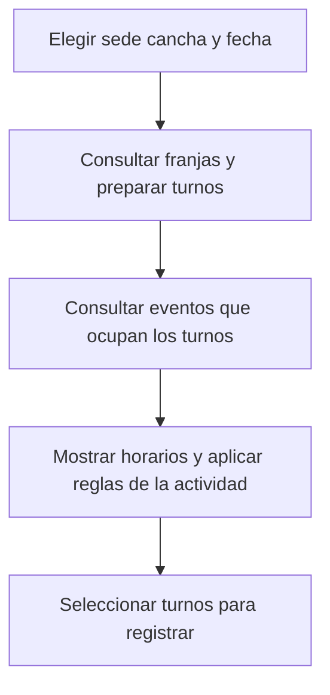

### 3.2 Usuarios

No existe un flujo separado de "registrar usuario": las cuentas no administrativas gestionadas por la academia se registran mediante **FL-02**, con credenciales de acceso propias y con Público y Reservas otorgados automáticamente en la misma operación. Los roles Profesor y Alumno pueden asignarse ya en ese mismo alta o en cualquier momento posterior mediante **FL-07**; Alumno, además, puede otorgarse automáticamente (ver **FL-20**). Las cuentas administrativas se crean mediante `crear_administrador` y sólo reciben Administrador. Las asignaciones referencian el catálogo fijo `roles`, sin flujos para crear, modificar o eliminar sus cinco registros.

El perfil propio permite consultar la información y cambiar únicamente la contraseña mediante **FL-59**. La edición administrativa de datos personales se limita al correo (**FL-04**); el restablecimiento de la contraseña de otra cuenta se realiza mediante **FL-69**. Nombre, apellido, nombre de usuario, celular, fecha de nacimiento y observaciones se cargan en el alta y no tienen un flujo de edición. El estado y los roles utilizan **FL-05** y **FL-07** por separado.

#### FL-02. Registrar un usuario

- **Objetivo:** crear un usuario activo con credenciales de acceso, Público y Reservas, y opcionalmente Profesor o Alumno.
- **Actor:** administrador.
- **Entradas:** nombre, apellido, celular, email y fecha de nacimiento obligatorios; contraseña ingresada o sugerida por el sistema; observaciones opcionales; rol adicional opcional (Profesor o Alumno, incompatibles entre sí). El nombre de usuario se genera automáticamente y no es editable.

Recorrido:

1. El administrador completa nombre, apellido, celular, email y fecha de nacimiento.
2. Al escribir nombre y apellido, el sistema muestra el nombre de usuario formado por el apellido normalizado y la inicial del nombre. Consulta si ya existe y, si hace falta, agrega el primer número disponible desde `1`. El campo no se puede editar. El administrador puede pedir una contraseña alfanumérica aleatoria o ingresar una propia; en ambos casos se aplican los validadores de contraseña configurados en Django.
3. El administrador puede marcar, opcionalmente, Profesor o Alumno para otorgar junto con el alta. Seleccionar ambos se rechaza por incompatibilidad.
4. Al confirmar, el sistema valida los campos obligatorios, que la fecha de nacimiento esté dentro del rango permitido y que nombre y apellido no contengan números. Genera nuevamente el nombre de usuario disponible y comprueba la unicidad del email sin distinguir mayúsculas de minúsculas.
5. Django genera el hash PBKDF2-SHA256 de la contraseña; la base nunca recibe la contraseña en texto plano.
6. En una transacción, el sistema crea el usuario con estado **Activo** y `debe_cambiar_contrasena = true`, le asigna automáticamente **Público** y **Reservas** y, si se seleccionó, el rol Profesor o Alumno autorizado. Cada asignación guarda una clave foránea al catálogo `roles`.
7. Muestra el nombre de usuario definitivo y la contraseña provisoria en texto plano una única vez, para que el administrador se los comunique a la persona.

Alternativas:

- El celular puede pertenecer a un tercero y no es único. El email y el nombre de usuario, en cambio, son siempre obligatorios y únicos sin distinguir mayúsculas de minúsculas. Si otro usuario ocupa el nombre mostrado antes de guardar, se asigna el siguiente sufijo disponible.
- La persona debe reemplazar la contraseña provisoria en su primer inicio de sesión mediante **FL-68**. Si no la recuerda, puede establecer una propia mediante recuperación (**FL-46**).
- Administrador, Público y Reservas no pueden elegirse en este paso: Administrador se crea mediante el comando de gestión `crear_administrador`; Público y Reservas se asignan automáticamente.
- No marcar ningún rol adicional no impide asignarlo después mediante **FL-07**.
- Si se cancela antes de confirmar, no se crea el usuario.
- Este flujo es siempre un paso previo e independiente: ninguna otra operación (como crear una reserva o registrar una contratación de plan o membresía) lo invoca ni registra un usuario nuevo dentro de su propio trámite. El usuario debe existir antes.

- **Resultado:** nuevo usuario activo con contraseña provisoria pendiente de reemplazo, Público, Reservas y los roles adicionales seleccionados.
- **Datos:** usuarios, usuarios_roles.

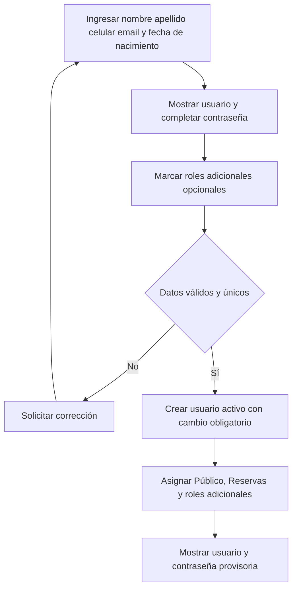

#### FL-03. Consultar un usuario

- **Objetivo:** localizar y visualizar la información de un usuario.
- **Actor:** administrador.
- **Entradas:** nombre, apellido, celular, email, nombre de usuario, rol, estado u otro criterio disponible.

Recorrido:

1. El administrador ingresa criterios de búsqueda.
2. El sistema muestra coincidencias activas e inactivas e identifica con una estrella a quienes tienen el rol Administrador.
3. El administrador selecciona un usuario.
4. El sistema muestra sus datos, roles y estado, nunca el hash de contraseña.

Alternativas:

- Si no hay coincidencias, informa que no se encontraron usuarios.
- Compartir celular no se considera duplicación.
- Filtrar por rol permite, por ejemplo, listar todos los usuarios con rol Alumno o Profesor.

- **Resultado:** detalle del usuario sin modificarlo.
- **Datos:** usuarios, usuarios_roles.

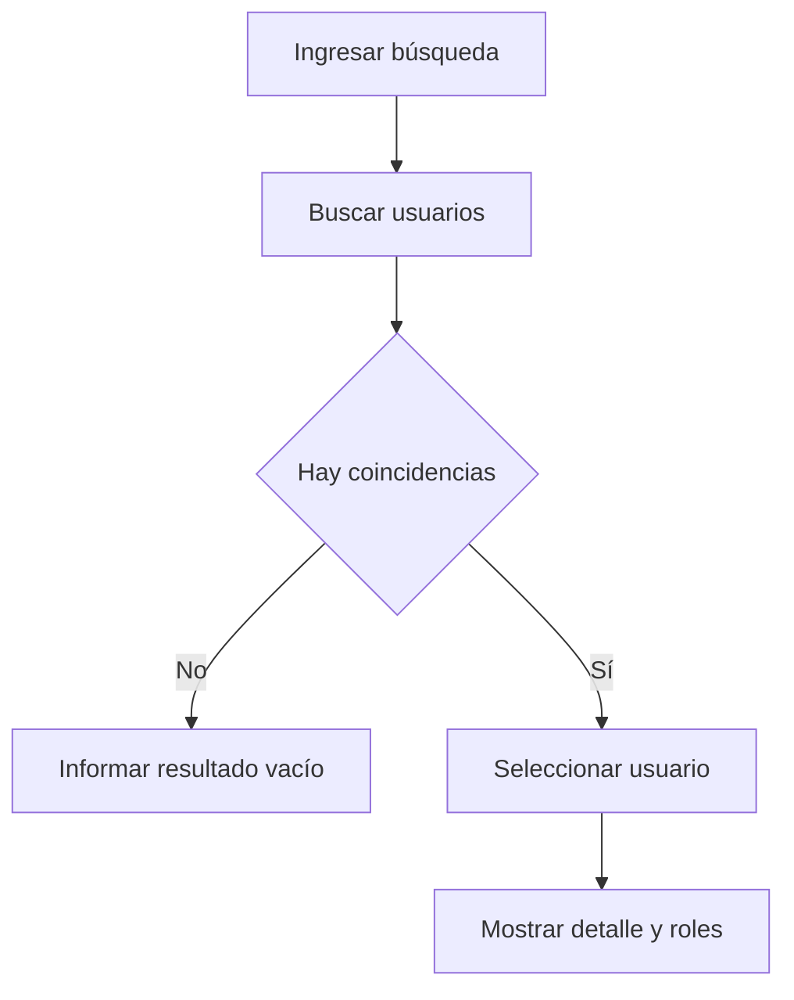

#### FL-04. Modificar el correo de un usuario

- **Objetivo:** modificar el correo de un usuario existente.
- **Actor:** administrador.
- **Precondición:** usuario localizado mediante **FL-03**.
- **Entrada:** nuevo correo.

Recorrido:

1. El sistema identifica al usuario mediante su nombre, apellido y nombre de usuario, y presenta el correo actual.
2. El administrador ingresa el nuevo correo.
3. El sistema valida el formato, que no quede vacío y que no pertenezca a otro usuario, sin distinguir mayúsculas de minúsculas.
4. Guarda el correo y actualiza la fecha de última modificación.

Alternativas:

- Este flujo no modifica los demás datos personales, el nombre de usuario, la contraseña, el estado ni los roles.
- Si el correo no es válido o ya está registrado, se informa el error sin modificar la cuenta.
- Cancelar la modificación conserva el correo anterior.

- **Resultado:** usuario con el correo actualizado.
- **Datos:** usuarios.

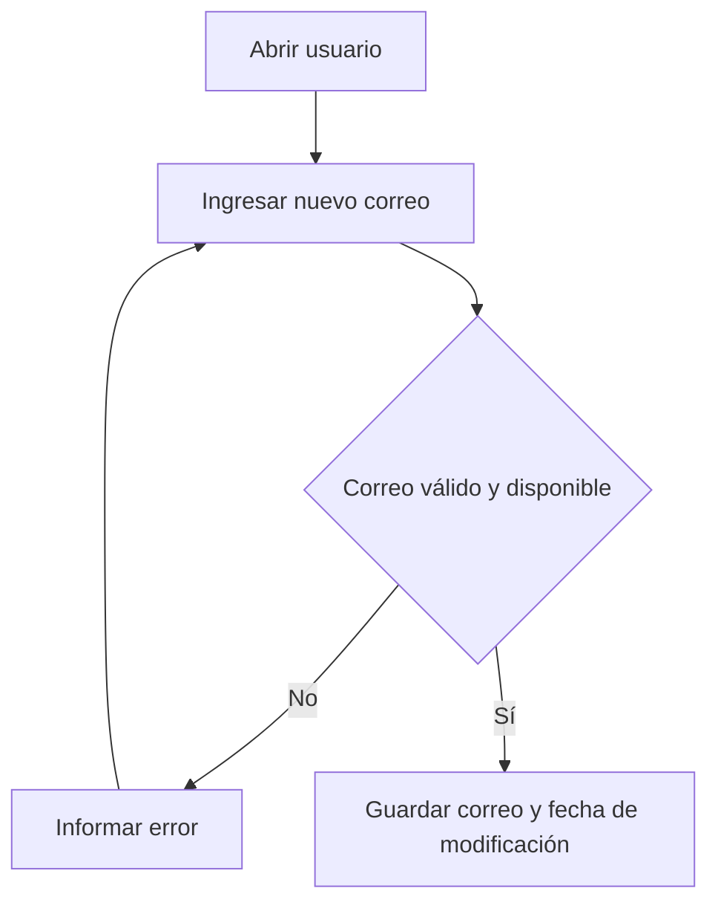

#### FL-05. Cambiar el estado de un usuario

- **Objetivo:** activar o inactivar un usuario sin eliminar su historia.
- **Actor:** administrador.
- **Precondición:** usuario localizado mediante **FL-03**.
- **Entrada:** nuevo estado.

Recorrido:

1. El administrador solicita cambiar el estado.
2. El sistema muestra el estado actual y el solicitado.
3. El administrador confirma.
4. El sistema valida que el actor no esté desactivando su propia cuenta y, si el usuario es administrador, que permanezca al menos otro administrador activo.
5. Si la cuenta queda inactiva, el sistema registra el momento actual en `fecha_baja`; si queda activa, limpia ese campo. Actualiza el estado, la fecha de baja y la fecha de última modificación dentro de la misma transacción de validación.

Alternativas:

- La inactivación no elimina clases, reservas, asistencias, contrataciones de planes y membresías, sesiones de caja, movimientos ni roles asignados.
- Reactivar la cuenta limpia `fecha_baja`; el campo representa la baja vigente, no un historial de cambios de estado.
- Un usuario inactivo no podrá iniciar sesión ni ser asignado como profesor activo, aunque conserve credenciales cargadas.
- Ningún usuario con permiso para cambiar estados puede desactivar su propia cuenta.
- El último administrador activo no puede ser desactivado. Las filas de los administradores activos se bloquean durante la validación para que dos operaciones concurrentes no puedan eludir esta regla.
- El estado ya aplicado no genera cambios.

- **Resultado:** usuario activo sin fecha de baja, o usuario inactivo con la fecha de baja registrada.
- **Datos:** usuarios.

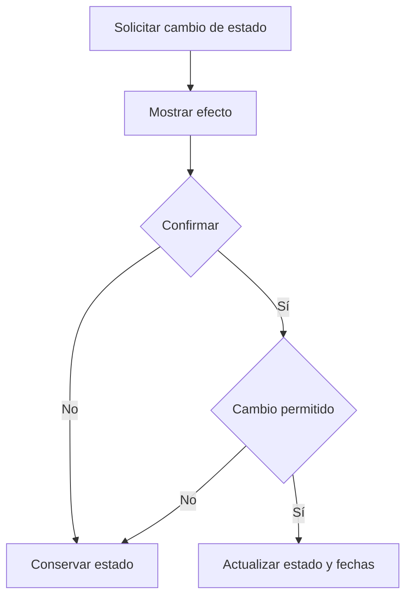

#### FL-69. Restablecer la contraseña de un usuario

- **Objetivo:** reemplazar administrativamente una contraseña desconocida por una nueva contraseña provisoria.
- **Actor:** administrador.
- **Precondición:** usuario localizado mediante **FL-03**.
- **Entrada:** confirmación del restablecimiento.

Recorrido:

1. El administrador solicita restablecer la contraseña desde el detalle del usuario.
2. El sistema informa que la contraseña actual dejará de funcionar y solicita confirmación.
3. Genera una contraseña alfanumérica aleatoria que cumple los validadores configurados.
4. En una transacción, guarda solamente su hash PBKDF2-SHA256 de Django, activa `debe_cambiar_contrasena` y actualiza la fecha de última modificación.
5. Muestra la contraseña provisoria en texto plano una única vez para que el administrador se la comunique a la persona.
6. En el próximo inicio de sesión se ejecuta **FL-68**.

Alternativas:

- Cancelar la confirmación conserva la contraseña vigente.
- Ningún administrador puede restablecer su propia contraseña. Para su cuenta debe utilizar **FL-59** o, si no puede iniciar sesión, **FL-46**.
- La operación no modifica el correo, los datos personales, el estado ni los roles.
- La contraseña provisoria no se almacena ni puede volver a consultarse en texto plano.

- **Resultado:** contraseña restablecida y cambio obligatorio pendiente.
- **Datos:** usuarios.

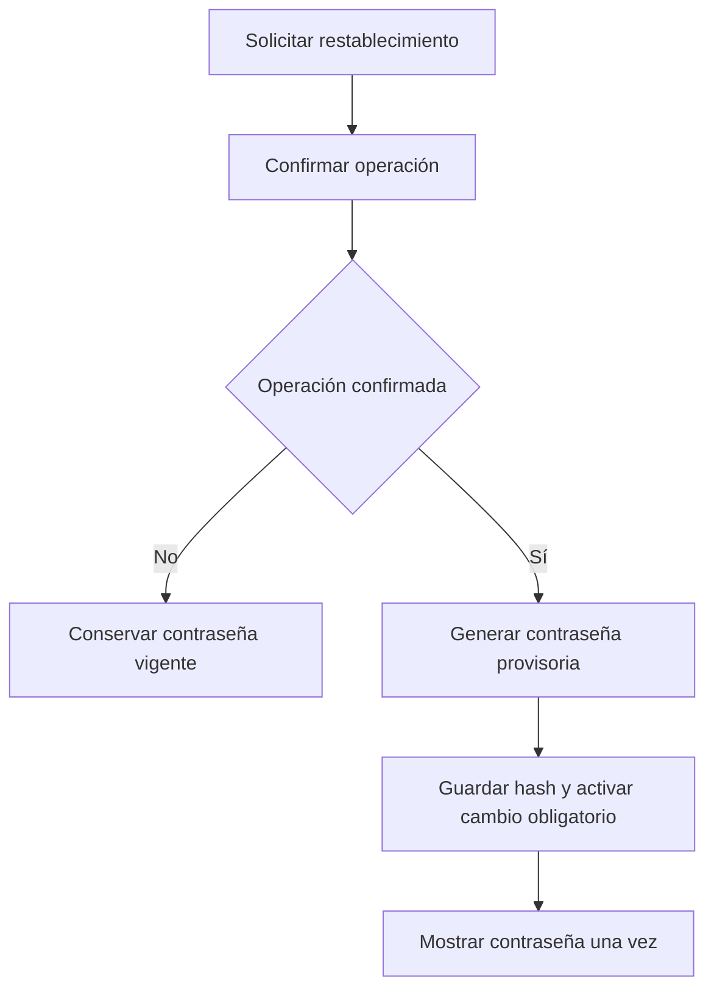

#### FL-06. Registrarse

- **Objetivo:** crear una cuenta de usuario con credenciales propias, igual que **FL-02** pero autogestionada desde el portal.
- **Actor:** público, sin cuenta previa.
- **Entradas:** nombre, apellido, celular, email, fecha de nacimiento y contraseña, todos obligatorios. El nombre de usuario se genera automáticamente y no es editable.

Recorrido:

1. La persona completa sus datos personales y contraseña desde el portal. Al escribir nombre y apellido, ve el nombre de usuario generado según la regla de **FL-02**.
2. Al confirmar, el sistema valida los campos obligatorios, que la fecha de nacimiento esté dentro del rango permitido y que nombre y apellido no contengan números. Genera nuevamente el nombre de usuario disponible y comprueba la unicidad del email sin distinguir mayúsculas de minúsculas.
3. Django genera el hash PBKDF2-SHA256 de la contraseña.
4. En una transacción, crea el usuario **Activo** y le asigna automáticamente **Público** y **Reservas**, igual que en **FL-02**.
5. Envía la confirmación de alta por email (ver 4.2).
6. Muestra el nombre de usuario definitivo para que la persona pueda iniciar sesión.

Alternativas:

- Si el email ya pertenece a un usuario existente (por ejemplo, registrado antes por la administración mediante **FL-02**), el alta se rechaza informando que la cuenta ya existe; la persona podrá iniciar sesión con esas credenciales o recuperar la contraseña (**FL-46**) en vez de registrarse de nuevo. Si otro usuario ocupa el nombre mostrado antes de guardar, se asigna el siguiente sufijo disponible.
- La base nunca recibe la contraseña en texto plano.
- El autorregistro guarda `debe_cambiar_contrasena = false`: la persona eligió y confirmó su propia contraseña, por lo que no debe reemplazarla en su primer inicio de sesión.

- **Resultado:** nuevo usuario activo con Público, Reservas y sesión iniciable.
- **Datos:** usuarios, usuarios_roles.

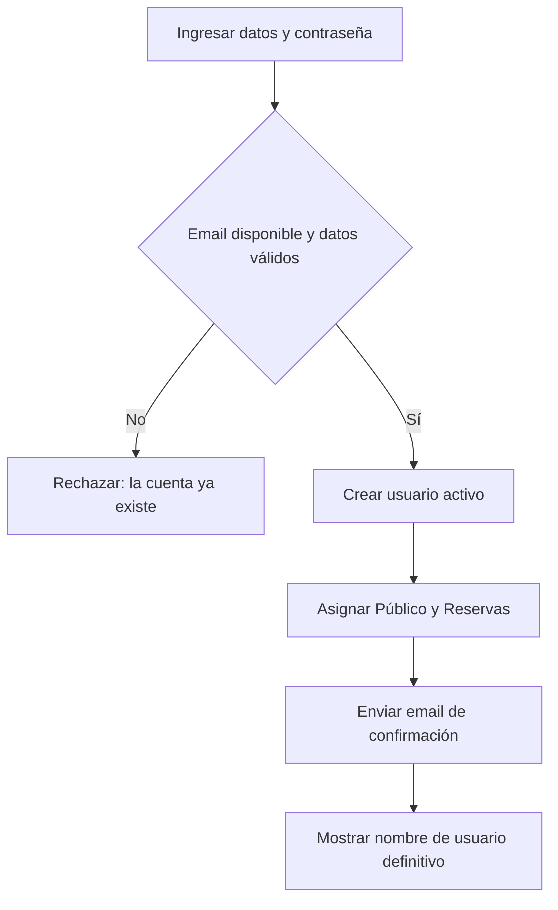

#### FL-07. Asignar o quitar un rol a un usuario

- **Objetivo:** otorgar o retirar Reservas, Profesor o Alumno a un usuario no administrador, conservando la coherencia con sus actividades y contrataciones.
- **Actor:** administrador.
- **Precondición:** usuario localizado mediante **FL-03**.
- **Entrada:** rol (Reservas, Profesor o Alumno) y acción (asignar o quitar).

Recorrido:

1. El administrador localiza al usuario.
2. El sistema muestra los roles vigentes del usuario.
3. El administrador elige Reservas, Profesor o Alumno y confirma asignarlo o quitarlo.
4. Si solicita quitarlo, comprueba que no existan relaciones que bloqueen el retiro: reservas propias Programadas para Reservas, contrataciones de planes Activas para Alumno o asignaciones activas como profesor en clases Programadas para Profesor.
5. Si la operación está permitida, actualiza `usuarios_roles`. La comprobación y el retiro se realizan en una misma operación transaccional, coordinada con la creación o reactivación de las relaciones involucradas.

Alternativas:

- **Público no se puede quitar.** Se asigna automáticamente en el alta de cuentas no administrativas. Administrador se gestiona exclusivamente mediante comandos ejecutados por el desarrollador y no puede combinarse con otros roles. Su perfil no ofrece la modificación de roles y el servidor rechaza solicitudes sobre esas cuentas. Este flujo tampoco permite crear, renombrar ni eliminar registros del catálogo `roles`.
- Reservas sigue asignándose automáticamente en el alta (**FL-02**, **FL-06**), pero puede retirarse si no hay reservas propias programadas y otorgarse nuevamente mediante este flujo.
- Si el usuario tiene reservas programadas, se rechaza el retiro de Reservas. Si tiene un plan contratado Activo, se rechaza el retiro de Alumno; una membresía contratada no impide retirar ese rol. Si tiene clases programadas con una asignación activa como profesor, se rechaza el retiro de Profesor.
- Ante un rechazo, se informa la causa, se conserva el rol y no se cancelan ni modifican las relaciones que lo bloquean. Los estados registrados determinan el bloqueo; una fecha pasada por sí sola no lo libera.
- El rol Alumno también puede otorgarse automáticamente mediante **FL-20**, además de por este flujo; ambas vías conviven sin conflicto.
- Quitar Reservas, Profesor o Alumno no elimina el historial de reservas, contrataciones, clases ni asistencia. Las reservas y clases canceladas o completadas y las contrataciones Vencidas o Anuladas no bloquean por sí solas el retiro.
- Asignar un rol ya vigente, o quitar uno que el usuario no tiene, no genera cambios.

- **Resultado:** asignación actualizada, o retiro rechazado conservando el rol y sus relaciones.
- **Datos:** usuarios_roles, roles, reservas, planes_usuarios, membresias_usuarios, clases_profesores, clases y eventos, turnos.

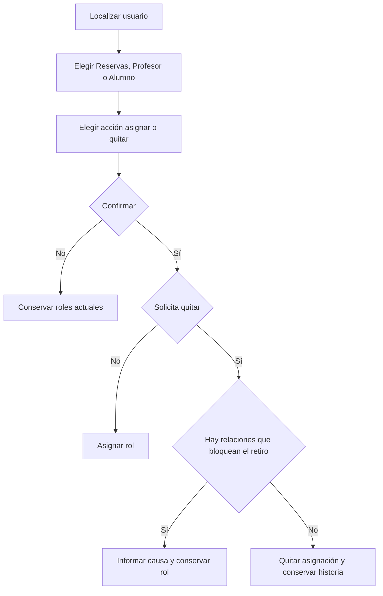

### 3.3 Sedes y canchas

#### FL-08. Consultar sedes y canchas

- **Objetivo:** visualizar las sedes y sus canchas asociadas.
- **Actor:** administrador.
- **Entradas:** sede seleccionada y filtros opcionales por nombre o estado de la sede.

Recorrido:

1. El administrador accede a la consulta.
2. El sistema muestra las sedes.
3. Al seleccionar una sede, muestra todas sus canchas, activas e inactivas, con sus superficies y estados.

Alternativas:

- Una sede sin canchas muestra una lista vacía.
- La consulta de sedes puede incluir registros inactivos.

- **Resultado:** jerarquía de sedes y canchas sin modificaciones.
- **Datos:** sedes y canchas.

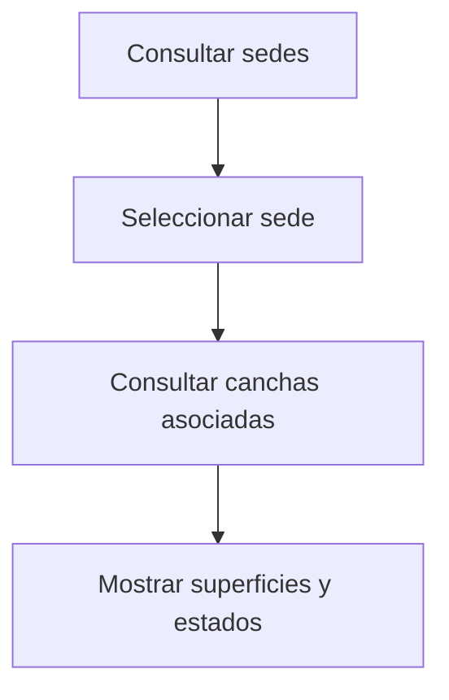

#### FL-09. Registrar una sede

- **Objetivo:** crear una sede activa.
- **Actor:** administrador.
- **Entradas:** nombre y dirección obligatorios; observaciones opcionales.

Recorrido:

1. El administrador completa los datos.
2. El sistema valida que el nombre no esté vacío ni repetido, sin distinguir mayúsculas de minúsculas.
3. Crea la sede con estado **Activa**.

Alternativas:

- Registrar la sede no crea canchas ni horario de funcionamiento automáticamente: hasta configurarlo mediante **FL-58**, la sede queda sin franjas y no funciona ningún día.

- **Resultado:** nueva sede activa.
- **Datos:** sedes.

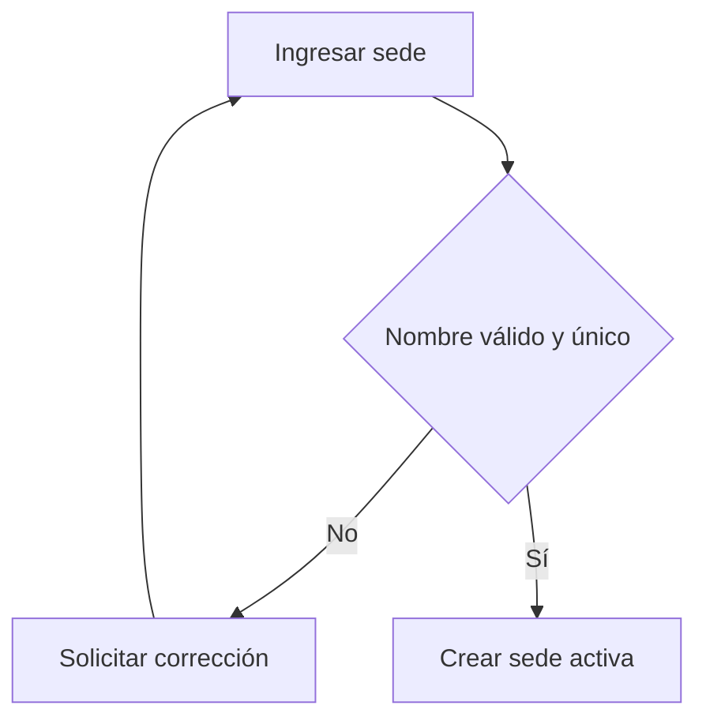

#### FL-10. Actualizar una sede

- **Objetivo:** modificar nombre, dirección u observaciones de una sede.
- **Actor:** administrador.
- **Precondición:** sede seleccionada mediante **FL-08**.

Recorrido:

1. El sistema presenta los datos actuales.
2. El administrador realiza cambios.
3. El sistema valida que el nombre sea único sin distinguir mayúsculas de minúsculas.
4. Guarda la sede.

Alternativas:

- Este flujo no cambia el estado ni modifica canchas.

- **Resultado:** sede actualizada.
- **Datos:** sedes.

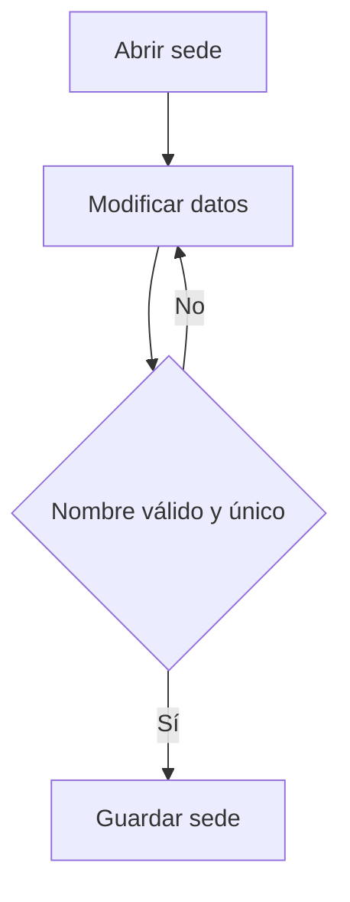

#### FL-11. Cambiar el estado de una sede

- **Objetivo:** activar o inactivar una sede conservando su historia.
- **Actor:** administrador.
- **Precondición:** sede seleccionada mediante **FL-08**.

Recorrido:

1. El administrador solicita el nuevo estado.
2. Para inactivar, el sistema comprueba las actividades de todas sus canchas. Rechaza la operación si existe una reserva, clase o bloqueo no Anulado cuyo turno esté en curso. Presenta una vista previa de todos los eventos Programados con inicio futuro.
3. El administrador revisa el impacto y confirma.
4. Dentro de una única transacción, el sistema bloquea los usuarios involucrados, la sede, las canchas del alcance, los turnos y los eventos en orden estable. Revalida permisos, estado, selección y límites horarios. Si la selección cambió, exige revisarla nuevamente.
5. Al inactivar, anula las reservas, clases y bloqueos futuros revisados con el motivo común «Actividad anulada por desactivación de la sede» y establece el estado solicitado. Antes de terminar comprueba que ninguno de esos turnos haya comenzado. Un error revierte toda la operación.

Alternativas:

- Los eventos Anulados y los turnos terminados no impiden inactivar. Las reservas y clases terminadas pendientes de finalización conservan su procesamiento habitual; los bloqueos terminados conservan su finalización automática y ocupación histórica.
- Las anulaciones conservan participantes, importes y relaciones históricas. No crean bloqueos ni modifican cobros, devoluciones o contrataciones.
- Una sede inactiva no admite nuevas actividades.
- Reactivar no restaura eventos Anulados. No modifica el estado individual de las canchas. Reactivar la sede no reactiva sus canchas.
- Repetir una solicitud que establece el estado vigente no genera cambios ni sobrescribe auditoría. Editar los datos no modifica el estado.

- **Resultado:** sede activa o inactiva, con las anulaciones confirmadas conjuntamente cuando corresponde.
- **Datos:** usuarios, sedes, canchas, turnos, eventos, reservas, clases, asignaciones y bloqueos.

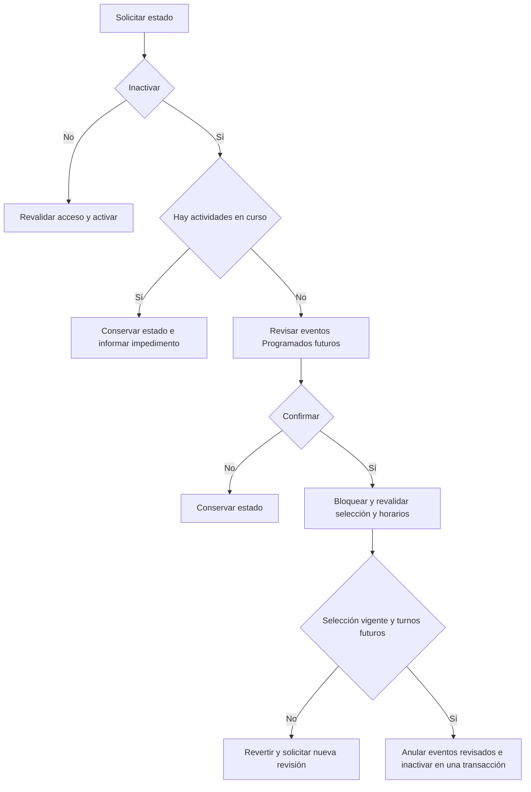

#### FL-12. Registrar una cancha

- **Objetivo:** crear una cancha activa dentro de una sede.
- **Actor:** administrador.
- **Entradas:** sede, nombre, superficie; observaciones opcionales.
- **Precondición:** sede activa seleccionada mediante **FL-08**.

Recorrido:

1. El administrador completa los datos.
2. El sistema valida superficie y nombre único dentro de la sede sin distinguir mayúsculas de minúsculas.
3. Crea la cancha con estado **Activa**.

Alternativas:

- La superficie debe ser **Cemento** o **Polvo de ladrillo**.

- **Resultado:** nueva cancha activa.
- **Datos:** sedes y canchas.

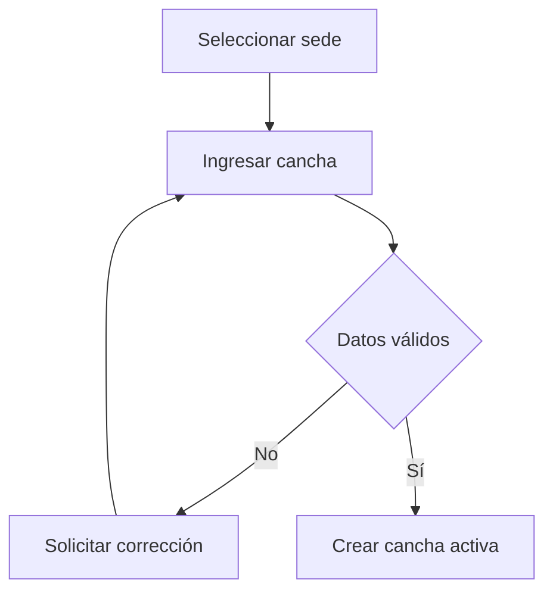

#### FL-13. Actualizar una cancha

- **Objetivo:** modificar nombre, superficie u observaciones de una cancha.
- **Actor:** administrador.
- **Precondición:** cancha seleccionada mediante **FL-08**.

Recorrido:

1. El sistema presenta los datos actuales.
2. El administrador realiza cambios.
3. El sistema valida superficie y nombre único dentro de la sede sin distinguir mayúsculas de minúsculas.
4. Guarda la cancha.

Alternativas:

- Este flujo no cambia el estado de la cancha.
- La sede de contexto determina el ámbito del nombre.

- **Resultado:** cancha actualizada.
- **Datos:** canchas y sedes.

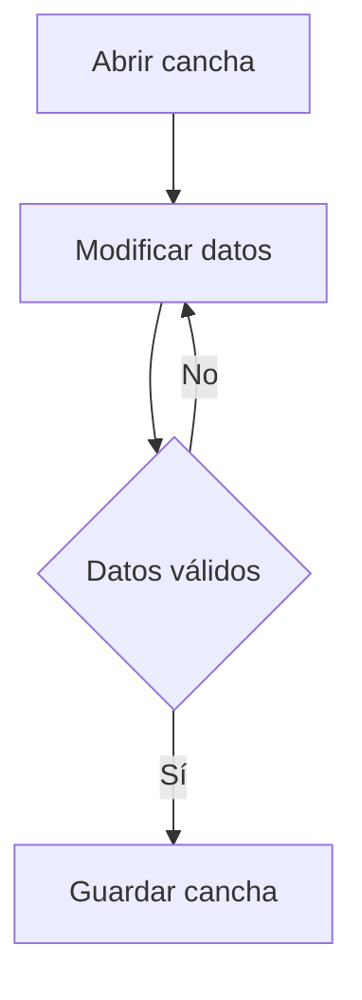

#### FL-14. Cambiar el estado de una cancha

- **Objetivo:** activar o inactivar una cancha conservando su historia.
- **Actor:** administrador.
- **Precondición:** cancha seleccionada mediante **FL-08**.

Recorrido:

1. El administrador solicita el nuevo estado.
2. Para inactivar, el sistema comprueba las actividades de la cancha seleccionada. Rechaza la operación si existe una reserva, clase o bloqueo no Anulado cuyo turno esté en curso. Presenta una vista previa de todos los eventos Programados con inicio futuro.
3. El administrador revisa el impacto y confirma.
4. Dentro de una única transacción, el sistema bloquea los usuarios involucrados, la sede, las canchas del alcance, los turnos y los eventos en orden estable. Revalida permisos, estado, selección y límites horarios. Si la selección cambió, exige revisarla nuevamente.
5. Al inactivar, anula las reservas, clases y bloqueos futuros revisados con el motivo común «Actividad anulada por desactivación de la cancha» y establece el estado solicitado. Antes de terminar comprueba que ninguno de esos turnos haya comenzado. Un error revierte toda la operación.

Alternativas:

- Los eventos Anulados y los turnos terminados no impiden inactivar. Las reservas y clases terminadas pendientes de finalización conservan su procesamiento habitual; los bloqueos terminados conservan su finalización automática y ocupación histórica.
- Las anulaciones conservan participantes, importes y relaciones históricas. No crean bloqueos ni modifican cobros, devoluciones o contrataciones.
- Una cancha inactiva no admite nuevas actividades.
- Reactivar no restaura eventos Anulados. Reactivar la cancha no activa su sede ni habilita nuevas actividades si la sede sigue inactiva.
- Repetir una solicitud que establece el estado vigente no genera cambios ni sobrescribe auditoría. Editar los datos no modifica el estado.

- **Resultado:** cancha activa o inactiva, con las anulaciones confirmadas conjuntamente cuando corresponde.
- **Datos:** usuarios, sedes, canchas, turnos, eventos, reservas, clases, asignaciones y bloqueos.


#### FL-57. Consultar el horario de funcionamiento de una sede

- **Objetivo:** visualizar los días y franjas horarias en los que una sede funciona.
- **Actores:** administrador; cualquier persona, sin necesidad de cuenta, desde el portal.
- **Entradas:** sede.

Recorrido:

1. El actor selecciona una sede, entre las activas mediante **FL-08** o directamente en el portal.
2. El sistema muestra los siete días de la semana con sus franjas habilitadas, cuando las tiene.
3. Un día sin franjas configuradas se muestra sin funcionamiento.

Alternativas:

- Esta consulta muestra el horario general de la sede, no la ocupación real de cada cancha; para disponibilidad concreta ver **FL-01**.
- Este horario rige tanto para clases como para reservas, aunque con distinta exigencia según quién actúa (ver **FL-28**, **FL-34**, **FL-40** y **FL-51**).

- **Resultado:** horario semanal de funcionamiento de la sede consultado sin modificaciones.
- **Datos:** sedes y horarios de sede.

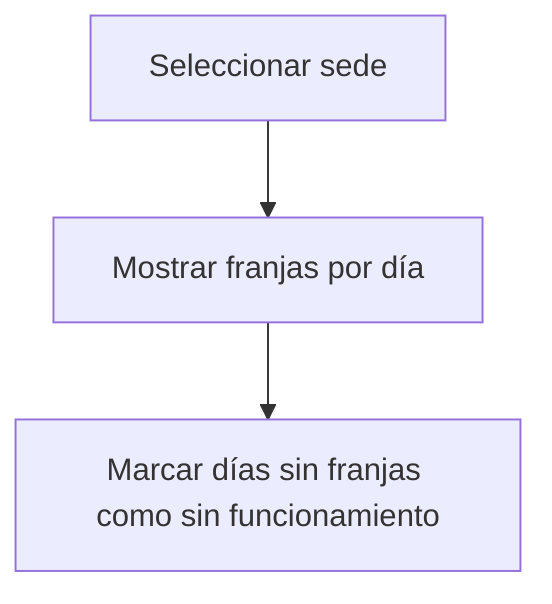

#### FL-58. Configurar el horario de funcionamiento de una sede

- **Objetivo:** definir o modificar hasta dos franjas horarias de funcionamiento para uno o varios días de la semana.
- **Actor:** administrador.
- **Precondición:** sede localizada mediante **FL-08**.
- **Entradas:** días de la semana seleccionados y una o dos franjas horarias, o la indicación de dejarlos sin funcionamiento.

Recorrido:

1. El administrador selecciona la sede mediante **FL-57** y marca los días que quiere modificar. Puede seleccionar lunes a viernes, fin de semana o toda la semana mediante accesos rápidos. Si abre la edición de un día, se precargan ese día y sus franjas.
2. Ingresa las horas de inicio y fin de la primera franja mediante campos numéricos de 0 a 23. Los minutos permanecen fijos en cero. Puede habilitar una segunda franja.
3. El sistema valida que todos los horarios sean en punto, que cada franja tenga el fin posterior al inicio y que, si hay dos, exista al menos una hora sin funcionamiento entre el fin de la primera y el inicio de la segunda. Se rechazan horarios con minutos o segundos distintos de cero y franjas contiguas o superpuestas.
4. El sistema comprueba que las actividades Programadas cuyo turno no terminó permanezcan dentro de las franjas propuestas. Si se cumple, el administrador aplica el horario y el sistema guarda la misma configuración en todos los días seleccionados, reemplazando sus franjas anteriores en una única transacción. Los días no seleccionados conservan su configuración.

Alternativas:

- La acción «Marcar como sin funcionamiento» elimina las franjas de los días seleccionados sin exigir horas de inicio ni fin, para reservas, clases y bloqueos, siempre que no deje fuera actividades Programadas cuyo turno no terminó.
- Este horario es independiente de la planilla (ver **FL-23** a **FL-26**): configurarlo no crea, modifica ni elimina turnos de planilla. Sí afecta la generación de clases (**FL-28**) y la creación o el cambio de cancha de clases, la creación de reservas y el registro de bloqueos, que lo validan en el momento (ver **FL-34**, **FL-35**, **FL-40**, **FL-51**).
- Antes de guardar, comprueba las reservas, clases y bloqueos Programados de los días seleccionados cuyo turno no terminó. Rechaza tanto la modificación como la eliminación de franjas si deja alguna actividad fuera del horario propuesto. La comprobación y el guardado bloquean la sede en una única transacción. Los eventos Anulados, Finalizados o con turno terminado no impiden el cambio y conservan su historia.

- **Resultado:** horario de funcionamiento de la sede actualizado para los días seleccionados.
- **Datos:** sedes, horarios de sede, canchas, turnos y eventos.

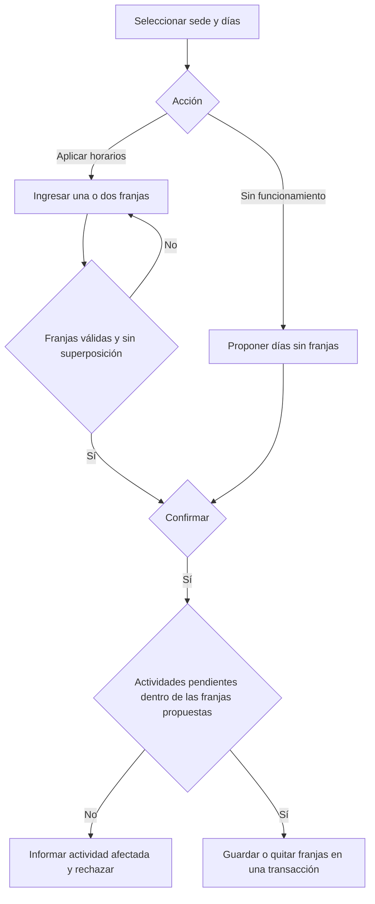

### 3.4 Catálogos de planes y membresías

#### FL-15. Consultar planes y membresías

- **Objetivo:** consultar productos del catálogo.
- **Actores:** Administrador, con acceso a activos e inactivos; usuario autenticado con rol Público, limitado a activos.
- **Entradas:** catálogo de planes o membresías y filtros por nombre, configuración o estado cuando el actor lo permite.

Recorrido:

1. El actor elige el catálogo y los filtros.
2. El sistema consulta `planes` o `membresias`, según lo seleccionado.
3. En administración muestra nombre, descripción, configuración y precio vigente, con acceso al detalle. En el portal presenta tarjetas con los datos comerciales y hasta dos líneas de descripción; si existe texto, Leer descripción abre un modal con el contenido completo, sin navegar a una pantalla de detalle. Las tarjetas sin descripción no ofrecen esa acción.

Alternativas:

- El portal sólo ofrece productos Activos.
- Cada membresía define ambos cupos mensuales positivos y precios; no tiene variantes por día ni límites diarios.
- Los nombres se validan dentro de cada catálogo, no entre ambas tablas.

- **Resultado:** listado y detalle de productos, sin modificar datos.
- **Datos:** planes o membresías.

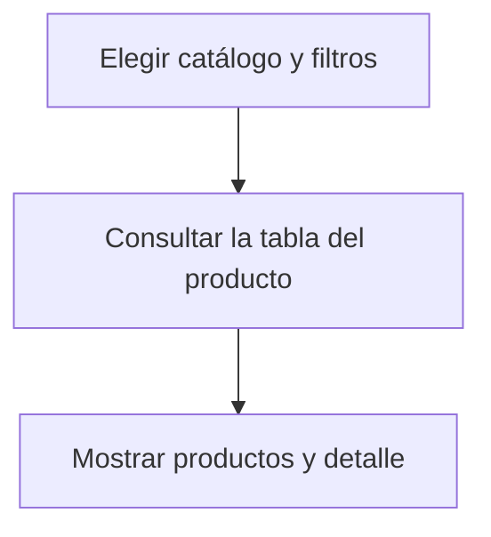

#### FL-16. Registrar un plan o una membresía

- **Objetivo:** registrar un producto completo en su catálogo.
- **Actor:** Administrador.
- **Entradas:** nombre, descripción y precio; configuración específica del plan o de la membresía.

Recorrido:

1. Selecciona el catálogo y completa los datos.
2. Para un plan, indica modalidad, frecuencia semanal y cantidad de clases por encuentro. Para una membresía, indica cupos mensuales independientes de organizador e invitado y adicional por invitado sin beneficio.
3. Valida nombre disponible entre productos Activos del mismo catálogo, importes y configuración.
4. Registra una fila Activa en `planes` o `membresias`.

Alternativas:

- Frecuencia de plan entre uno y siete, con una o dos clases de una hora por encuentro.
- Ambos cupos mensuales de membresía positivos; permite cualquier día y sede sujeto a disponibilidad.
- Los precios no pueden ser negativos.

- **Resultado:** producto Activo en el catálogo correspondiente.
- **Datos:** planes o membresías.

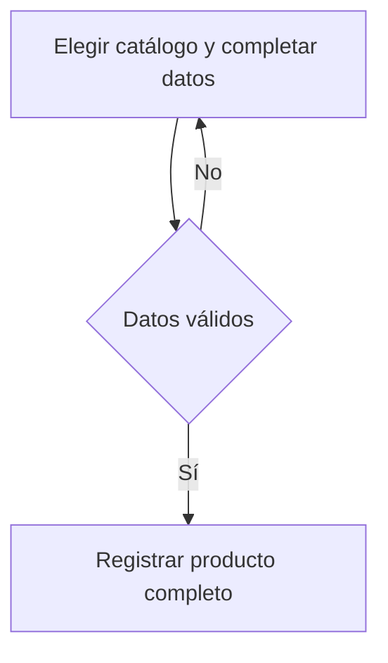

#### FL-17. Actualizar un plan o una membresía

- **Objetivo:** modificar los datos comerciales de un producto.
- **Actor:** Administrador.
- **Precondición:** producto localizado mediante **FL-15**.

Recorrido:

1. El sistema informa si tiene contrataciones históricas.
2. El Administrador modifica nombre, descripción y precios vigentes.
3. Si no tiene contrataciones históricas, puede modificar también su configuración estructural.
4. Valida y guarda los cambios en su tabla, actualizando la fecha de modificación.

Alternativas:

- Con contrataciones históricas no se cambia modalidad, frecuencia o duración del plan, ni los cupos mensuales de organizador o invitado de la membresía.
- Una configuración estructural distinta se registra como otro producto.
- Cambiar el precio vigente no modifica importes aplicados ni movimientos monetarios registrados.
- El adicional de invitados se conserva en cada reserva que lo aplica.

- **Resultado:** producto actualizado, conservando los datos aplicados a operaciones existentes.
- **Datos:** planes y planes_usuarios, o membresías y membresias_usuarios.

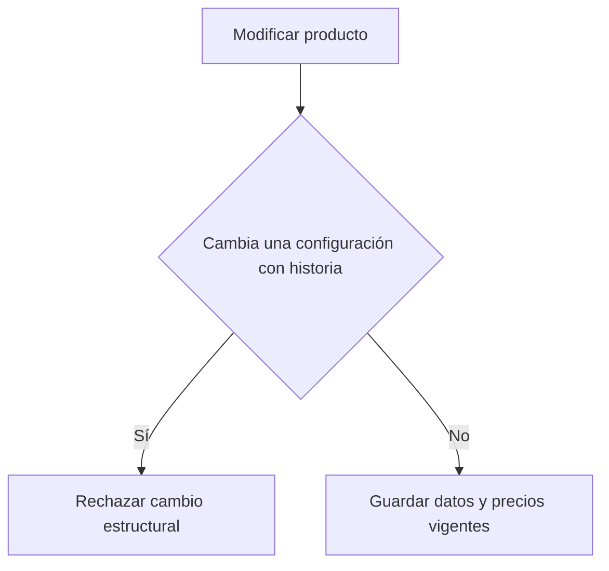

#### FL-18. Cambiar el estado de un plan o una membresía

- **Objetivo:** activar o desactivar un producto sin alterar sus contrataciones.
- **Actor:** Administrador.
- **Precondición:** producto localizado mediante **FL-15**.
- **Entrada:** estado solicitado y confirmación.

Recorrido:

1. Solicita activar o desactivar el producto.
2. Confirma el efecto sobre nuevas contrataciones.
3. El sistema establece el estado y actualiza la marca de modificación en la tabla correspondiente.

Alternativas:

- Desactivar no anula contrataciones existentes.
- Un producto Inactivo no admite nuevas contrataciones.
- Repetir el estado aplicado no invierte la operación.
- Activar un producto del catálogo no asigna roles a usuarios.

- **Resultado:** producto con el estado solicitado.
- **Datos:** planes o membresías.

```mermaid
flowchart TD
    A[Solicitar estado del producto] --> B{Confirmar}
    B -->|No| C[Conservar estado]
    B -->|Sí| D[Establecer estado solicitado]
```

### 3.5 Contrataciones de planes y membresías

#### FL-19. Consultar una contratación de plan o membresía

- **Objetivo:** consultar una contratación mensual y sus cobros o usos.
- **Actores:** Administrador, sobre todas; titular autenticado, sólo sobre las propias.
- **Entradas:** tipo de contratación y filtros por usuario, producto, mes o estado.

Recorrido:

1. El sistema consulta `planes_usuarios` o `membresias_usuarios` y limita el alcance según el actor.
2. El actor selecciona una contratación.
3. Muestra producto, mes, período calculado, importe aplicado, estado y cobros vinculados vigentes. Administración consulta además responsables, observaciones y motivo de anulación; el titular sólo sus fechas y datos comerciales, sin información interna.
4. Para membresías, muestra por separado los cupos de organizador e invitado conservados en la contratación, ajustes, horas comprometidas, consumidas y disponibles, junto al historial de ajustes visible para el titular. El saldo incluye usos conservados del titular y mes de contrataciones Anuladas.

Alternativas:

- Consultar una membresía propia no exige Alumno.
- El titular consulta únicamente sus contrataciones y solicita Contratar membresía o Renovar el mismo plan por FL-74/75 cuando corresponde. Las anulaciones y los cambios de producto son administrativos.
- Desde el detalle, administración y titular pueden abrir el comprobante autorizado e imprimirlo o guardarlo como PDF. Muestra el importe registrado y las condiciones del producto, acredita la contratación y no el pago, y aplica los mismos límites de información del detalle.
- La consulta de cobros excluye movimientos Anulados, incluso si se anularon después del cierre de caja. Las contrataciones Anuladas conservan su consulta histórica. Muestra ingresos, devoluciones y neto, con la comparación comercial de FL-79, sin utilizar los totales históricos del cierre.
- La consulta histórica utiliza la contratación concreta.

- **Resultado:** detalle autorizado, sin modificar datos.
- **Datos:** usuarios, planes, membresías, planes_usuarios, membresias_usuarios, movimientos_fondos, reservas e invitados.

```mermaid
flowchart TD
    A[Elegir tipo y filtros] --> B[Consultar contrataciones autorizadas]
    B --> C[Mostrar período importes auditoría y usos]
```

#### FL-20. Registrar un plan o una membresía para un usuario

- **Objetivo:** registrar una contratación mensual desde la administración.
- **Actor:** Administrador.
- **Entradas:** usuario, producto Activo, mes cubierto, fecha efectiva de alta, precio revisado del producto y observaciones.

Recorrido:

1. Selecciona al usuario, un plan o una membresía y el mes.
2. Muestra el período calculado y el precio vigente en lectura.
3. Planes y membresías aplican el precio mensual vigente completo al confirmar, conservado en precio_aplicado y sin descuentos o recargos por fecha de pago ni importe negociado al registrar. El servidor revalida el precio revisado; si cambió exige confirmar el nuevo resumen. La membresía no tiene prorrateo.
4. En una transacción, bloquea al usuario y al producto, verifica acceso, estado y configuración del producto, precio revisado y ausencia de otra contratación no Anulada del mismo tipo para ese mes.
5. Registra una fila en `planes_usuarios` o `membresias_usuarios`, con su producto obligatorio, mes, importe aplicado y responsable. Si el mes terminó nace Vencida; en otro caso, Activa.
6. Si registra un plan Activo, falta Alumno y el titular no es administrador, asigna el rol en la misma transacción.

Alternativas:

- El formulario tiene dos pasos: selección de usuario y producto, y datos de contratación. Volver conserva la selección, el mes, la fecha de alta, el precio revisado y las observaciones; el importe no es editable. Cambiar de producto muestra su precio vigente; ambos tipos aplican siempre el precio vigente al confirmar. Cancelar abandona el proceso y sólo la confirmación final registra la contratación.
- Puede combinar un plan y una membresía, pero no duplicar el mismo tipo en un mes, incluidos registros Vencidos.
- El mes se encuentra entre agosto de 2026 y el siguiente al actual; ese mes siguiente sólo se habilita desde el día 25 inclusive. Las operaciones del mes vigente o históricas permitidas no dependen de esa apertura. La fecha efectiva de alta administrativa es independiente del mes cubierto y admite desde el inicio de operaciones hasta hoy, inclusive.
- Renovar para otro mes crea una contratación nueva. La primera contratación de plan y los cambios son administrativos; el titular puede renovar el mismo producto por FL-75 sin habilitación adicional. Las asignaciones iniciales y modificaciones de horarios se gestionan por sus recorridos propios.
- Una membresía no otorga Alumno y su vigencia se verifica para cada fecha de uso.
- El ingreso se registra por separado mediante **FL-43**; el importe aplicado no representa lo abonado.

- **Resultado:** contratación registrada con precio aplicado conservado y cobro independiente.
- **Datos:** usuarios, planes o membresías, planes_usuarios o membresias_usuarios y usuarios_roles cuando corresponde.

```mermaid
flowchart TD
    A[Elegir usuario producto y mes] --> B[Revisar período e importe aplicado]
    B --> C{Confirmar}
    C -->|Sí| D[Bloquear usuario y validar exclusividad]
    D --> E[Registrar contratación en su tabla]
    E --> F{Plan Activo de titular no administrador}
    F -->|Sí| G[Asignar Alumno si falta]
    F -->|No| H[Terminar]
    G --> H
```

#### FL-21. Anular una contratación de plan o membresía

- **Objetivo:** impedir nuevas aplicaciones de una contratación, conservando su historia.
- **Actor:** Administrador.
- **Precondición:** contratación Activa localizada mediante **FL-19**.
- **Entrada:** motivo obligatorio y confirmación.

Recorrido:

1. Revisa titular, producto, período, importe y efectos de la anulación, junto con los usos e ingresos de la contratación.
2. Ingresa el motivo y confirma en la página de revisión. Si los datos cambiaron, vuelve a revisarlos antes de confirmar.
3. En una transacción, bloquea al usuario y la fila de contratación, verifica estado Activo y, en membresías, ausencia de aplicaciones en reservas Programadas como organizador o invitado socio Aceptado; sólo entonces establece Anulado.
4. Registra administrador, momento y motivo de anulación, actualizando la fecha de modificación.

Alternativas:

- Conserva producto, titular, mes, precio aplicado e ingresos.
- No anula automáticamente clases, reservas, cobros o condiciones de socio registradas ni devuelve dinero. Si corresponde reintegrar, la administración registra un Egreso de categoría devoluciones mediante FL-43.
- Una contratación de membresía Anulada no cubre aplicaciones nuevas.
- No se retira Alumno automáticamente.
- El registro Anulado permite contratar un reemplazo para ese mes, conservando ambos. En membresías se descuentan del nuevo cupo los usos conservados del titular y período; no se reinician horas. Las invitaciones Pendientes o Rechazadas, y las reservas Anuladas o Finalizadas, no bloquean anulación.
- Repetir una anulación no sobrescribe su auditoría.

- **Resultado:** contratación Anulada.
- **Datos:** planes_usuarios o membresias_usuarios, movimientos_fondos y reservas relacionadas.

```mermaid
flowchart TD
    A[Solicitar anulación de contratación] --> B[Revisar impacto e ingresar motivo]
    B --> C{Confirmar}
    C -->|Sí| D[Bloquear y comprobar estado]
    D --> E[Anular y registrar auditoría]
```

### 3.6 Planilla y generación de clases

La planilla semanal de una cancha es única y viva (ver `1_organizacion.md`, 2.1 y `2_criterios_del_sistema.md`, 2.1): no existen versiones por período, ni un estado de "en preparación" o "confirmada". Editar la planilla no crea ni modifica clases por sí solo; generar clases para un período (**FL-28**) es la única operación que lee la planilla y crea clases concretas a partir de ella.

Cada turno de planilla debe tener al menos un profesor previsto, con cuenta activa y rol Profesor. Esta condición se valida al crear y editar el turno. Los participantes previstos deben ser usuarios activos; la selección propone Alumno por defecto y permite ampliar a cualquier usuario activo, incluidos profesores. Participar no exige ni otorga Alumno, no requiere un plan y no genera cargos. Una persona no se asigna a una misma celda en ambas funciones.

#### FL-23. Consultar la planilla de una cancha

- **Objetivo:** visualizar los turnos vigentes de la planilla semanal de una cancha.
- **Actor:** administrador.
- **Entradas:** sede y luego cancha.

Recorrido:

1. El administrador selecciona una sede y luego una de sus canchas activas.
2. El sistema muestra la grilla semanal con los turnos vigentes: día, horario, profesores y alumnos previstos.
3. El administrador puede seleccionar un turno para ejecutar **FL-25** o **FL-26**, o crear uno nuevo mediante **FL-24**.

Alternativas:

- Una cancha sin turnos muestra la grilla vacía.

- **Resultado:** grilla semanal consultada sin modificaciones.
- **Datos:** canchas, turnos de planilla y sus profesores y usuarios previstos.

```mermaid
flowchart TD
    A[Seleccionar sede y cancha] --> B[Mostrar grilla semanal]
    B --> C{Selecciona turno}
    C -->|Sí| D[Ofrecer FL-25 o FL-26]
    C -->|No| E[Ofrecer FL-24]
```

#### FL-24. Crear un turno de planilla

- **Objetivo:** ocupar una celda de la planilla semanal de una cancha.
- **Actor:** administrador.
- **Precondición:** cancha activa seleccionada mediante **FL-23**.
- **Entradas:** día de la semana, horario, observaciones opcionales, profesores y alumnos previstos.

Recorrido:

1. El administrador selecciona una celda vacía (día y horario) de la cancha.
2. Ingresa observaciones y profesores y alumnos previstos.
3. El sistema valida que no exista ya un turno para esa cancha, día y horario, y comprueba las condiciones de profesores y participantes previstas en esta sección.
4. Presenta la revisión y guarda el turno y sus asignaciones en una transacción.

Alternativas:

- Crear o editar un turno sin profesores se rechaza con el mensaje «Agregá al menos un profesor».
- No puede haber dos turnos para la misma cancha, día y horario.

- **Resultado:** nuevo turno visible en la grilla.
- **Datos:** turnos de planilla y sus profesores y usuarios previstos.

```mermaid
flowchart TD
    A[Seleccionar celda vacía] --> B[Ingresar datos y asignaciones]
    B --> C{Celda disponible}
    C -->|No| D[Informar duplicación]
    C -->|Sí| E[Guardar turno]
```

#### FL-25. Modificar un turno de planilla

- **Objetivo:** cambiar observaciones, profesores o alumnos previstos de un turno, sin moverlo.
- **Actor:** administrador.
- **Precondición:** turno seleccionado mediante **FL-23**.

Recorrido:

1. El sistema muestra los datos del turno.
2. El administrador modifica observaciones, profesores o alumnos previstos.
3. Valida las condiciones de profesores y participantes, presenta las advertencias de cantidad cuando corresponden y guarda los cambios en una transacción.

Alternativas:

- La cancha, el día y el horario de un turno guardado no se modifican; para reubicarlo se ejecutan **FL-26** y luego **FL-24**.
- Los cambios no alteran clases ya generadas. Cada clase concreta se modifica mediante sus acciones individuales; volver a generar conserva las existentes y omite sus turnos ocupados.

- **Resultado:** turno actualizado.
- **Datos:** turnos de planilla y sus profesores y usuarios previstos.

```mermaid
flowchart TD
    A[Abrir turno] --> B[Modificar datos o asignaciones]
    B --> C{Datos válidos}
    C -->|No| B
    C -->|Sí| D[Guardar turno]
```

#### FL-26. Quitar un turno de planilla

- **Objetivo:** retirar una celda de la planilla.
- **Actor:** administrador.
- **Precondición:** turno seleccionado mediante **FL-23**.

Recorrido:

1. El administrador solicita quitar el turno.
2. El sistema muestra sus profesores y alumnos previstos, y advierte si ya generó clases.
3. El administrador confirma.
4. El sistema elimina el turno y sus asignaciones.

Alternativas:

- Las clases ya generadas desde ese turno no se eliminan: conservan su historia, sus asignaciones y su indicador de origen sin modificaciones.

- **Resultado:** celda libre en la planilla.
- **Datos:** turnos de planilla y sus asignaciones.

```mermaid
flowchart TD
    A[Solicitar quitar turno] --> B[Mostrar datos y clases ya generadas]
    B --> C{Confirmar}
    C -->|No| D[Conservar turno]
    C -->|Sí| E[Eliminar turno de la grilla]
```

#### FL-27. Registrar o quitar un feriado

- **Objetivo:** registrar una fecha del calendario común de feriados o quitar una existente.
- **Actor:** administrador.
- **Entradas:** fecha y descripción para registrar; feriado seleccionado para quitar.

Recorrido de registro:

1. Valida el acceso, la fecha entre el 01/08/2026 y cinco años calendario después de hoy y la ausencia de otro feriado en esa fecha.
2. Si la fecha es posterior a hoy, prepara la vista previa de todas las clases Programadas de ese día, incluidas las manuales, en todas las sedes. Informa sus profesores y participantes y el motivo común «Clase anulada por registro de feriado».
3. El administrador confirma. El sistema coordina la operación con la creación y generación de clases, bloquea los turnos y eventos afectados y vuelve a comprobar el conjunto revisado.
4. En una única transacción registra el feriado y anula las clases revisadas, conservando asignaciones, actor, momento y motivo. Libera los turnos sin crear bloqueos ni modificar reservas. Si cambian las condiciones, revierte todo y exige revisar nuevamente.

Recorrido de retiro:

1. El administrador selecciona el feriado y confirma quitarlo.
2. El sistema elimina la fecha del calendario. No reactiva clases Anuladas ni genera clases nuevas.

Alternativas:

- Registrar un feriado de hoy o pasado no anula ni modifica clases existentes.
- Generar omite las fechas feriadas. Se admite crear una clase manual después del registro del feriado, respetando disponibilidad y horarios; esa excepción permanece Programada.
- El feriado no se limita a una sede. Una fecha duplicada se rechaza sin cambios.

- **Resultado:** calendario actualizado y, al registrar una fecha futura, clases revisadas Anuladas con historia preservada.
- **Datos:** feriados, usuarios y roles del actor, clases, profesores, participantes, eventos, turnos y auditoría.

```mermaid
flowchart TD
    A[Seleccionar operación y fecha] --> B{Registrar}
    B -->|Sí| C[Validar fecha y duplicación]
    C --> D{Fecha posterior a hoy}
    D -->|Sí| E[Revisar clases programadas y confirmar]
    E --> F[Revalidar y registrar feriado con anulaciones atómicas]
    D -->|No| G[Registrar sin modificar clases]
    B -->|No| H[Confirmar retiro y quitar feriado sin reactivar clases]
```


#### FL-28. Generar clases para un período

- **Objetivo:** crear clases concretas de una sede a partir de su planilla vigente.
- **Actor:** administrador.
- **Entradas:** sede y mes calendario completo dentro del calendario operativo. El mes actual se selecciona por defecto. El primer y último día del mes delimitan el período interno, de hasta 62 días corridos inclusive y hasta el último día del segundo mes calendario siguiente al actual. El selector sólo ofrece el mes actual y los dos siguientes.

Recorrido:

1. Valida el acceso, la sede y el mes completo. Acepta que el mes incluya días pasados y omite sus turnos, al igual que los turnos de hoy que ya comenzaron. Expande las celdas de planilla a las fechas que coinciden con su día de semana y ordena las candidatas por fecha, hora e identificadores de sede y cancha.
2. Evalúa cada candidata completa: horario íntegro dentro de una franja habilitada, instalaciones activas, al menos un profesor previsto y condiciones de asignación de todos sus usuarios. Omite turnos cuyo inicio ya ocurrió o coincide con el momento actual, feriados, turnos ocupados por eventos no Anulados y candidatas cuyos profesores o participantes tienen asignaciones activas a otra clase no Anulada en la misma fecha y hora, sin importar sede, cancha o función.
3. Compara también las candidatas válidas de esta ejecución. La primera válida conserva sus asignaciones; una posterior en conflicto se omite completa. No elimina usuarios para crear una clase parcial ni aborta las demás candidatas.
4. Presenta las clases a crear, cada candidata omitida con su motivo. Las coincidencias personales con reservas también omiten la candidata completa, según criterios 2.2.
5. Solicita dos confirmaciones explícitas y sucesivas: la generación no admite deshacer ni eliminación física de clases. Las generadas por error pueden anularse antes de su inicio desde su detalle mediante **FL-37** o desde Acciones del día o del mes, conservando su historia.
6. Al confirmar, bloquea usuarios en orden de identificador y coordina sede, canchas y calendario de feriados. Obtiene o crea los turnos concretos, los bloquea y vuelve a evaluar el conjunto revisado. Si cambia, revierte y exige una nueva revisión.
7. Comprueba el inicio futuro al guardar y al terminar la operación; si un turno alcanza su inicio, revierte todo y exige una nueva revisión. Crea en una transacción los eventos Programados de tipo clase, sus especializaciones con `es_generada = true`, y sus asignaciones con Asistirá para participantes y sin respuesta para profesores. Las observaciones se copian al evento.
8. La notificación por email a profesores se describe en el proceso 4.2.

Alternativas:

- Los usuarios inactivos, profesores sin rol Profesor, celdas sin profesor, asignaciones en ambas funciones, instalaciones inactivas y turnos fuera de horario originan omisiones informadas.
- Las asignaciones inactivas y clases Anuladas no generan conflictos. Una clase Finalizada conserva la ocupación y las asignaciones que correspondan.
- Las reservas no Anuladas ocupan su turno e impiden generar en él. La participación personal incompatible en una reserva, aunque sea en otra cancha, omite la candidata completa.
- Una clase omitida no ocupa el turno ni reserva sus usuarios para las candidatas posteriores.
- Volver a generar no duplica clases: los turnos ya ocupados se omiten.

- **Resultado:** clases generadas y lista de omisiones, sin cambios parciales ante un error de confirmación.
- **Datos:** usuarios y roles, planilla y vínculos previstos, feriados, sedes, canchas, horarios, turnos, eventos, clases y asignaciones.

```mermaid
flowchart TD
    A[Validar sede y período] --> B[Expandir y ordenar candidatas]
    B --> C[Evaluar candidatas completas y omitir conflictos]
    C --> D[Presentar clases válidas, omisiones y advertencias]
    D --> E{Primera confirmación}
    E -->|No| F[Conservar datos]
    E -->|Sí| G{Segunda confirmación}
    G -->|No| F
    G -->|Sí| H[Bloquear y revalidar conjunto]
    H --> I{Coincide con la revisión}
    I -->|No| D
    I -->|Sí| J[Crear eventos, clases y asignaciones en una transacción]
```


### 3.7 Agenda unificada

#### FL-31. Consultar la agenda diaria

- **Objetivo:** visualizar la ocupación de todas las canchas de una sede durante una fecha.
- **Actores:** administrador; usuario del portal según sus relaciones con cada actividad.
- **Entradas:** sede y fecha; selección opcional de cancha y hora para consultar un turno. Para clases, filtros opcionales por profesor o estado.

Recorrido:

1. Selecciona sede y fecha. La agenda permite avanzar o retroceder un día y volver a Hoy, dentro del calendario operativo.
2. El sistema valida el acceso y los criterios, consulta horarios, canchas y eventos no Anulados de la fecha y aplica los permisos.
3. Muestra columnas por cancha y filas por hora, distinguiendo libres, reservas, clases y bloqueos. Conserva actividades fuera del horario vigente y agrupa pausas comunes sin actividad. Destaca la hora actual sólo en el margen con Ahora.
4. Seleccionar una celda carga el panel y actualiza el resaltado sin recargar la página ni cambiar la posición de la grilla. Cerrar el detalle utiliza el mismo mecanismo. La consulta mantiene las validaciones de acceso y selección; un fallo conserva el contenido anterior y se informa, y una respuesta desactualizada no reemplaza la última selección. El panel muestra los datos y las acciones autorizadas. Permite registrar mediante **FL-51**, **FL-34** o **FL-63**, consultar una actividad o anularla para liberar o bloquear. Las operaciones no admitidas no se ofrecen.
5. Puede pasar a **FL-32** conservando fecha y cancha seleccionada. Consultar no escribe eventos ni prepara turnos persistidos.

Alternativas:

- El portal muestra las actividades ajenas como No disponible, sin tipo, identidad, participantes ni observaciones. Las relaciones propias permiten las consultas autorizadas; dictar una clase y asistir a ella conceden permisos diferentes. Las operaciones administrativas no se ofrecen en el portal.
- Sin canchas se muestra un estado vacío. Sin horarios ni actividades no se inventan espacios reservables.
- Las instalaciones inactivas conservan su historia y no admiten nuevas actividades. La ausencia de precio no impide consultar; impide registrar reservas normales.
- Las fechas, canchas o selecciones inválidas se rechazan sin ejecutar acciones.
- La selección de turno y toda acción posterior vuelven a validar permisos, ocupación y límites temporales. La anulación confirma el identificador de la reserva; no actúa sobre una reserva distinta que ocupe ese turno.

- **Resultado:** agenda diaria y detalle del turno seleccionado, sin modificar actividades.
- **Datos:** usuarios, roles, sedes, canchas, horarios, turnos, eventos, reservas, clases, profesores asignados y bloqueos.

```mermaid
flowchart TD
    A[Seleccionar sede y fecha] --> B[Validar acceso y calendario]
    B --> C[Consultar horarios y ocupación autorizada]
    C --> D[Mostrar canchas y horas]
    D --> E[Seleccionar turno y mostrar detalle y acciones]
```

#### FL-32. Consultar la agenda semanal

- **Objetivo:** visualizar la ocupación de una cancha durante una semana.
- **Actores:** administrador; usuario del portal según sus relaciones con cada actividad.
- **Entradas:** sede, cancha, fecha de referencia y selección opcional de hora; para clases, filtros opcionales por profesor o estado.

Recorrido:

1. Selecciona sede y cancha; cambiar de sede limpia cancha y turno. Se propone la primera cancha disponible de la sede cuando no se indicó una.
2. Selecciona una fecha de referencia. El sistema obtiene su semana de lunes a domingo y permite navegar por semanas o volver a Hoy.
3. Valida el calendario y consulta la ocupación y horarios de cada día, con las mismas reglas de acceso y representación de **FL-31**.
4. Muestra días en columnas y horas en filas. Las fechas fuera de los límites del calendario permanecen sin acciones; conserva las actividades fuera del horario actual de la sede.
5. Permite consultar la actividad seleccionada y pasar a la vista diaria de esa fecha manteniendo la cancha. La presentación y la interacción de la vista semanal están pendientes de definición.

Alternativas:

- Se aplican la privacidad y los permisos de **FL-31**: cualquier titular puede consultar sus clases como participante sin exigir Alumno; sólo un profesor autorizado tiene acciones de docencia y no accede a datos de actividades ajenas.
- Una cancha que no pertenece a la sede o una fecha inválida rechaza la consulta.
- La consulta no requiere una tarifa ni crea eventos o turnos persistidos; las operaciones de reserva conservan el límite de tres días.

- **Resultado:** agenda semanal y detalle del turno seleccionado, sin modificaciones.
- **Datos:** usuarios, roles, sedes, canchas, horarios, turnos, eventos, reservas, clases, profesores asignados y bloqueos.

```mermaid
flowchart TD
    A[Seleccionar sede cancha y fecha] --> B[Validar acceso y calendario]
    B --> C[Obtener semana y ocupación autorizada]
    C --> D[Mostrar días y horas]
    D --> E[Seleccionar turno y mostrar detalle y acciones]
```

#### FL-33. Consultar el detalle de una clase

- **Objetivo:** visualizar toda la información disponible de una clase concreta.
- **Actores:** administrador; profesor asignado para dictar; titular autenticado que participa en la clase o tiene asistencia registrada, limitado a su propia información. No se exige rol Alumno para la consulta personal.
- **Entrada:** clase seleccionada desde una agenda o actividad personal.

Recorrido:

1. El sistema verifica el permiso del usuario.
2. Obtiene fecha, horario, sede, cancha, estado, origen y observaciones.
3. Obtiene profesores, alumnos asignados y asistencia.
4. Muestra las acciones permitidas según rol y estado.

Alternativas:

- Un usuario sin relación con la clase ni permiso administrativo no accede a su detalle. Un profesor que asiste como participante tiene sólo permisos de consulta personal, sin acciones de docencia.
- El administrador consulta toda la información. El profesor asignado para dictar consulta los datos necesarios de su clase; el participante consulta la clase, su propia asignación y su asistencia, sin acceder a datos personales ajenos.
- Modificar y anular son acciones administrativas. Sólo el administrador o un profesor activo con rol Profesor y asignación activa para dictar pueden finalizar y registrar asistencia.

- **Resultado:** detalle consultado sin modificaciones.
- **Datos:** eventos, turnos, clases, profesores, usuarios y asistencias.

```mermaid
flowchart TD
    A[Seleccionar clase] --> B{Usuario autorizado}
    B -->|No| C[Impedir acceso]
    B -->|Sí| D[Cargar datos y participantes]
    D --> E[Mostrar detalle y acciones permitidas]
```

### 3.8 Clases concretas

Las operaciones se rigen por criterios, 2.0, 2.1 y 2.12. La creación exige inicio estrictamente futuro y fecha hasta el último día del segundo mes calendario siguiente al actual, en Salta. No admite fechas pasadas ni turnos de hoy que ya comenzaron. Las clases duran una hora y comienzan en punto entre 00:00 y 22:00. La consulta y las correcciones permitidas conservan el acceso a la historia desde el 01/08/2026.

Profesores nuevos o reactivados requieren cuenta activa y rol Profesor. Los participantes nuevos o reactivados requieren cuenta activa, sin exigir Alumno, contratación ni cobro. La selección propone Alumno por defecto y permite buscar cualquier usuario activo. Cada clase conserva al menos una asignación activa de profesor. La clase admite varios participantes sin un máximo bloqueante.

La disponibilidad personal aplica criterios 2.2: docencia vigente, participación de clase activa en Asistirá, organización de reserva e invitación Aceptada impiden otra actividad simultánea. Una persona tampoco puede dictar y participar en la misma clase. Invitaciones de reserva Rechazadas, relaciones inactivas y actividades Anuladas no impiden coincidencias. El aviso No asistirá libera disponibilidad personal.

Las coincidencias personales con reservas se rechazan, sin confirmación que las habilite. La revisión se vincula al actor y al conjunto validado; si cambia, exige nueva revisión. Las altas y reactivaciones conservan la identidad y respuestas de las relaciones concretas.

#### FL-34. Crear una clase concreta

- **Objetivo:** crear una clase concreta de una hora fuera de la planilla.
- **Actor:** administrador.
- **Entradas:** fecha, hora de inicio, sede, cancha, al menos un profesor, alumnos y observaciones opcionales.

Recorrido:

1. El administrador selecciona un turno libre en Agenda y solicita Crear clase. Completa tres pasos dentro del panel lateral: Profesores, Participantes y Resumen. Profesores exige al menos uno; Participantes es opcional y permite agregar observaciones al final. Ambos selectores muestran título, buscador y asignaciones, en ese orden. Atrás conserva los datos y la tarjeta del turno permanece visible durante el recorrido.
2. El sistema calcula la hora de fin exactamente una hora después del inicio.
3. Valida calendario, profesores, participantes, disponibilidad personal frente a clases y reservas e instalaciones activas. Exige que el turno quede íntegramente dentro de una franja de funcionamiento (**FL-57**); no hay excepciones. El paso Resumen presenta turno, profesores, participantes, observaciones y las condiciones de disponibilidad personal. La confirmación se realiza dentro del panel.
4. Al confirmar, bloquea usuarios en orden de identificador, sede y cancha; obtiene o crea el turno concreto, lo bloquea y revalida acceso, asignaciones, disponibilidad personal y ocupación. En una transacción crea el evento Programado, clase y asignaciones con Asistirá para participantes y sin respuesta para profesores; las observaciones pertenecen al evento. Una revisión que cambió exige nueva confirmación y no deja cambios parciales.
5. Actualiza la grilla y el panel sin salir de Agenda ni recargar la página. Envía una notificación por email a cada profesor asignado (ver 4.2).

Alternativas:

- Un turno ocupado obliga a elegir otro; el evento existente no se desplaza.
- La clase puede crearse sin alumnos, pero debe tener al menos un profesor activo.
- Una asignación docente activa o de participante en Asistirá a otra clase no Anulada impide confirmar en la misma fecha y hora, sin importar sede, cancha o función. El aviso No asistirá libera disponibilidad personal.
- Las coincidencias personales con reservas se rechazan para profesores y participantes según criterios 2.2, sin excepciones confirmables.
- Un turno fuera del horario de funcionamiento de la sede impide crear la clase, sin excepciones administrativas.
- Las clases generadas desde la planilla se crean mediante **FL-28**, no mediante este flujo; esa generación notifica una sola vez por profesor y por corrida, no clase por clase. Una clase creada por este flujo queda marcada como no generada por planilla.

- **Resultado:** una clase concreta de una hora en estado **Programada**.
- **Datos:** eventos, turnos, clases, horarios de sede, profesores y usuarios asignados.

```mermaid
flowchart TD
    A[Completar turno y participantes] --> B[Calcular una hora de duración]
    B --> C{Datos válidos y turno libre}
    C -->|No| A
    C -->|Sí| F{Dentro del horario de funcionamiento}
    F -->|Sí| D[Crear evento clase y asignaciones]
    F -->|No| A
    D --> E[Notificar a los profesores asignados]
```

#### FL-35. Actualizar los datos, participantes y cancha de una clase

- **Objetivo:** modificar observaciones, profesores, alumnos o la cancha de una clase programada, sin cambiar su día ni horario.
- **Actor:** administrador.
- **Precondición:** clase programada localizada mediante **FL-33**.
- **Entradas:** observaciones, asignaciones actualizadas y, opcionalmente, una nueva sede y cancha (mismo día y horario).

Recorrido:

1. El sistema muestra datos, participantes y turno actuales.
2. El administrador realiza cambios.
3. Valida que quede al menos un profesor con asignación activa y comprueba las condiciones de cada alta o reactivación de profesor o participante. Rechaza participaciones simultáneas incompatibles según criterios 2.2 y personas en ambas funciones. Rechaza coincidencias personales con reservas según las reglas comunes.
4. Si se indicó una nueva sede o cancha, exige que el turno original no haya comenzado, que las instalaciones de destino estén activas y que el turno de destino, con el mismo día y horario, esté disponible, excluyendo el evento actual de esa comprobación. Exige que el turno quede íntegramente dentro de una franja de funcionamiento de la sede (**FL-57**) para ese día; si no se cumple, rechaza la operación.
5. Coordina los bloqueos de usuarios en orden de identificador, instalaciones, turnos y evento, y revalida permisos, estado, asignaciones y disponibilidad personal antes de guardar. Guarda las asignaciones en sus relaciones específicas y las observaciones en el evento. Si cambió la cancha, actualiza `eventos.turno_id` al turno de la nueva cancha en la misma fecha y hora; bloquea origen y destino, valida la disponibilidad y conserva el turno original. Actualiza la fecha de modificación del evento. Día y hora no cambian.
6. Si se agregó un profesor que no estaba asignado antes, le envía una notificación por email (ver 4.2).

Alternativas:

- Este flujo no permite cambiar el día ni el horario de la clase: para eso se cancela (**FL-37**) y se crea una nueva (**FL-34**), sin ninguna vinculación entre ambas. Las reservas también se crean independientemente después de cancelar.
- Un conflicto de cancha o instalaciones de destino inactivas rechaza el traslado. Un conflicto de asignaciones entre clases exige corregir las asignaciones; cambiar de cancha no lo resuelve. Ninguna actividad existente se desplaza.
- Un cambio de cancha que ubique el turno fuera del horario de funcionamiento de la sede impide guardar, igual que en **FL-34**.
- Una clase cancelada o completada conserva su historia y no se edita mediante este flujo.
- Quitar un profesor o un alumno no genera notificación.
- Reactivar la asignación de un alumno que estaba inactiva establece en `false` su marca de recordatorio enviado (ver 4.6), para que reciba el recordatorio si la clase sigue programada para el día siguiente. El aviso de asistencia y su historia se conservan.

- **Resultado:** datos, participantes y, si correspondía, cancha actualizados, con el mismo día y horario.
- **Datos:** clases, eventos, turnos, profesores y usuarios asignados, y horarios de sede.

```mermaid
flowchart TD
    A[Abrir clase programada] --> B[Modificar datos, participantes o cancha]
    B --> C{Profesores y participantes sin conflictos entre clases}
    C -->|No| D[Solicitar corrección]
    D --> B
    C -->|Sí| E{Asignaciones válidas}
    E -->|No| D
    E -->|Sí| F{Cambia la cancha}
    F -->|No| J[Guardar]
    F -->|Sí| G{Sede y cancha activas y turno disponible}
    G -->|No| D
    G -->|Sí| H{Dentro del horario de funcionamiento}
    H -->|Sí| J
    H -->|No| D
    J --> K[Notificar a profesores agregados]
```

#### FL-37. Cancelar una clase

- **Objetivo:** registrar que una clase programada no se dictará.
- **Actor:** administrador.
- **Precondición:** clase en estado **Programada** cuyo turno no haya comenzado.
- **Entrada:** motivo obligatorio en texto libre.

Recorrido:

1. El administrador solicita Anular y liberar desde el panel de la clase en Agenda; el formulario se revela dentro del mismo panel.
2. Ingresa el motivo y continúa. El servidor valida los datos y presenta un modal con sede, cancha, fecha, horario, motivo y efecto. Cancelar el modal conserva el formulario; confirmar utiliza la revisión firmada.
3. Bloquea el turno y el evento, comprueba acceso, estado Programado e inicio futuro y registra estado Anulado, administrador, momento y motivo de cancelación en el evento.
4. La cancelación libera el turno de la clase, conserva su referencia histórica al turno y no crea un bloqueo.
5. Envía la notificación de cancelación a los alumnos asignados (ver 4.2).

Alternativas:

- Una clase iniciada o pasada no se anula, aunque siga Programada.
- Cancelar no elimina la clase ni crea otra actividad o bloqueo.
- Una clase completada no puede cancelarse: solo puede cancelarse una clase **Programada**, y una clase programada nunca tiene asistencia efectiva registrada (ver **FL-39**), así que la cancelación nunca compite con asistencia ya cargada.

- **Resultado:** clase cancelada con motivo e historia preservada y turno liberado.
- **Datos:** eventos, turnos y clases.

```mermaid
flowchart TD
    A[Solicitar cancelación] --> B[Ingresar motivo]
    B --> C{Confirmar}
    C -->|No| D[Conservar programada]
    C -->|Sí| E[Cancelar evento]
    E --> I[Liberar turno]
    I --> F[Notificar a los alumnos asignados]
```

#### FL-38. Completar una clase

- **Objetivo:** registrar la finalización de una clase y habilitar el registro de asistencia.
- **Actores:** administrador o usuario activo con rol Profesor y asignación activa para dictar la clase.
- **Precondiciones:** evento de clase Programado y turno terminado.

Recorrido:

1. El actor solicita completar la clase.
2. El sistema comprueba su autorización y el fin calculado del turno.
3. Al confirmar, bloquea el turno y el evento, y repite las comprobaciones.
4. En una transacción, cambia el evento a Finalizado, registra `eventos.finalizado_en` y `clases.finalizado_por_id`, y actualiza la fecha de modificación del evento.
5. Ofrece registrar la asistencia mediante **FL-39**.

Alternativas:

- Un profesor inactivo o no asignado no puede completar la clase.
- Una clase Anulada o Finalizada no se modifica ni permite sobrescribir la auditoría.
- La asistencia puede registrarse posteriormente y no es condición previa para finalizar.
- La tarea automática utiliza las mismas condiciones de estado y horario; deja vacío el responsable de clase. Si otra operación finalizó primero, no se sobrescriben sus datos.
- La finalización indica que terminó el horario; la asistencia se acredita mediante sus registros específicos.

- **Resultado:** evento de clase Finalizado, con responsable manual y momento de procesamiento.
- **Datos:** usuarios, clases, profesores asignados, eventos y turnos.

```mermaid
flowchart TD
    A[Solicitar completar la clase] --> B{Actor autorizado y turno terminado}
    B -->|No| C[Rechazar]
    B -->|Sí| D{Confirmar}
    D -->|Sí| E[Bloquear y validar nuevamente]
    E --> F[Finalizar evento y registrar responsable de clase]
    F --> G[Ofrecer registrar asistencia]
```

### 3.9 Asistencia

#### FL-39. Registrar la asistencia de una clase

- **Objetivo:** guardar la participación efectiva de usuarios en una clase ya dictada.
- **Actores:** administrador; usuario activo con rol Profesor y asignación activa para dictar la clase.
- **Precondiciones:** clase en estado **Finalizada** (ver **FL-38**), accesible mediante **FL-33** o desde el propio **FL-38**.
- **Entradas:** usuario, estado presente, ausente o sin registrar y observaciones opcionales.

Recorrido:

1. El sistema muestra los alumnos asignados y sus estados actuales.
2. El administrador o profesor marca cada alumno como presente, ausente o sin registrar.
3. Puede buscar y registrar asistencia de un usuario sin asignación previa, sin exigir rol Alumno ni contratación.
4. Al confirmar, bloquea y revalida el acceso, la clase Finalizada y todas las filas antes de guardar en una transacción estados, responsable, momento y observaciones. Presente y ausente requieren responsable y momento; Sin registrar no se interpreta como ausencia. La corrección actualiza la marca de modificación y conserva los cambios en auditoría.

Alternativas:

- Un profesor sólo registra asistencia en sus clases.
- La asistencia solo puede registrarse una vez que la clase quedó **Finalizada**; mientras está **Programada** no admite estados presente ni ausente.
- Agregar asistencia no incorpora al alumno a futuros turnos.
- El sistema no clasifica la asistencia como recuperación.
- Los cambios posteriores de asistencia se realizan repitiendo este flujo sobre la misma clase.
- Si alguna fila contiene un valor inválido, no se guarda ninguna de las filas.
- Puede finalizar y registrar asistencia en una sola transacción: se validan las condiciones de ambas operaciones y cualquier error revierte todo. La finalización automática no marca presentes ni ausentes.

- **Resultado:** asistencia de la clase actualizada.
- **Datos:** clases, eventos, profesores asignados, usuarios y asistencias.

```mermaid
flowchart TD
    A[Abrir asistencia] --> B{Evento de clase Finalizado y actor autorizado}
    B -->|No| C[Impedir registro]
    B -->|Sí| D[Marcar estados]
    D --> E{Agregar alumno no asignado}
    E -->|Sí| F[Buscar alumno]
    E -->|No| G[Confirmar]
    F --> G
    G --> H[Guardar asistencia]
```

### 3.10 Reservas

Todos los recorridos de escritura coordinan los bloqueos y la revalidación según criterios 2.12. La cancelación y las respuestas bloquean primero a las personas involucradas, antes de turno, evento, relaciones y contrataciones. No se muestran formularios abiertos por defecto; los detalles priorizan estado, participantes y condiciones comerciales.


#### FL-40. Crear una reserva propia

- **Objetivo:** Registrar una reserva propia normal o con membresía desde Agenda.
- **Actor:** usuario con rol Reservas o Administrador sobre su propia cuenta.
- **Entradas y precondiciones:** Cuenta activa y acceso vigente; turno libre seleccionado en Agenda, modalidad, invitados y observaciones opcionales.

Recorrido:

1. Elige en Agenda un turno futuro desde hoy hasta el tercer día calendario siguiente inclusive, dentro del funcionamiento de una instalación activa. El organizador es el titular autenticado.
2. Si existe membresía que cubre la fecha del turno, muestra Reserva normal y Reserva con membresía; en otro caso sólo Reserva normal. Cada opción abre su propio recorrido.
3. Normal aplica tarifa positiva de sede y admite invitados opcionales, sin consultar membresías ni aplicar horas o adicionales. Con membresía exige cobertura y horas de organizador disponibles y conserva el adicional unitario. Los invitados se registran Pendientes, sin comprobar su disponibilidad personal ni aplicar condiciones comerciales.
4. Presenta turno, modalidad, participantes, tarifa o contratación aplicada, adicional unitario y total para confirmar. Los invitados sin beneficio generan adicional sólo con membresía, incluidos socios con cupo de invitado agotado.
5. En una transacción bloquea personas en orden estable, instalaciones, turno, evento y contrataciones involucradas conforme a criterios 2.12. Revalida acceso, máximo de dos Programadas por organizador, coincidencias personales, calendario, ocupación, cobertura y precios.
6. Registra evento Programado, reserva e invitados Pendientes juntos. Con membresía compromete una hora del organizador y conserva el adicional unitario. Normal conserva la tarifa. Envía confirmación e invitaciones por el proceso de email.

Alternativas:

- No se selecciona otro organizador ni se crean usuarios o roles en este flujo.
- Sin tarifa no se confirma normal; con membresía no se exige tarifa de sede. Sin horas no se confirma con membresía, aunque la modalidad normal sigue disponible.
- El organizador no puede repetirse como invitado. Todos los invitados registrados son cuentas activas habilitadas; se rechazan duplicados, el máximo de reservas organizadas para el organizador y coincidencias con reservas o clases.
- El beneficio de invitado se evalúa al aceptar, siempre con disponibilidad personal. Pendiente no ocupa horario ni compromete horas o adicional. Aceptada con beneficio compromete una hora y la consume al inicio; sin beneficio genera adicional. Rechazar o quitar libera la aplicación. Cada nueva aceptación revalida las condiciones. Las reservas normales no utilizan horas ni adicionales de invitados.
- Un cambio de selección, cobertura, precio o disponibilidad exige una nueva revisión, sin escrituras parciales. Cancelar la revisión no registra nada.
- No hay reservas recurrentes. El portal no cobra; pagos y devoluciones corresponden a caja como operaciones independientes.

- **Resultado:** Reserva propia Programada con sus importes aplicados e invitaciones Pendientes.
- **Datos:** usuarios, roles, sedes, canchas, horarios, turnos, eventos, reservas, membresias, membresias_usuarios y reservas_invitados.

```mermaid
flowchart TD
    A[Seleccionar turno en Agenda]
    A --> B[Elegir modalidad para el titular]
    B --> C[Revisar invitados e importes]
    C --> D[Revalidar cupos disponibilidad y cobertura]
    D --> E[Registrar evento reserva e invitados juntos]
```


#### FL-42. Finalizar una reserva de emergencia

- **Objetivo:** finalizar una reserva vencida cuando se necesita operar sin la tarea automática.
- **Actor:** administrador.
- **Precondición:** reserva Programada cuyo turno terminó.
- **Entrada:** reserva seleccionada y confirmación.

Recorrido:

1. El administrador abre el detalle de la reserva y solicita finalizarla.
2. Confirma la operación en el modal.
3. En una transacción, el sistema comprueba el acceso vigente del administrador, bloquea el turno y el evento de la reserva y valida nuevamente el estado y el fin del turno.
4. Cambia el evento de la reserva a Finalizado y guarda `finalizado_en` con el momento de procesamiento, sin responsable de finalización.

Alternativas:

- Una reserva con evento Anulado o Finalizado, o cuyo turno no terminó, no se modifica.
- Si coincide con la tarea automática, sólo la primera operación registra la finalización; la otra no sobrescribe su fecha.
- Funciona directamente sobre la base de datos, sin depender de Celery ni Redis.
- Conserva la referencia al turno, el precio y la ocupación histórica. No acredita asistencia ni pago.

- **Resultado:** evento de reserva Finalizado o rechazo de la operación.
- **Datos:** usuarios, usuarios_roles, reservas, eventos y turnos.

```mermaid
flowchart TD
    A[Solicitar finalizar una reserva] --> B{Confirmar}
    B -->|No| C[Conservar la reserva]
    B -->|Sí| D[Bloquear y validar acceso estado y fin del turno]
    D --> E{Condiciones válidas}
    E -->|No| F[Rechazar sin modificar]
    E -->|Sí| G[Registrar estado Finalizado y momento]
```

La finalización automática se describe en el proceso interno 4.3 y utiliza las mismas condiciones de estado y horario. Ninguna finalización asigna un resultado de uso; se registra por FL-71.

### 3.11 Caja y movimientos

`movimientos_fondos` es la única fuente monetaria y `sesiones_caja` agrupa sus registros. El acceso exige usuario autenticado, activo, sin cambio obligatorio de contraseña y con rol Administrador; la marca `is_superuser` por sí sola no habilita acceso. Opera el responsable fijo que abrió la sesión. Otros administradores pueden consultar. No hay reasignación de responsable.

Los medios son efectivo, transferencia, tarjeta y QR. Todos los movimientos usan monto positivo en pesos con dos decimales y Decimal, concepto obligatorio y fecha de registro del servidor en `America/Argentina/Salta`, sin fecha real editable. Los estados del movimiento son Vigente y Anulado; los de la sesión, Abierta y Cerrada. Los formularios se revelan bajo demanda, las listas usan filas compactas y un menú por registro, y se ofrecen solo acciones válidas para el estado y el actor. El estado vacío presenta un texto breve y una acción principal.

Se admiten pagos parciales por varios ingresos vinculados al mismo origen. La situación comercial compara neto recibido e importe acordado según FL-79; no cambia el precio ni genera movimientos automáticos. Los cobros son manuales; no hay pasarela de pagos.

Apertura, registro, anulación y cierre se confirman dentro de `transaction.atomic`. Registro, anulación y cierre bloquean la sesión con `select_for_update`; una anulación de un movimiento de otra sesión bloquea también esa sesión de origen. Cada servicio vuelve a validar acceso, responsabilidad, estado y condiciones al confirmar. Las escrituras usan POST con protección CSRF, las consultas no modifican datos y un error revierte toda la operación y su auditoría.

#### CJ-01. Abrir caja

- **Objetivo:** iniciar la sesión de la única caja.
- **Actor:** Administrador con acceso vigente.
- **Entrada:** efectivo inicial no negativo y motivo de apertura cuando difiere del último contado.
- **Precondición:** ninguna sesión abierta.

Recorrido:

1. Solicita Abrir caja y consulta el contado del último cierre como referencia.
2. Declara efectivo inicial. Si difiere, se muestra un aviso y solicita explicación breve; si coincide o es la primera apertura, el motivo queda vacío.
3. Al confirmar, el servicio verifica acceso, importe, último cierre y motivo, e intenta crear la sesión en una transacción.
4. Guarda responsable fijo, momento del servidor, inicial y motivo y muestra la sesión abierta.

Alternativas:

- El índice único parcial impide aperturas simultáneas; si otra solicitud abrió primero, se informa la sesión existente.
- No se pide saldo bancario ni se crea un ingreso por el fondo inicial.
- La sesión puede atravesar medianoche y no se cierra automáticamente. Cancelar no crea registros.

- **Resultado:** sesión Abierta.
- **Datos:** usuarios y sesiones_caja.

```mermaid
flowchart TD
    A[Solicitar apertura] --> B[Declarar efectivo inicial]
    B --> C{Difiere del último contado}
    C -->|Sí| D[Explicar diferencia]
    C -->|No o primera apertura| E[Confirmar]
    D --> E
    E --> F{Datos válidos y sin sesión abierta}
    F -->|Sí| G[Crear sesión con responsable fijo]
    F -->|No| H[Informar y conservar formulario]
```

#### FL-43. Registrar un movimiento

- **Objetivo:** registrar un ingreso, egreso, aporte o retiro.
- **Actor:** responsable de la sesión abierta.
- **Entradas:** clase, concepto, monto positivo y medio; referencia para no efectivo; categoría para Ingreso y Egreso; destinatario opcional para Egreso; vínculo comercial opcional para Ingreso.
- **Precondición:** sesión abierta a cargo del actor y operación efectivamente realizada.

Recorrido:

1. Solicita Registrar movimiento y elige clase.
2. Completa concepto, monto y medio. Para Ingreso puede seleccionar una reserva o contratación concreta confirmada; como máximo un vínculo comercial por movimiento y concepto obligatorio aun sin vínculo. La categoría de ingreso es reservas, planes, membresías u otros: se determina por el tipo de origen si hay vínculo, y es Otros si no lo hay. Reservas, Planes y Membresías requieren el vínculo correspondiente.
3. Para Egreso completa categoría y puede agregar un destinatario de texto. Para transferencia, tarjeta o QR agrega una referencia y verifica la recepción para un ingreso, el pago realizado para un egreso o la aprobación de la operación con tarjeta. Aporte y Retiro usan efectivo y concepto explicativo. Si registra un reintegro, elige Egreso y categoría devoluciones.
4. Confirma con el UUID conservado del formulario. El servicio bloquea la sesión, revalida acceso, responsabilidad, estado y datos y registra el movimiento Vigente con fecha del servidor.
5. Muestra el movimiento y el resumen actualizado.

Alternativas:

- Al vincular una contratación, muestra producto, mes, precio_aplicado e ingresos Vigentes anteriores. El precio de referencia es el guardado, aunque el catálogo haya aumentado.
- Un ingreso menor puede ser parcial o corresponder a un acuerdo excepcional administrativo, explicado en su concepto. No modifica el contrato ni registra descuentos; la situación financiera se consulta según FL-79. Las observaciones comerciales pueden documentar acuerdos generales.

- Se admite como máximo un vínculo comercial por Ingreso y varios ingresos para el mismo origen. La consulta compara neto e importe acordado según FL-79, sin cambiar condiciones comerciales.
- No se cobran contrataciones Anuladas ni reservas con evento Anulado. No se crea ni renueva el origen al registrar un cobro.
- Egreso usa categorías alquiler, servicios, profesores, insumos, mantenimiento, publicidad, otros o devoluciones. Registra pagos realizados, no compromisos futuros. Registrar pagos a profesores no calcula salarios ni honorarios.
- Una devolución es dinero efectivamente reintegrado a un cliente. Se registra como Egreso de categoría devoluciones por cualquiera de los cuatro medios, con concepto y referencia si no es efectivo; el destinatario es opcional. Puede vincularse a una reserva o contratación concreta, sin seleccionar un ingreso particular. El vínculo es opcional y el máximo es el neto recibido positivo del origen (ingresos Vigentes menos devoluciones Vigentes), incluso si está Anulado. Sin vínculo exige concepto y validaciones habituales de caja, sin tope comercial. Otros egresos no admiten vínculos comerciales; una compensación superior a lo recibido se registra en otra categoría con su concepto y no modifica automáticamente cobros, contratación ni reserva. En los resúmenes se presenta separada de gastos operativos. Si es efectivo, resta al esperado como cualquier egreso en efectivo.
- Cancelar una reserva, o anular una contratación, no genera un reintegro ni anula cobros automáticamente. Si corresponde devolver, la administración ejecuta este flujo y registra el egreso efectivo. Anular una carga mediante FL-44 no representa ese reintegro.
- Una salida de efectivo no supera lo disponible. Un aporte necesario se registra primero como otra operación. Aporte y Retiro no son cobros ni gastos operativos. Retirar efectivo para depositarlo no crea un ingreso por transferencia.
- No se permite fecha editable, edición de datos originales ni eliminación. El UUID único se conserva al reenviar el formulario: con los mismos datos y actor devuelve el registro existente; con otro contenido o actor se rechaza. No se exige que coincida con el UUID del contexto de auditoría.
- Reserva o contratación y cobro se confirman por separado. Si falla este registro, el origen permanece confirmado.
- Los medios digitales no alteran el efectivo esperado. El módulo no verifica saldo bancario ni acreditaciones de tarjetas.

- **Resultado:** movimiento Vigente en la sesión abierta.
- **Datos:** sesiones_caja, movimientos_fondos, usuarios y origen comercial cuando corresponde.

```mermaid
flowchart TD
    A[Solicitar movimiento] --> B[Completar clase concepto monto y medio]
    B --> C[Completar datos condicionales]
    C --> D{Confirmar}
    D -->|Sí| E[Bloquear sesión y revalidar]
    E --> F{Datos válidos y efectivo disponible}
    F -->|No| B
    F -->|Sí| G[Guardar una vez por UUID y mostrar resumen]
```

#### FL-44. Anular un movimiento

- **Objetivo:** invalidar una carga errónea de ingreso, egreso, aporte o retiro sin editar sus datos ni borrarla.
- **Actor:** responsable de la sesión abierta actual.
- **Entrada:** motivo obligatorio.
- **Precondición:** movimiento Vigente localizado mediante FL-56 y sesión actual abierta.

Recorrido:

1. Solicita Anular desde el movimiento.
2. El sistema muestra si pertenece a una sesión cerrada y explica el efecto.
3. Ingresa motivo y confirma.
4. El servicio bloquea la sesión actual y la de origen si es distinta; revalida acceso y estado. En sesión abierta comprueba que el esperado no quede negativo.
5. Guarda estado Anulado, actor, momento y motivo y conserva los datos originales. La anulación participa de la auditoría transversal.

Alternativas:

- La anulación invalida una carga errónea y no entrega dinero ni cancela una reserva o contratación. Se aplica a ingresos y egresos, incluidas devoluciones, y también a aportes y retiros. El reintegro real se registra mediante FL-43 como Egreso de categoría devoluciones.
- En sesión abierta recalcula el esperado. En sesión cerrada conserva sus resultados y totales históricos, aunque el movimiento deje de contar en la consulta comercial vigente.
- El hecho correcto se carga por FL-43 como movimiento independiente en la sesión actual. Si es efectivo tiene efecto ordinario; puede generar una diferencia sin movimiento físico actual. En ese caso, el arqueo no representa exclusivamente movimientos físicos de la sesión.
- No hay reactivación ni segunda anulación del mismo registro. Se conservan concepto, monto, medio, referencia, fecha, destinatario, categoría y vínculos originales; solo se completan estado y metadatos de anulación.

- **Resultado:** movimiento Anulado con motivo y auditoría.
- **Datos:** sesiones_caja, movimientos_fondos y usuarios.

```mermaid
flowchart TD
    A[Solicitar anulación] --> B[Revisar efecto e ingresar motivo]
    B --> C{Confirmar}
    C -->|Sí| D[Bloquear sesiones y revalidar]
    D --> E{Condiciones válidas}
    E -->|No| B
    E -->|Sí| F[Anular sin editar datos originales]
```

#### CJ-04. Cerrar caja

- **Objetivo:** comparar el efectivo contado con el esperado y cerrar la sesión.
- **Actor:** responsable de la sesión abierta.
- **Entradas:** efectivo contado no negativo y motivo si la diferencia no es cero.

Recorrido:

1. Solicita Cerrar caja y revisa el resumen por clase y medio.
2. Declara contado y explica la diferencia cuando corresponde.
3. Al confirmar, el servicio bloquea la sesión y recalcula esperado: `efectivo_inicial + ingresos en efectivo + aportes − egresos en efectivo − retiros`, considerando solo movimientos Vigentes. Los egresos por devoluciones en efectivo restan; los medios digitales no intervienen.
4. Calcula `diferencia = contado − esperado`, positiva para sobrante y negativa para faltante. Valida contado y motivo y guarda esperado, contado, diferencia, motivo y momento del servidor; cambia a Cerrada.
5. Muestra el cierre confirmado. El cambio participa de la auditoría transversal.

Alternativas:

- Si el cálculo definitivo detecta diferencia sin motivo, solicita revisar y completar; cancelar mantiene Abierta.
- No genera movimientos por diferencias ni admite reapertura o modificación del cierre desde el servicio.
- El resumen histórico incluye movimientos con `anulado_en IS NULL OR anulado_en > cerrada_en`. No suma los anulados con `anulado_en <= cerrada_en`. Las anulaciones posteriores se identifican sin cambiar los resultados guardados.
- El servicio impide modificar, borrar o reabrir una sesión Cerrada y agregarle movimientos. La tabla participa de auditoría; no tiene triggers adicionales de inmutabilidad en PostgreSQL.

- **Resultado:** sesión Cerrada con arqueo registrado.
- **Datos:** sesiones_caja, movimientos_fondos y usuarios.

```mermaid
flowchart TD
    A[Solicitar cierre] --> B[Revisar resumen y declarar contado]
    B --> C[Bloquear sesión y recalcular esperado]
    C --> D{Diferencia distinta de cero}
    D -->|Sí| E[Exigir explicación]
    D -->|No| F[Validar y cerrar]
    E --> F
    F --> G[Guardar resultados y mostrar cierre]
```

---

### 3.12 Acceso

#### FL-45. Iniciar sesión normalmente

- **Objetivo:** autenticar a un usuario que ya posee una contraseña personal y habilitar las funciones correspondientes a los roles que tiene asignados.
- **Actor:** cualquier usuario, tanto desde la gestión interna como desde el portal.
- **Precondición:** usuario activo con `debe_cambiar_contrasena = false`.
- **Entradas:** nombre de usuario y contraseña.

Recorrido:

1. El usuario ingresa sus credenciales.
2. El sistema localiza la cuenta por su nombre de usuario.
3. La aplicación verifica la contraseña contra el hash PBKDF2-SHA256 de Django almacenado.
4. Comprueba que el usuario se encuentre activo.
5. Comprueba que `debe_cambiar_contrasena` se encuentre en `false`.
6. Establece la sesión autenticada con el identificador y todos los roles vigentes del usuario (ver **FL-02**, **FL-07**).

Alternativas:

- Si el usuario no existe o la contraseña es incorrecta, el sistema rechaza el acceso con un mensaje genérico. Si las credenciales son correctas pero la cuenta está inactiva, informa que debe contactar a un administrador.
- Si las credenciales son válidas pero `debe_cambiar_contrasena = true`, se ejecuta **FL-68**.
- El sistema no expone el hash de la contraseña.
- Un usuario sin roles asignados podrá autenticarse, consultar su propio perfil y cambiar su contraseña; no accede a las funciones de negocio que requieren roles.
- La sesión utiliza el mecanismo técnico provisto por Django, sin agregar una tabla de negocio al modelo funcional.

- **Resultado:** sesión autenticada con la identidad y los roles del usuario.
- **Datos:** usuarios, usuarios_roles y mecanismo técnico de sesión.

```mermaid
flowchart TD
    A[Ingresar nombre de usuario y contraseña] --> B[Localizar usuario]
    B --> C{Credenciales válidas y usuario activo}
    C -->|No| D[Rechazar acceso]
    C -->|Sí| E{Cambio obligatorio pendiente}
    E -->|Sí| G[Continuar por FL-68]
    E -->|No| F[Establecer sesión con identidad y roles]
```

#### FL-46. Recuperar contraseña

- **Objetivo:** permitir a un usuario recuperar el acceso cuando olvidó su contraseña, sin estar autenticado.
- **Actor:** cualquier persona que conozca el email de una cuenta, desde la pantalla de inicio de sesión.
- **Entradas:** email; luego, nueva contraseña.

Recorrido:

1. El usuario solicita la recuperación indicando su email.
2. Si existe un usuario activo con ese email, el sistema genera un enlace o código de un solo uso y lo envía por email (ver 4.2).
3. El usuario abre el enlace e ingresa una nueva contraseña.
4. En una transacción, la aplicación genera y guarda un nuevo hash PBKDF2-SHA256 de Django y establece `debe_cambiar_contrasena = false`.

Alternativas:

- Si el email no corresponde a ningún usuario o a un usuario inactivo, el sistema responde igual que si el envío se hubiera realizado, sin revelar la causa.
- Se utilizan las vistas, formularios y tokens nativos de Django. El enlace vence después de una hora; al guardar la nueva contraseña queda invalidado, junto con los demás enlaces anteriores de la cuenta. No requiere una tabla de recuperaciones.
- Para la demostración, el backend de correo de consola muestra el mensaje completo y el enlace en los logs del servicio `web`. No se entrega a una casilla real; el token y el cambio de contraseña sí son reales.
- Un usuario que recuerda su contraseña y solo quiere reemplazarla, estando autenticado, usa **FL-59** en su lugar; este flujo es exclusivamente para cuando no puede iniciar sesión.

- **Resultado:** usuario con contraseña renovada y sin cambio obligatorio pendiente.
- **Datos:** usuarios.

```mermaid
flowchart TD
    A[Solicitar recuperación con email] --> B{Usuario activo}
    B -->|Sí| C[Enviar enlace de un solo uso]
    B -->|No| D[Responder igual sin revelar causa]
    C --> E[Abrir enlace e ingresar nueva contraseña]
    E --> F[Guardar nuevo hash y desactivar cambio obligatorio]
```

#### FL-59. Cambiar contraseña

- **Objetivo:** permitir a un usuario autenticado reemplazar su propia contraseña desde su perfil.
- **Actor:** cualquier usuario autenticado, tanto desde la gestión interna como desde el portal.
- **Precondición:** sesión normal con `debe_cambiar_contrasena = false`; el cambio obligatorio utiliza **FL-68**.
- **Entradas:** contraseña actual, nueva contraseña y confirmación de la nueva.

Recorrido:

1. El usuario abre su perfil y solicita cambiar la contraseña.
   **Mi perfil** abre el detalle del usuario conectado; **Cambiar mi contraseña** aparece únicamente en el detalle propio y abre el formulario de cambio.
2. Ingresa su contraseña actual, la nueva y su confirmación.
3. La aplicación verifica la contraseña actual contra el hash PBKDF2-SHA256 de Django almacenado.
4. Valida que la nueva contraseña y su confirmación coincidan, que sea distinta de la vigente y que cumpla los validadores de Django.
5. Guarda el nuevo hash PBKDF2-SHA256 de Django y actualiza la fecha de última modificación, conservando `debe_cambiar_contrasena = false`.

Alternativas:

- Si la contraseña actual ingresada es incorrecta, el sistema rechaza el cambio sin modificar nada.
- Una nueva contraseña igual a la vigente, una confirmación diferente o una contraseña que no cumple los validadores también se rechaza sin modificar la cuenta.
- Este flujo no requiere email ni enlace: el usuario ya está autenticado y conoce su contraseña actual.
- No reemplaza a **FL-46**: un usuario que no puede iniciar sesión porque olvidó su contraseña debe usar la recuperación.
- Se utiliza el comportamiento nativo de Django: el cambio conserva la sesión desde la que se realiza y las otras sesiones se invalidan al volver a utilizarse.

- **Resultado:** usuario con contraseña renovada.
- **Datos:** usuarios.

```mermaid
flowchart TD
    A[Abrir perfil y solicitar cambio] --> B[Ingresar contraseña actual nueva y confirmación]
    B --> C{Contraseña actual correcta y nueva válida y distinta}
    C -->|No| D[Rechazar cambio]
    C -->|Sí| E[Generar nuevo hash y guardar]
```

#### FL-68. Iniciar sesión con cambio obligatorio de contraseña

- **Objetivo:** exigir que una persona reemplace la contraseña provisoria antes de acceder a cualquier función de la aplicación.
- **Actor:** usuario creado mediante un alta administrativa desde la aplicación o mediante `crear_administrador`, o cuya contraseña fue restablecida por un administrador.
- **Precondición:** usuario activo con `debe_cambiar_contrasena = true`.
- **Entradas:** nombre de usuario y contraseña provisoria; luego, contraseña provisoria actual, nueva contraseña personal y confirmación.

Recorrido:

1. El usuario ingresa sus credenciales provisorias.
2. El sistema localiza al usuario, verifica la contraseña contra el hash almacenado y comprueba que la cuenta esté activa.
3. Al detectar `debe_cambiar_contrasena = true`, establece una sesión restringida y dirige al formulario obligatorio de cambio de contraseña, sin aplicar un destino solicitado previamente.
4. Mientras la marca siga activa, toda solicitud a otra función vuelve al formulario. Solo permanecen disponibles el cambio y la recuperación de contraseña, los recursos visuales necesarios y el cierre de sesión.
5. El usuario ingresa la contraseña provisoria actual, elige una nueva contraseña personal y la confirma.
6. La aplicación verifica la contraseña actual y valida que la nueva sea distinta, que coincida con su confirmación y que cumpla los validadores de Django.
7. En una transacción, guarda el nuevo hash, establece `debe_cambiar_contrasena = false` y actualiza la fecha de última modificación, conservando la sesión actual.
8. El usuario puede acceder a las funciones habilitadas por sus roles.

Alternativas:

- Si el usuario no existe o la contraseña es incorrecta, el sistema rechaza el acceso con un mensaje genérico. Si las credenciales son correctas pero la cuenta está inactiva, informa que debe contactar a un administrador.
- Si la contraseña actual no coincide o la nueva contraseña no supera las validaciones, no se modifica la cuenta y la sesión continúa restringida.
- Cerrar sesión no desactiva la obligación.
- Si el usuario no recuerda la contraseña provisoria, puede ejecutar **FL-46**; la recuperación correcta establece su contraseña personal y desactiva la marca.
- El cambio no puede cancelarse ni postergarse.

- **Resultado:** usuario autenticado con contraseña personal, `debe_cambiar_contrasena = false` y acceso según sus roles.
- **Datos:** usuarios, usuarios_roles y mecanismo técnico de sesión.

```mermaid
flowchart TD
    A[Ingresar credenciales provisorias] --> B{Credenciales válidas y usuario activo}
    B -->|No| C[Rechazar acceso]
    B -->|Sí| D{Cambio obligatorio pendiente}
    D -->|No| E[Continuar por FL-45]
    D -->|Sí| F[Establecer sesión restringida]
    F --> G[Solicitar contraseña actual nueva y confirmación]
    G --> H{Cambio válido}
    H -->|No| G
    H -->|Sí| I[Guardar hash y desactivar obligación]
    I --> J[Habilitar acceso según roles]
```

### 3.13 Precios de reservas

#### FL-47. Consultar el precio de reservas de una sede

- **Objetivo:** consultar la tarifa vigente por turno de una sede.
- **Actor:** Administrador.
- **Entradas:** sede seleccionada.

Recorrido:

1. Abre el detalle de la sede.
2. El sistema muestra `precio_reserva_vigente`, o informa que no está configurado.
3. Ofrece establecerlo mediante **FL-48** si está vacío, o actualizarlo mediante **FL-49**.

Alternativas:

- El valor se aplica a todas las canchas de la sede.
- Una sede inactiva conserva su configuración.
- Los precios aplicados a reservas existentes se consultan en esas reservas.

- **Resultado:** tarifa vigente o falta de configuración.
- **Datos:** sedes.

```mermaid
flowchart TD
    A[Abrir sede] --> B[Consultar tarifa vigente]
    B --> C[Mostrar importe o falta de configuración]
```

#### FL-48. Establecer el precio de reservas de una sede

- **Objetivo:** configurar una tarifa por turno cuando la sede no tiene una.
- **Actor:** Administrador.
- **Entradas:** sede e importe positivo.

Recorrido:

1. Ingresa el importe por turno de una hora y confirma.
2. Dentro de una transacción, bloquea la sede y comprueba que su tarifa esté vacía.
3. Guarda `precio_reserva_vigente` y actualiza la marca de modificación.

Alternativas:

- Si ya tiene una tarifa, se solicita revisarla y utilizar **FL-49**.
- El importe debe ser positivo y común a todas las canchas.
- El registro de una reserva normal exige una tarifa configurada.

- **Resultado:** sede con tarifa vigente.
- **Datos:** sedes.

```mermaid
flowchart TD
    A[Ingresar tarifa y confirmar] --> B[Bloquear sede y comprobar configuración]
    B --> C{Tarifa vacía e importe válido}
    C -->|No| D[Informar impedimento]
    C -->|Sí| E[Guardar tarifa en la sede]
```

#### FL-49. Actualizar el precio de reservas de una sede

- **Objetivo:** establecer una nueva tarifa para reservas normales futuras.
- **Actor:** Administrador.
- **Entradas:** sede, importe vigente mostrado y nuevo importe positivo.

Recorrido:

1. Consulta la tarifa actual, ingresa el nuevo importe y confirma.
2. En una transacción, bloquea la sede y comprueba que el importe mostrado siga vigente.
3. Valida el nuevo importe y modifica `precio_reserva_vigente`, actualizando la marca de modificación.

Alternativas:

- Un importe igual al vigente no genera cambios.
- Si otra operación cambió la tarifa desde la consulta, se solicita revisar el valor actual antes de confirmar.
- Las reservas existentes conservan `precio_por_turno_aplicado`; su total no se modifica.
- Una reserva en preparación cuyo precio cambió debe mostrar el nuevo total y solicitar confirmación nuevamente.

- **Resultado:** tarifa actualizada para reservas nuevas.
- **Datos:** sedes.

```mermaid
flowchart TD
    A[Revisar tarifa e ingresar nuevo importe] --> B{Confirmar}
    B -->|Sí| C[Bloquear sede y validar valor vigente]
    C --> D{Nuevo importe válido y diferente}
    D -->|No| E[Informar resultado sin cambios]
    D -->|Sí| F[Actualizar tarifa de la sede]
```

### 3.14 Reservas creadas por el administrador

#### FL-51. Crear una reserva para un usuario

- **Objetivo:** Registrar una reserva para un organizador existente, separada de su cobro.
- **Actor:** Administrador.
- **Entradas y precondiciones:** Turno libre de Agenda y organizador existente activo con rol Reservas o Administrador.

Recorrido:

1. Desde el turno libre selecciona Nueva reserva, elige al organizador y pulsa Continuar.
2. Con el organizador identificado, ofrece Normal y Con membresía si es socio para la fecha; en otro caso únicamente Normal. Conserva turno y organizador al abrir el recorrido elegido.
3. Realiza selección de invitados, cálculo y revisión según FL-40, aplicando las mismas condiciones comerciales y personales.
4. Confirma en una transacción con las revalidaciones, bloqueos y registro conjunto de FL-40, conservando por separado al administrador que registra y al organizador.
5. Envía confirmación e invitaciones. Registrar un ingreso por FL-43 es una operación posterior independiente con sesión de caja habilitada.

Alternativas:

- No crea usuarios ni asigna roles; deben resolverse antes por sus recorridos propios.
- No admite excepciones a tres días, inicio futuro, funcionamiento, cupos o coincidencias personales.
- La reserva con membresía no exige tarifa normal. Los invitados con beneficio comprometen una hora de invitado y todos se identifican en esta modalidad.
- Si falla el cobro posterior, la reserva conserva su existencia e importes; no hay reversión conjunta con caja.

- **Resultado:** Reserva Programada del organizador elegido, sin cobro automático.
- **Datos:** usuarios, roles, sedes, canchas, horarios, turnos, eventos, reservas, membresias_usuarios y reservas_invitados.

```mermaid
flowchart TD
    A[Seleccionar turno libre y Nueva reserva]
    A --> B[Elegir organizador y Continuar]
    B --> C[Elegir modalidad disponible]
    C --> D[Revisar invitados importes y disponibilidad]
    D --> E[Confirmar reserva sin registrar cobro]
```

#### FL-52. Modificar invitados de una reserva

- **Actor:** organizador o Administrador.
- **Precondiciones:** reserva Programada e inicio futuro.

1. Desde el detalle solicita Gestionar invitados y revisa la selección existente, incluidas las Rechazadas.
2. Agrega cuentas habilitadas o quita invitaciones de cualquiera de los tres estados. Las altas comienzan Pendientes, sin comprobar disponibilidad personal del invitado ni aplicar condiciones comerciales.
3. Revisa altas, eliminaciones y total resultante. No se recalculan respuestas ni condiciones de quienes permanecen.
4. Al confirmar bloquea y revalida personas, reserva, estado, inicio y conjunto revisado. Elimina las relaciones quitadas y crea las nuevas invitaciones juntas, con auditoría.
5. Muestra participantes confirmados, respuestas y total derivado, con cobros separados. Notifica las nuevas invitaciones según el proceso de email.

Quitar libera disponibilidad, horas o adicional según corresponda. La invitación deja de existir; no admite respuestas ni reincorporación. Volver a invitar crea una relación Pendiente con una nueva identidad de revisión. Un cambio de grupo exige otra revisión y no deja efectos parciales. Los invitados no tienen límite de reservas organizadas. No se edita organizador, modalidad, turno ni precio unitario. Reconocer una membresía contratada después de aceptar utiliza FL-70.

- **Resultado:** conjunto revisado de invitaciones confirmado.
- **Datos:** usuarios, reservas, reservas_invitados, eventos y turnos.

#### FL-70. Actualizar socios de una reserva

- **Objetivo:** Reconocer la condición de socio de invitados antes del inicio.
- **Actor:** organizador o Administrador.
- **Entradas y precondiciones:** Reserva con membresía Programada y turno no iniciado.

Recorrido:

1. Solicita Actualizar socios desde el detalle, bajo demanda.
2. Evalúa contrataciones que cubran la fecha del turno de invitados Aceptados. Un invitado que contrató después de ser invitado deja de generar adicional al acreditarse como socio, si tiene cobertura y horas de invitado disponibles. La confirmación compromete una hora y elimina el adicional; sin saldo se mantiene el cargo.
3. Muestra cambios de condición y total resultante con el adicional unitario conservado y solicita confirmación.
4. Bloquea personas, reserva, relaciones y contrataciones de forma consistente; revalida permisos, inicio, cobertura y conjunto revisado. Un cambio exige nueva revisión.
5. Guarda condiciones aplicadas y auditoría juntas. Conserva historia comercial, respuestas, horas del organizador y cobros.

Alternativas:

- No responde ni modifica invitaciones Pendientes o Rechazadas.
- No se ofrece en reservas normales o iniciadas. Sin cambios no produce modificaciones ni auditoría artificial.
- No actualiza el precio unitario a la tarifa vigente ni registra devoluciones.

- **Resultado:** Condiciones de socios y total derivado actualizados por solicitud explícita.
- **Datos:** reservas, reservas_invitados, usuarios, membresias_usuarios, eventos y turnos.

```mermaid
flowchart TD
    A[Solicitar Actualizar socios]
    A --> B[Evaluar membresías de invitados Aceptados]
    B --> C[Revisar cambios y nuevo total]
    C --> D[Revalidar cobertura e inicio al confirmar]
    D --> E[Guardar condiciones e historia sin alterar cobros]
```

#### FL-71. Registrar o corregir el resultado de una reserva

- **Objetivo:** Registrar el resultado global de uso y su única corrección administrativa.
- **Actor:** Administrador.
- **Entradas y precondiciones:** Reserva Finalizada; resultado Realizada o No realizada y motivo obligatorio para corrección.

Recorrido:

1. Consulta el resultado y solicita registrar o corregir bajo demanda.
2. Para carga inicial revisa el resultado. Para corrección revisa resultado original y nuevo y completa motivo.
3. Bloquea la reserva y comprueba Finalizado, acceso y ausencia de corrección previa. Corregir exige resultado inicial y un valor distinto.
4. Guarda resultado, responsable y momento. En corrección conserva original, responsable, momento y motivo, en la misma transacción.

Alternativas:

- La carga inicial no cuenta como corrección. Sólo se admite una corrección, sin límite temporal; dos solicitudes concurrentes no pueden producir dos.
- Sin registrar no presume realización. No realizada y su corrección no devuelven horas ni cambian invitados, respuestas, asistencia o cobros.

- **Resultado:** Resultado global de uso conservado con su única corrección auditable.
- **Datos:** reservas y eventos.

```mermaid
flowchart TD
    A[Solicitar registrar o corregir resultado]
    A --> B[Revisar decisión y motivo de corrección]
    B --> C[Bloquear reserva y verificar Finalizado]
    C --> D[Validar carga inicial o única corrección]
    D --> E[Guardar resultado responsables y momentos]
```

#### FL-72. Responder una invitación a reserva

- **Actor:** titular autenticado, habilitado y con invitación existente.
- **Precondiciones:** reserva Programada e inicio futuro.

1. Consulta Pendiente, Aceptada o Rechazada. Pendiente ofrece Aceptar y Rechazar; Aceptada sólo Rechazar; Rechazada sólo Aceptar, bajo demanda.
2. Revisa la decisión. Aceptar comprueba disponibilidad personal; una coincidencia impide continuar sin cambiar datos. En normal no consulta membresías. Con membresía evalúa cobertura y horas de invitado: con beneficio compromete una hora; sin cobertura o con cupo agotado informa el adicional unitario conservado.
3. Confirma una revisión firmada vinculada al actor, la invitación concreta, su versión y la condición comercial informada, con vigencia de quince minutos.
4. Bajo bloqueos comunes revalida acceso, titularidad, existencia, versión, estado, inicio y, al aceptar, disponibilidad y condición comercial. Un cambio de beneficio o importe exige nueva revisión.
5. Guarda la decisión y la aplicación comercial con titular, momento y auditoría. Rechazar libera la aplicación. Repetir la decisión no cambia datos ni duplica usos. Puede cambiar sin límite antes del inicio, sin volver a Pendiente.

Quitar la invitación impide toda respuesta, incluida una solicitud emitida antes de su eliminación. Volver a invitar requiere una nueva revisión y aceptación. Administración y organizador no responden por el titular. Después del inicio se conserva el estado, incluida Pendiente, y no se ofrecen acciones. No modifica horas del organizador ni cobros y no acredita asistencia real.

- **Resultado:** decisión del titular y sus compromisos confirmados en una transacción.
- **Datos:** usuarios, reservas, reservas_invitados, eventos, turnos y membresias_usuarios.

#### FL-73. Registrar aviso de no asistencia

- **Objetivo:** comunicar la intención de asistencia a una clase concreta.
- **Actor:** titular autenticado y habilitado.
- **Entradas y precondiciones:** asignación activa en clase Programada antes del inicio.

Recorrido:

1. Consulta su clase, que muestra Asistirá por defecto o No asistirá si existe aviso.
2. Si no registró el aviso, despliega No asisto, lee la advertencia de irreversibilidad y confirma. Si cambia de opinión después, debe comunicarse con su profesor; una presencia efectiva se registra por asistencia real.
3. En una transacción bloquea a la persona, turno, evento, clase y relación. Revalida acceso, titularidad, asignación activa, clase Programada e inicio futuro.
4. Guarda el aviso y su última modificación con responsable, momento y auditoría. Revalida el inicio antes de guardar.

Alternativas:

- El aviso es irreversible. Repetir No asistirá no genera una modificación ni cambia el titular o momento del aviso. Retirar y reactivar la asignación conserva la decisión.
- Asistirá ocupa disponibilidad personal; No asistirá la libera. Registrar el aviso no exige revalidar disponibilidad porque sólo libera ese compromiso.
- El aviso corresponde sólo a esa clase, sin cambiar plantilla, asignaciones ni asistencia real. Estar Presente no modifica No asistirá.
- Administración no actúa por el titular. Los profesores no tienen este circuito por docencia.
- Al inicio se conserva Asistirá o No asistirá y se ocultan las acciones.

- **Resultado:** intención de asistencia conservada por clase concreta.
- **Datos:** usuarios, clases, clases_alumnos, eventos y turnos.

```mermaid
flowchart TD
    A[Consultar clase propia] --> B[Desplegar y confirmar aviso]
    B --> C[Revalidar titularidad estado e inicio]
    C --> D[Guardar intención y auditoría]
```

### 3.15 Consultas operativas

#### FL-53. Consultar uso de membresía

- **Objetivo:** Consultar usos y disponibilidad mensual de membresía del titular.
- **Actor:** Administrador o titular autenticado.
- **Entradas y precondiciones:** Titular y mes o rango de hasta 366 días inclusive dentro del calendario operativo.

Recorrido:

1. Limita la consulta al titular autorizado y obtiene contrataciones y reservas del período.
2. Cuenta por separado horas de organizador e invitado. El organizador usa computa_hora_membresia; los invitados Aceptados con beneficio comprometen antes del inicio y consumen desde el inicio. Las cancelaciones liberan invitados; una propia tardía conserva consumo de organizador.
3. Para cada rol y mes calcula cupo aplicado más otorgadas menos descontadas, comprometidas y consumidas, incluyendo usos conservados del titular de contrataciones Anuladas. Los ajustes y sus reversiones explican cada efecto. Si los usos conservados agotan el cupo del reemplazo, no hay horas disponibles.
4. Muestra por rol cupo, otorgadas, descontadas, comprometidas, consumidas y disponibles, detalle de usos y contratación concreta e historial de ajustes con motivo visible al titular. Incluye reservas Anuladas que conservan cómputo de organizador.

Alternativas:

- Una cancelación administrativa nunca consume. Una propia con dos horas o menos sí puede consumir aunque la reserva esté Anulada.
- El reemplazo de contratación no reinicia beneficios; no se guardan saldos ni se arrastran horas entre meses.
- La consulta conserva historia y privacidad; períodos mayores se consultan por tramos.

- **Resultado:** Uso y disponibilidad mensual derivados, sin modificar datos.
- **Datos:** membresias, membresias_usuarios, reservas, reservas_invitados, eventos y turnos.

```mermaid
flowchart TD
    A[Seleccionar titular y período autorizado]
    A --> B[Obtener usos que computan por mes]
    B --> C[Incluir contrataciones Anuladas del período]
    C --> D[Derivar comprometidas consumidas y disponibles]
    D --> E[Mostrar usos y ajustes de cada rol]
```

#### FL-54. Consultar actividad de clases de un usuario

- **Objetivo:** conocer a cuántas clases fue asignado un usuario y a cuántas asistió durante un período.
- **Actores:** administrador; cualquier titular autenticado, limitado a su propia actividad desde el portal, sin exigir rol Alumno. El titular también consulta sus próximas clases como participante; los profesores consultan las clases que dictan según sus asignaciones.
- **Entradas:** usuario, fecha inicial y fecha final. Para la consulta personal, el usuario es siempre el titular autenticado. Los rangos admiten hasta 366 días corridos inclusive dentro del calendario operativo; un período mayor se consulta por tramos.

Recorrido:

1. Valida acceso y período, y obtiene las clases donde el usuario autorizado posee asignación. En el portal no admite sustituir al titular por otro usuario.
2. Obtiene las asistencias del usuario, incluso cuando no existió asignación previa.
3. Calcula clases asignadas, presentes, ausentes y sin registro.
4. Muestra totales y detalle de fecha, hora, cancha y estado de cada clase.

Alternativas:

- Una asistencia como presente sin asignación previa suma asistencia, pero no suma clase asignada.
- Las clases canceladas se muestran separadas y no se consideran dictadas.
- La consulta no intenta atribuir cada clase a un plan: los planes sólo dan derecho a participar.
- El titular consulta su información en modo de sólo lectura, cualquiera sea su rol. Participar no concede permisos de docencia ni acceso a información personal ajena.

- **Resultado:** actividad de clases del usuario resumida y detallada.
- **Datos:** usuarios, clases, eventos, turnos, asignaciones y asistencias.

```mermaid
flowchart TD
    A[Elegir usuario y período] --> B[Buscar asignaciones]
    B --> C[Buscar asistencias]
    C --> D[Calcular indicadores]
    D --> E[Mostrar totales y detalle]
```

#### FL-55. Consultar reservas

Agenda es la entrada única para las actividades y permite abrir el detalle y comprobante desde el panel del turno. Las celdas muestran el estado del evento en la esquina superior derecha y, cuando corresponde, un indicador de anulaciones sin cantidad en la inferior derecha. Al seleccionar un turno con anulaciones accesibles, incluso pasado o actualmente ocupado por otra actividad, el panel lateral ofrece «Ver eventos anulados». Esta opción abre el listado dentro del mismo panel, con horario, cancha y un enlace para volver al turno. Cada fila conserva el fondo de su tipo y enlaza al detalle completo de la reserva, clase o bloqueo; el detalle de bloqueo es de sólo lectura y exclusivo de administración. El tipo tiene prioridad visual sobre el organizador o el motivo clasificado del bloqueo. La consulta sólo expone eventos autorizados y no incluye motivos de anulación, identificadores internos ni datos de responsable o momento de anulación. La búsqueda por criterios se realiza dentro de Agenda.

- **Objetivo:** localizar y visualizar reservas existentes, normales o con membresía.
- **Actores:** administrador, sin restricción; usuario con rol Reservas, limitado a las propias, desde el portal.
- **Entradas:** para el administrador, filtros opcionales por usuario organizador, sede, cancha, fecha o estado; un usuario con rol Reservas no ingresa criterios, ve directamente las suyas.

Recorrido:

1. El actor ingresa filtros, o accede directamente a sus propias reservas si tiene rol Reservas.
2. El sistema busca reservas coincidentes.
3. Muestra un listado con organizador, fecha, horario, cancha, importe o membresía aplicada y estado.
4. El organizador o administrador selecciona una reserva para ver el detalle completo, incluidos los invitados registrados y el resultado de uso, ingresos Vigentes asociados, devoluciones Vigentes y neto recibido, con la situación comercial correspondiente.

Alternativas:

- El organizador consulta sus reservas y solicita las acciones propias autorizadas. Un invitado dispone de consulta de su participación y respuesta, sin comprobante, cobros ni datos financieros de terceros.
- Esta consulta es la vía para localizar una reserva y ejecutar **FL-60** o **FL-61**; una reserva cancelada conserva su historia y otra reserva se crea por **FL-40** o **FL-51**, con independencia de sus cobros y participantes. La finalización se realiza automáticamente mediante 4.3 o por el administrador mediante **FL-42** cuando terminó el turno.

- **Resultado:** listado y detalle de reservas sin modificaciones.
- **Datos:** usuarios, reservas, eventos, turnos, invitados, tarifa de sede, membresías contratadas y movimientos_fondos.

```mermaid
flowchart TD
    A[Ingresar filtros o acceder a las propias] --> B[Buscar reservas]
    B --> C[Mostrar listado]
    C --> D{Selecciona reserva}
    D -->|Sí| E[Mostrar detalle]
```

#### FL-56. Consultar sesiones y movimientos

- **Objetivo:** consultar resumen de sesión, historial de sesiones y listado de movimientos.
- **Actor:** Administrador con las condiciones de acceso de 3.11; no se exige ser responsable para consultar.
- **Entradas:** fecha de apertura y estado para sesiones; fecha de registro, sesión, clase, categoría, medio y estado para movimientos.

Recorrido:

1. El administrador elige historial, resumen de sesión o movimientos y sus filtros.
2. El sistema consulta sesiones y movimientos coincidentes y muestra filas compactas.
3. Al seleccionar una sesión muestra responsable, apertura, cierre, inicial, totales por clase y medio, ingresos por categoría y, si está cerrada, esperado, contado, diferencia y motivo. Los ingresos, aportes y retiros se distinguen de los egresos; las devoluciones se muestran separadas de los gastos operativos. El motivo de apertura se consulta cuando existe.
4. Al seleccionar un movimiento muestra clase, concepto, monto, medio, referencia, destinatario y categoría cuando corresponden, vínculo comercial, responsable, fecha de registro, estado y datos de anulación si corresponde. La acción FL-44 se revela bajo demanda solo si está vigente y el actor es responsable de la sesión abierta actual.

Alternativas:

- En sesión abierta los totales usan movimientos Vigentes y se muestra el efectivo esperado. En cerrada cuentan los movimientos con `anulado_en IS NULL OR anulado_en > cerrada_en`; se muestran esperado, contado y diferencia guardados. Una anulación posterior no cambia ese resumen histórico.
- La consulta comercial propia desde una reserva o contratación usa ingresos y devoluciones vinculados Vigentes y deriva el neto recibido, excluyendo movimientos Anulados. No usa el criterio histórico del cierre ni permite entrar a caja o consultar movimientos de terceros.
- No hay resúmenes de deuda ni totales por cuenta bancaria. Las consultas no modifican datos y conservan la historia anulada identificada.

- **Resultado:** historial, resumen o listado y detalle sin modificaciones.
- **Datos:** sesiones_caja, movimientos_fondos, usuarios y orígenes comerciales cuando corresponden.

```mermaid
flowchart TD
    A[Elegir consulta y filtros] --> B[Consultar sesiones o movimientos]
    B --> C[Mostrar listado compacto]
    C --> D[Consultar resumen o detalle]
```

#### FL-60. Cancelar una reserva propia

- **Objetivo:** cancelar una reserva propia, sin ofrecer reprogramación.
- **Actor:** usuario con rol Reservas, sobre su propia reserva.
- **Precondición:** reserva propia en estado **Programada**, localizada mediante **FL-55**, cuyo turno todavía no comenzó.
- **Entrada:** motivo obligatorio en texto libre de al menos 5 caracteres, sin contar los espacios al principio y al final. El formulario y el servidor validan ese mínimo.

Recorrido:

1. El usuario localiza su reserva, solo entre las propias, y solicita cancelarla.
2. Ingresa el motivo.
3. Bloquea personas, contrataciones, turno y evento en orden común; revalida plazo y acceso, cambia el evento a Anulado y registra usuario, momento y motivo. Guarda `anulada_por_organizador = true` y aplica el cómputo de organizador según el umbral de dos horas. Libera siempre las horas comprometidas de invitados y el cupo Programado, conservando historia.
4. Envía al organizador el aviso de cancelación (ver 4.2).

Alternativas:

- Un usuario con rol Reservas no puede cancelar una reserva ajena.
- El inicio y la antelación se verifican dentro de la transacción. Con membresía, más de dos horas libera la hora; con dos horas o menos conserva el consumo. Desde el inicio se rechaza sin modificar datos. Normal no tiene penalización.
- La reserva permanece Anulada. Una nueva se crea por FL-40 o FL-51, incluso para el mismo turno si está disponible; no recibe horas, participantes, respuestas ni movimientos de la cancelada.
- La cancelación no devuelve dinero ni anula cobros automáticamente. Si corresponde reintegrar, la administración registra un Egreso de categoría devoluciones mediante FL-43; el usuario del portal no registra ese egreso.
- Los movimientos vinculados originales no se anulan ni se modifican automáticamente. Una reserva cancelada no podrá recibir nuevos ingresos.
- La reserva original no se elimina ni cambia de fecha, horario, duración o cancha.
- La cancelación actúa sobre el evento completo; cada reserva corresponde a un único turno de una hora.
- Una reserva cancelada o completada no puede cancelarse nuevamente.

- **Resultado:** reserva propia cancelada, turno liberado.
- **Datos:** reservas, eventos, turnos.

```mermaid
flowchart TD
    A[Localizar reserva propia] --> B[Ingresar motivo]
    B --> C{Confirmar}
    C -->|No| D[Conservar reserva]
    C -->|Sí| E[Cancelar evento y liberar turno]
    E --> F[Notificar cancelación al organizador]
```

#### FL-61. Cancelar una reserva (administrador)

- **Objetivo:** cancelar la reserva de cualquier usuario por una causa de la academia, liberando las horas de ambos roles.
- **Actor:** administrador.
- **Precondición:** reserva en estado **Programada**, localizada mediante **FL-55**, cuyo turno todavía no comenzó.
- **Entrada:** motivo obligatorio en texto libre de al menos 5 caracteres, sin contar los espacios al principio y al final, siempre una causa ajena al organizador. El formulario y el servidor validan ese mínimo.

Recorrido:

1. El administrador localiza la reserva y solicita cancelarla.
2. Ingresa el motivo.
3. Bloquea el turno y el evento, valida nuevamente el plazo y el acceso, cambia el evento a Anulado y registra usuario, momento y motivo. En la reserva guarda `anulada_por_organizador = false` y `computa_hora_membresia = false`, liberando siempre la hora y el cupo Programado.
4. La cancelación libera el turno de la actividad, conserva su referencia histórica y no crea un bloqueo.
5. Libera las horas comprometidas de invitados y envía el aviso de cancelación (ver 4.2).

Alternativas:

- Este flujo no es el camino para que un organizador cancele su propia reserva por su propio deseo: si el organizador quiere cancelar, lo hace él mismo mediante **FL-60**, que siempre libera el turno sin importar el motivo. Tener cuenta y gestionar la propia reserva es, en este sistema, un requisito, no una comodidad opcional.
- Otra reserva se crea mediante el formulario habitual FL-40 o FL-51, sin vínculo con el origen y validando todas sus condiciones. No existe restauración de reservas Anuladas.
- Administración puede cancelar en cualquier momento anterior al inicio y siempre libera la hora de membresía. El inicio se revalida dentro de la transacción; no hay selector de consumo.
- Cancelar no devuelve dinero ni anula cobros automáticamente. Si corresponde reintegrar, la administración registra un Egreso de categoría devoluciones por FL-43, con concepto y referencia si no es efectivo; el destinatario es opcional. No modifica automáticamente la reserva ni sus cobros.
- Los movimientos vinculados originales no se anulan ni se modifican automáticamente. Una reserva cancelada no podrá recibir nuevos ingresos.
- La reserva original no se elimina ni cambia de fecha, horario, duración o cancha.
- La cancelación actúa sobre el evento completo; cada reserva corresponde a un único turno de una hora.
- Una reserva cancelada o completada no puede cancelarse nuevamente.

- **Resultado:** reserva cancelada, turno y horas de ambos roles liberados, historia y movimientos conservados.
- **Datos:** reservas, eventos y turnos.

```mermaid
flowchart TD
    A[Localizar reserva] --> B[Ingresar motivo]
    B --> C{Confirmar}
    C -->|No| D[Conservar reserva]
    C -->|Sí| E[Cancelar evento]
    E --> L[Liberar turno]
    L --> H[Notificar cancelación al organizador]
```

### 3.16 Bloqueos y operaciones masivas

Toda reserva anulada por estos recorridos queda anulada administrativamente y deja de computar la hora de organizador y libera las comprometidas de invitados. La vista previa informa las horas que se liberan; la confirmación coordina personas, contrataciones, relaciones, turnos y eventos con las demás operaciones, sin modificar cobros. También se aplica al desactivar instalaciones. Un evento iniciado nunca se anula.

#### FL-63. Bloquear un turno

- **Objetivo:** impedir el uso de un turno por clima adverso, torneo o mantenimiento.
- **Actor:** administrador.
- **Precondición:** turno no iniciado de una cancha activa, libre u ocupado por una reserva o clase Programada que admita anulación.
- **Entradas:** cancha, fecha, hora y motivo del bloqueo; observaciones opcionales y motivo de anulación de la actividad cuando corresponda.

Recorrido:

1. Selecciona el turno y el motivo. La vista previa muestra su ocupación y las acciones propuestas.
2. Si lo ocupa una reserva o clase, confirma su anulación y la creación del bloqueo. Se respetan los requisitos del motivo de anulación, incluido el mínimo de 5 caracteres para todo motivo libre.
3. Dentro de una transacción, bloquea el turno y el evento existente, valida permisos, instalaciones, calendario, inicio futuro y alcance confirmado. Si corresponde, anula la actividad y libera el turno conservando su referencia histórica.
4. Comprueba que el turno esté libre y crea un evento Programado de tipo bloqueo que lo referencia, su fila en `bloqueos` y su único origen si se anuló una actividad. Un fallo revierte también la anulación.
5. Envía la notificación de cancelación de la reserva o clase después de confirmar la transacción.

Alternativas:

- Un turno con bloqueo vigente rechaza la acción individual; puede liberarse mediante **FL-65** antes de su inicio.
- Un turno iniciado o pasado o un evento Finalizado no admite esta operación. Un evento Anulado no ocupa el turno.
- Un bloqueo exige que el turno quede íntegramente dentro de una franja de funcionamiento de la sede; fuera de ella se rechaza, incluso si existe una actividad para anular.
- Si cambia la ocupación o la elegibilidad desde la vista previa, se exige revisarla nuevamente; no se anulan actividades sin confirmar.

- **Resultado:** un bloqueo de una hora y, si corresponde, la actividad previa anulada con su historia conservada.
- **Datos:** usuarios, eventos, turnos, reservas, clases y bloqueos con su evento de origen opcional.

```mermaid
flowchart TD
    A[Seleccionar turno y motivo] --> B[Revisar ocupación y acciones]
    B --> C{Confirmar}
    C -->|Sí| D[Validar y anular actividad si corresponde]
    D --> E[Comprobar turno libre y registrar bloqueo con su origen]
    E --> F[Confirmar transacción y notificar]
```

#### FL-64. Bloquear varios turnos en lote

- **Objetivo:** impedir el uso de varios turnos por una causa común.
- **Actor:** administrador.
- **Entradas:** una o varias canchas de una sede, fecha y turnos seleccionados o fecha completa o intervalo desde una hora de corte inclusiva; motivo común de clima adverso, torneo o mantenimiento; exclusión opcional de clases, reservas o ambas; observaciones opcionales. El nombre del motivo de bloqueo se usa también para anular las reservas o clases afectadas.

Recorrido:

1. Desde Acciones del día de Agenda, abre el panel lateral conservando la grilla, sede y fecha; elige una o varias canchas y selecciona el alcance y el motivo. Para una fecha completa o desde una hora, se incluyen únicamente los turnos contenidos en las franjas de funcionamiento. Las actividades existentes fuera de las franjas actuales se conservan y se informan. Una hora de corte que no sea en punto incluye los turnos cuyo inicio sea igual o posterior al corte. Puede indicarse además un fin opcional, posterior al inicio y hasta el cierre del día; sólo incluye turnos completos que terminen a esa hora o antes. Sin fin indicado se abarca el resto del día.
2. La vista previa muestra cada turno a bloquear, cada reserva o clase a anular, los bloqueos existentes que permanecen y los eventos excluidos o iniciados que se conservan. La operación sólo actúa sobre turnos no iniciados; a las 18:30 admite los de las 19:00 en adelante.
3. Revisa las cantidades y los listados desplegables dentro del panel. Puede volver a editar sin recargar la grilla o confirmar las acciones efectivas y sus motivos, con un único motivo clasificado para el bloqueo y las anulaciones, sin pedir texto adicional ni un mínimo de caracteres para reservas. Cada evento corresponde a un turno y se procesa una sola vez.
4. Dentro de una única transacción, bloquea los turnos y eventos afectados en orden estable, valida permisos, instalaciones, calendario, ocupación, hora actual y coincidencia con el alcance confirmado.
5. Anula cada reserva o clase confirmada, registra su auditoría y libera su turno. Después comprueba los turnos a bloquear y crea un evento Programado y un bloqueo independiente por cada uno, con un único origen cuando la operación anuló una actividad sobre ese turno.
6. Confirma toda la transacción y envía las notificaciones de cancelación correspondientes.

Alternativas:

- Los bloqueos existentes se conservan como ya cubiertos: no se anulan ni se superponen con otros.
- Conservar actividades permite marcar por separado clases creadas manualmente, clases generadas desde la planilla y reservas. Las categorías marcadas conservan sus actividades y sus turnos ocupados; las no marcadas se incluyen si son elegibles. Los turnos libres se bloquean. Los eventos Anulados son historia y no impiden un nuevo bloqueo.
- Los días pasados no admiten la operación. Los turnos iniciados y los eventos Finalizados se muestran como conservados y no impiden actuar sobre los demás.
- Cada turno debe quedar íntegramente dentro de una franja, aunque los distintos turnos del lote pertenezcan a franjas diferentes. Cada bloqueo referencia un único turno, con estado y auditoría independientes.
- La confirmación identifica al actor y los parámetros revisados, con una validez de quince minutos. Una confirmación vencida o de otra selección exige preparar nuevamente la vista previa.
- La vista previa no escribe datos. Si cambian la ocupación, el alcance o la elegibilidad, se revierte toda la operación y se exige revisarla nuevamente. Un error no deja anulaciones o bloqueos parciales.
- Las actividades anuladas conservan sus datos comerciales. La operación no ofrece reprogramación ni modifica movimientos monetarios.

- **Resultado:** un bloqueo independiente por turno efectivo, con las reservas o clases correspondientes anuladas y los eventos conservados informados.
- **Datos:** usuarios, sedes, canchas, horarios de sedes, turnos, eventos, reservas, clases y bloqueos con su evento de origen opcional.

```mermaid
flowchart TD
    A[Seleccionar alcance motivo y exclusiones] --> B[Mostrar acciones eventos conservados y bloqueos existentes]
    B --> C{Confirmar acciones}
    C -->|Sí| D[Validar alcance y hora dentro de una transacción]
    D --> E[Anular actividades confirmadas y liberar sus turnos]
    E --> F[Crear un bloqueo por turno libre efectivo]
    F --> G[Confirmar lote y notificar cancelaciones]
```

#### FL-65. Liberar un bloqueo

- **Objetivo:** liberar el turno de un bloqueo que no haya comenzado.
- **Actor:** administrador.
- **Precondición:** evento de bloqueo Programado con inicio futuro, localizado mediante **FL-67**.
- **Entrada:** motivo obligatorio en texto libre.

Recorrido:

1. Selecciona el bloqueo, ingresa el motivo y confirma.
2. Dentro de una transacción, bloquea el turno y el evento y comprueba nuevamente estado, acceso e inicio futuro.
3. Cambia el evento a Anulado, registra actor, momento y motivo y libera el turno. Conserva la referencia al turno y el origen del bloqueo.

Alternativas:

- Un bloqueo Anulado, iniciado o terminado por horario no puede liberarse.
- Los bloqueos no pasan a Finalizado; terminar su hora sólo los deja para consulta.
- Liberar un bloqueo no envía notificaciones a usuarios.

- **Resultado:** bloqueo Anulado y su único turno libre.
- **Datos:** usuarios, eventos, turnos y bloqueos.

```mermaid
flowchart TD
    A[Seleccionar bloqueo y motivo] --> B{Confirmar y validar inicio futuro}
    B -->|Sí| C[Anular evento y liberar turno]
```

#### FL-66. Anular y liberar eventos en lote

- **Objetivo:** liberar varios turnos anulando sus eventos no iniciados.
- **Actor:** administrador.
- **Entradas:** una o varias canchas de una sede, fecha o mes calendario completo, todas o varias canchas y día completo o intervalo desde una hora de corte inclusiva, con fin opcional exclusivo; exclusión opcional de clases, reservas, bloqueos o cualquier combinación; motivo de anulación.

Recorrido:

1. Desde Acciones del día o Acciones del mes de Agenda, elige alcance, exclusiones y motivo. En el alcance mensual conserva la sede de Agenda y elige el mes completo dentro del mismo panel lateral, con el mes de la fecha consultada por defecto si está habilitado y el actual en caso contrario; sólo se ofrecen el mes actual y los dos siguientes. Elegir mes, revisar y editar mantienen la grilla visible. El horario se aplica a cada día y no se ofrece crear bloqueos. Un corte a las 18:30 selecciona desde las 19:00; a la hora exacta de inicio el turno ya se considera iniciado.
2. La vista previa muestra las reservas, clases y bloqueos a anular y los eventos excluidos, iniciados o Finalizados que se conservan. Los turnos libres y los eventos Anulados no requieren acción.
3. Confirma las acciones. Se exigen los motivos y condiciones de cada tipo, incluido el mínimo de 5 caracteres para todo motivo libre. Conservar actividades ofrece casillas independientes para clases creadas manualmente, clases generadas desde la planilla, reservas y bloqueos. Las categorías marcadas se conservan; las no marcadas se incluyen si son elegibles. Para seleccionar sólo bloqueos se marcan ambas categorías de clases y reservas. La vista previa identifica el origen de cada clase.
4. En una transacción, bloquea los turnos y eventos afectados en orden estable y vuelve a validar acceso, estado, inicio futuro y alcance confirmado. Anula cada evento efectivo y registra su auditoría, conservando referencias, orígenes, importes y movimientos monetarios.
5. Confirma todo el lote y envía las notificaciones de cancelación de reservas y clases. Los bloqueos no generan avisos.

Alternativas:

- Acciones del día no admite fechas pasadas. Acciones del mes acepta un mes con días pasados y conserva sus eventos sin modificarlos. En ambos alcances actúa únicamente sobre turnos no iniciados, aunque un evento iniciado conserve estado Programado.
- Una selección de fecha completa o desde una hora incluye las actividades existentes fuera del horario habitual de la sede.
- Los tipos excluidos y eventos no elegibles se informan antes de confirmar. Si cambian el alcance, la ocupación o la elegibilidad, se exige revisar nuevamente y no se guarda ningún cambio.
- La selección, vista previa, edición y confirmación utilizan el mismo recorrido de **FL-64**, con confirmación vinculada al actor y validez de quince minutos. En el alcance mensual, el token incluye el mes completo y los listados muestran la fecha de cada evento; los horarios ofrecidos combinan las franjas semanales de la sede. Todo el mes se confirma o revierte en una única transacción.
- La operación no crea bloqueos, cobros, devoluciones ni transferencias de movimientos monetarios. Un fallo revierte todo el lote.

- **Resultado:** eventos confirmados Anulados y sus turnos libres, con los eventos conservados informados.
- **Datos:** usuarios, sedes, canchas, turnos, eventos, reservas, clases y bloqueos.

```mermaid
flowchart TD
    A[Elegir alcance exclusiones y motivo] --> B[Mostrar acciones y eventos conservados]
    B --> C{Confirmar}
    C -->|Sí| D[Validar inicio futuro y alcance en una transacción]
    D --> E[Anular eventos confirmados y liberar sus turnos]
    E --> F[Confirmar lote y notificar cancelaciones]
```

#### FL-67. Consultar bloqueos

- **Objetivo:** localizar y visualizar bloqueos no iniciados, en curso, terminados por horario o Anulados, para gestionarlos o para entender por qué un turno no está disponible.
- **Actor:** administrador.
- **Entradas:** sede, cancha y fecha seleccionadas en la agenda; filtros opcionales por estado registrado o condición horaria.

Recorrido:

1. El administrador selecciona un bloqueo desde la agenda o consulta su historia con los filtros disponibles.
2. El sistema busca los bloqueos coincidentes y valida el acceso.
3. Muestra su detalle o historia con cancha, fecha, horario, motivo, estado registrado y condición horaria; si el bloqueo nació de cancelar una reserva o una clase, referencia ese evento de origen.

Alternativas:

- Esta consulta se integra en la agenda, sin una sección independiente de navegación, y permite ejecutar **FL-65** o **FL-66**.
- Un bloqueo también aparece, sin distinguirse de una clase o una reserva salvo por su tipo, en la vista unificada de ocupación de **FL-01**.

- **Resultado:** listado y detalle de bloqueos sin modificaciones.
- **Datos:** eventos, turnos, bloqueos.

```mermaid
flowchart TD
    A[Ingresar filtros] --> B[Buscar bloqueos]
    B --> C[Mostrar listado]
    C --> D{Selecciona bloqueo}
    D -->|Sí| E[Mostrar detalle]
```

### 3.17 Contratación propia y seguimiento de planes

#### FL-74. Contratar una membresía propia

- **Objetivo:** confirmar una membresía mensual del titular con cobro independiente.
- **Actor:** titular autenticado, activo y con contraseña regularizada.
- **Entradas:** producto Activo, mes actual o siguiente habilitado y observaciones opcionales.

Recorrido:

1. Desde Mis contrataciones o el acceso autorizado en Oferta solicita Contratar membresía. La contratación corresponde al propio titular, sin selector de otra persona.
2. Elige producto y mes. El siguiente se ofrece desde el día 25 inclusive; el actual cubre el mes completo, sin prorrateo.
3. Revisa producto, horas, cobertura, precio vigente mensual y condiciones. La revisión informa que no registra un pago y que los cobros se gestionan en la sede.
4. Confirma dentro de una transacción que bloquea al titular y el producto según criterios 2.12. Revalida acceso, producto Activo, importe revisado, calendario y ausencia de otra membresía no Anulada para ese mes.
5. Registra `membresias_usuarios` con precio aplicado copiado del catálogo, fecha efectiva local del servidor y responsable igual al titular. No otorga Alumno ni crea un movimiento de caja.
6. Muestra contratación, estado y acceso al comprobante propio. Los beneficios se aplican al mes contratado sin exigir un cobro previo.

Alternativas:

- Atrás conserva selección; Cancelar no guarda. Un cambio de precio, producto o elegibilidad exige otra revisión.
- No permite titular ajeno, precio editable ni contratación histórica. Una cuenta con Profesor puede contratar membresía.
- Un reenvío de la misma operación ofrece la contratación registrada; una colisión con otro producto no sobrescribe el registro ni se presenta como una confirmación propia exitosa.
- La falta de cobros no suspende automáticamente beneficios. Anular o reemplazar corresponde a administración con sus guardas comerciales.

- **Resultado:** membresía confirmada con importe conservado, sin cobro automático.
- **Datos:** usuarios, membresias y membresias_usuarios.

```mermaid
flowchart TD
    A[Solicitar Contratar membresía] --> B[Elegir producto y mes habilitado]
    B --> C[Revisar cobertura e importe]
    C --> D[Confirmar y revalidar bajo bloqueo]
    D --> E[Registrar contratación del titular]
    E --> F[Mostrar comprobante sin registrar cobro]
```

#### FL-75. Renovar el mismo plan propio

- **Objetivo:** confirmar otro mes del mismo plan, sin habilitación administrativa adicional.
- **Actor:** alumno titular autenticado, activo y con contraseña regularizada, sin incompatibilidad con Profesor.
- **Entradas:** contratación no Anulada de referencia y observaciones opcionales.

Recorrido:

1. Desde Mis contrataciones solicita Renovar sobre su plan de referencia. Conserva producto y propone el mes calendario siguiente al de esa contratación.
2. Comprueba que el mes propuesto no sea histórico y esté habilitado por calendario; si es el siguiente al actual sólo se abre desde el día 25 inclusive.
3. Revisa producto, frecuencia, modalidad, duración, mes cubierto e importe vigente definitivo. La pantalla distingue contratación, horarios y cobro: renovar no modifica automáticamente clases ni plantilla.
4. Confirma dentro de una transacción coordinada con el alta administrativa y anulaciones. Bloquea titular, producto y referencia en orden consistente; revalida permisos, cuenta habilitada, referencia no Anulada, mismo producto Activo, precio revisado y exclusividad de plan para el mes.
5. Crea otra fila de `planes_usuarios` con precio vigente, fecha efectiva del servidor y responsable titular. Conserva origen, programación, cobros y roles según sus reglas.
6. Muestra contratación y comprobante propio; el cobro se registra posteriormente como otra operación.

Alternativas:

- No hay una aprobación individual de renovación por administración ni estado Solicitud.
- No permite elegir otro plan, modificar frecuencia o modalidad ni cargar meses históricos. Un producto Inactivo o una referencia anulada exige gestionar el caso con administración.
- El alta inicial, cambios de producto, asignaciones iniciales y modificaciones de horarios son administrativos. Administración también registra renovaciones por FL-20.
- Cambios en precio, referencia o período exigen nueva revisión. Reenvíos no duplican contratos; una contratación existente se consulta sin sobrescribirla.
- Una ausencia de pago no cambia cobertura ni precio; no hay renovación automática del mes posterior.

- **Resultado:** nuevo mes del mismo plan confirmado por el titular.
- **Datos:** usuarios, roles, planes y planes_usuarios.

```mermaid
flowchart TD
    A[Solicitar Renovar plan propio] --> B[Conservar producto y proponer mes siguiente]
    B --> C[Revisar precio y condiciones]
    C --> D[Revalidar referencia calendario y exclusividad]
    D --> E[Registrar nueva contratación]
    E --> F[Conservar horarios y cobros independientes]
```

#### FL-76. Consultar contrataciones de alumnos de la plantilla

- **Objetivo:** identificar la situación comercial de las personas previstas en la plantilla para un mes.
- **Actor:** Administrador.
- **Entradas:** plantilla consultada y mes calendario dentro del calendario operativo.

Recorrido:

1. Desde la plantilla solicita consultar contrataciones y elige el mes, sin crear una versión mensual de planilla.
2. Obtiene personas y asignaciones recurrentes del alcance consultado y busca la contratación de plan no Anulada de cada titular para ese período.
3. Muestra persona, horarios previstos, producto contratado o Sin contratación. Puede localizar los casos sin contratación y consultar diferencias de producto respecto del mes anterior para revisar su programación.
4. Desde la consulta accede al contrato autorizado o a los recorridos administrativos de alta y modificación de asignaciones, como operaciones independientes.

Alternativas:

- Sin contratación no se interpreta como baja, indecisión, deuda o ausencia de pago. Se conservan participaciones de prueba y acuerdos fuera de contratación.
- No crea encuestas ni retira personas automáticamente. La consulta no tiene un botón para quitar en lote a quienes no contrataron.
- Contratar o no contratar no modifica clases concretas, respuestas, asistencia, cobros ni plantilla. Las modificaciones se confirman por sus recorridos propios.
- Un caso sin datos muestra texto breve, sin abrir un alta comercial por cada fila.

- **Resultado:** situación comercial del mes consultada sin cambios automáticos en la programación.
- **Datos:** usuarios, turnos_planilla, turnos_planilla_alumnos, planes y planes_usuarios.

```mermaid
flowchart TD
    A[Consultar plantilla y elegir mes] --> B[Obtener personas previstas]
    B --> C[Buscar contrataciones no Anuladas del período]
    C --> D[Mostrar producto o Sin contratación]
    D --> E[Acceder a operaciones administrativas propias]
```

### 3.18 Ajustes de horas y situación financiera

#### FL-77. Ajustar horas de una contratación

- **Actor:** Administrador activo con acceso vigente.
- **Precondición:** Contratación Activa del mes vigente o programada para un período futuro.

1. Desde el detalle abre Ajustar horas; el formulario no aparece por defecto.
2. Elige organizador o invitado, otorgar o quitar, cantidad entera positiva y motivo obligatorio visible al titular.
3. Revisa contratación, titular, período, disponibilidad actual y efecto previsto.
4. Al confirmar, bloquea titular y contratación en el orden común con reservas, invitaciones y ajustes; revalida estado, mes y saldo. Un descuento superior al disponible se rechaza indicando el máximo, sin penalización pendiente ni cambios de participaciones.
5. Guarda el movimiento con administrador y fecha del servidor y muestra el saldo derivado y el historial. No cambia cupo base, precio, ingresos ni devoluciones.

#### FL-78. Revertir un ajuste de horas

- **Actor:** Administrador activo con acceso vigente.
- **Precondición:** Ajuste original sin reversión y contratación habilitada para ajustes según FL-77.

1. Desde el historial compacto abre Revertir para un ajuste elegible e ingresa motivo.
2. Revisa tipo de horas, cantidad, efecto inverso y saldo resultante.
3. Bajo los bloqueos comunes revalida elegibilidad, ausencia de reversión y disponibilidad no negativa.
4. Registra un movimiento inverso vinculado al original, con motivo, responsable y fecha. Conserva ambos y rechaza una segunda reversión, sin editar ni borrar el ajuste.

#### FL-79. Consultar situación financiera de una operación

- **Actor:** Administrador o titular sobre sus reservas y contrataciones; los invitados no acceden a finanzas ajenas.

1. Desde el detalle consulta una única situación financiera con importe acordado, cobros vigentes (suma de ingresos Vigentes), devoluciones vigentes y neto recibido (ingresos menos devoluciones). Los importes y el estado se calculan sin almacenar saldos ni estados de pago mutables.
2. Si no está Anulada, compara neto e importe: Diferencia por cubrir, Cubierto o Excedente por resolver. La diferencia por cubrir no implica por sí sola una deuda exigible. Si está Anulada, muestra importes, movimientos y neto sin esos estados, sin exigir completar el precio ni presumir devolución.
3. Una devolución reduce el neto sin modificar los cobros originales ni el importe acordado. Modificar el importe acordado requiere una operación autorizada y auditada, independiente de la devolución. Un neto negativo muestra una diferencia para revisión administrativa y sus movimientos explicativos.
4. Despliega movimientos bajo demanda, incluidos los Anulados, y consulta concepto, medio, referencia y motivo de anulación. El titular ve los detalles dentro de su operación; el administrador puede abrir el movimiento en caja y volver a su origen. El historial se pagina de a 25 registros. Ninguna consulta genera cobros, devoluciones o compensaciones.

#### FL-80. Registrar una devolución vinculada

- **Actor:** Administrador responsable de la sesión abierta.

1. Abre Registrar egreso, elige Devoluciones y solicita vincular una reserva o contratación concreta, o continúa sin vínculo. Busca y selecciona un único origen en resultados compactos; admite orígenes Anulados con cobros.
2. Revisa contexto del origen, ingresos, devoluciones y máximo disponible. Completa concepto obligatorio, monto positivo, medio y referencia para medios no efectivos; destinatario opcional. Sin vínculo se aplican las validaciones habituales de caja sin tope comercial.
3. Confirma bajo bloqueos comunes de sesión y origen con ingresos, anulaciones y otras devoluciones; recalcula neto y rechaza un importe superior al máximo o un neto no positivo. Revalida efectivo disponible, medio y permisos.
4. Guarda un egreso nuevo en la sesión abierta, con responsable, fecha e identificador de operación. Conserva ingresos originales y cierres anteriores. Una compensación mayor que lo recibido corresponde a otro egreso sin vínculo comercial.
5. Muestra el movimiento y la situación financiera actualizada del origen, sin transferir movimientos a otra operación.

La anulación de un ingreso por FL-44 conserva las devoluciones aunque revele neto negativo; exige motivo y auditoría y mantiene las validaciones de caja. El neto negativo no habilita nuevas devoluciones vinculadas.


## 4. Procesos automáticos

Estos procesos no son flujos: no representan la intención de un actor humano que busca completar una tarea, sino comportamiento que el sistema ejecuta por sí solo. Se documentan aparte, con el mismo nivel de detalle que un flujo, y se referencian desde los flujos que los disparan o que compiten con ellos; por ejemplo, **FL-38** para la finalización manual de clases que la 4.3 también puede hacer. Las reservas se finalizan automáticamente mediante 4.3 o por la acción administrativa de FL-42 cuando su turno terminó.

### 4.1 Vencimiento de contrataciones de planes y membresías

- **Objetivo:** actualizar el estado de contrataciones cuyo mes terminó.
- **Disparador:** tarea diaria de Celery a las 00:05 en la zona de Salta.

Procedimiento:

1. Consulta `planes_usuarios` y `membresias_usuarios` por separado.
2. Selecciona los Activos cuyo fin de mes calculado es anterior a la fecha local actual.
3. Los marca Vencidos y actualiza su fecha de modificación en una transacción. Cada actualización exige que la fila siga Activa para no sobrescribir una anulación concurrente.
4. Registra por separado la cantidad de planes y membresías procesados.

Condiciones:

- No modifica Anulados o Vencidos ni retira roles.
- Una repetición sólo encuentra los que siguen Activos. Cada ejecución recupera todos los meses pendientes, incluidas interrupciones previas; los errores operativos de base de datos permiten reintento sin sobrescribir transiciones confirmadas.
- Cada uso comprueba también el mes cubierto; no depende exclusivamente de que la tarea haya actualizado el estado.
- Conserva productos, importes aplicados, movimientos y relaciones históricas.

- **Resultado:** contrataciones vencidas actualizadas.
- **Datos:** planes_usuarios y membresias_usuarios.

```mermaid
flowchart TD
    A[Tarea diaria] --> B[Consultar Activos cuyo mes terminó en ambas tablas]
    B --> C{Hay pendientes}
    C -->|No| D[Terminar sin cambios]
    C -->|Sí| E[Marcar Vencidos y actualizar fecha]
    E --> F[Registrar cantidad]
```

### 4.2 Notificaciones por email

- **Objetivo:** avisar por email a un usuario sobre un evento relevante de su cuenta.
- **Disparador:** invocación desde otro flujo o desde un proceso automático (4.5, 4.6), nunca por iniciativa propia.
- **Entradas:** usuario destinatario y tipo de evento.

Recorrido:

1. El flujo de origen invoca este proceso indicando el usuario destinatario y el tipo de evento.
2. El sistema arma el contenido del email según el tipo de evento.
3. En las operaciones que modifican datos, programa el envío para después de confirmar la transacción; los procesos periódicos bloquean y revalidan cada registro antes de enviarlo y marcarlo, para que dos ejecuciones simultáneas no dupliquen el aviso.
4. Envía el email a la dirección registrada del usuario.

Alternativas:

- Los tipos de evento contemplados son: confirmación de alta de cuenta (**FL-06**), recuperación de contraseña (**FL-46**), confirmación de una reserva propia (**FL-40**, **FL-51**), invitación a una reserva normal o con membresía (**FL-40**, **FL-51**, **FL-52**), cancelación de una reserva o clase que afecta al usuario (**FL-37**, **FL-60**, **FL-61**), vencimiento próximo de una contratación (ver 4.5), recordatorio de la próxima clase asignada (ver 4.6), y asignación de participantes o profesores a clases, y de profesores a turnos de planilla.
- Si el envío falla, registra el error y no revierte la operación que lo originó; queda para reintento según la infraestructura de envío.
- No existe una bandeja de notificaciones dentro del sistema: el email es el único canal.

- **Resultado:** email enviado o encolado para envío.
- **Datos:** usuarios, para obtener la dirección de email; no se persiste una tabla de notificaciones.

```mermaid
flowchart TD
    A[Flujo de origen dispara el evento] --> B[Armar contenido según el tipo]
    B --> C[Enviar email al usuario]
```

### 4.3 Finalización automática de clases, reservas y bloqueos vencidos

- **Objetivo:** finalizar eventos de clases, reservas y bloqueos cuyo turno terminó.
- **Disparador:** Celery Beat cada hora en punto de Salta; Redis transporta la tarea y el worker la ejecuta.

Procedimiento:

1. Consulta los eventos de clase, reserva o bloqueo Programados y calcula el fin de su turno mediante `eventos.turno_id` y `turnos`.
2. Selecciona los que terminaron antes o en el momento actual.
3. Para cada actividad, bloquea su turno y su evento dentro de una transacción, y comprueba nuevamente estado y horario.
4. Cambia el evento a Finalizado y registra `finalizado_en` con el momento real de procesamiento. No registra responsable de reserva o bloqueo; el responsable manual de clase queda vacío si la tarea la finaliza.
5. Conserva la referencia al turno, ocupación histórica, precios y participantes, sin modificar asistencias.

Condiciones:

- No modifica eventos Anulados o Finalizados ni sobrescribe sus fechas.
- Los bloqueos se finalizan al terminar su turno; su liberación anticipada se realiza mediante anulación.
- Consulta todas las vencidas pendientes, incluidas las que terminaron mientras los servicios estuvieron apagados.
- Una reserva puede finalizarse manualmente como emergencia mediante **FL-42**. Las clases conservan **FL-38** para administradores o profesores autorizados.
- Una ejecución concurrente utiliza los mismos bloqueos. Sólo la primera operación válida registra la finalización.
- Los errores transitorios de base de datos se reintentan con espera creciente, hasta cinco veces. La ejecución horaria también encuentra las pendientes.
- Una operación fallida revierte sólo esa actividad; no revierte las ya procesadas.
- La finalización habilita el registro de asistencia de clase mediante **FL-39**, sin acreditar asistencia por sí misma.

- **Resultado:** eventos vencidos Finalizados con fecha de procesamiento.
- **Datos:** eventos, turnos y clases.

```mermaid
flowchart TD
    A[Hora en punto] --> B[Consultar eventos Programados cuyo turno terminó]
    B --> C{Hay pendientes}
    C -->|No| D[Terminar sin cambios]
    C -->|Sí| E[Bloquear turnos y evento]
    E --> F{Estado y horario válidos}
    F -->|No| G[Continuar con otra actividad]
    F -->|Sí| H[Finalizar evento y registrar momento]
    H --> G
```

### 4.5 Aviso de vencimiento próximo de una contratación

- **Objetivo:** avisar al titular que su plan o membresía está por vencer.
- **Disparador:** tarea diaria de Celery.

Procedimiento:

1. Consulta por separado las contrataciones Activas de planes y membresías.
2. Calcula el fin de cada mes cubierto y selecciona las que terminan dentro de los próximos tres días.
3. Si `aviso_vencimiento_enviado` es falso, envía el email y conserva la marca para no repetirlo.

Condiciones:

- No avisa contrataciones Anuladas o Vencidas.
- No renueva, cobra ni cambia el estado de la contratación.
- El aviso pertenece a la contratación concreta, no al producto del catálogo.

- **Resultado:** avisos enviados y registrados.
- **Datos:** usuarios, planes_usuarios y membresias_usuarios.

```mermaid
flowchart TD
    A[Tarea diaria] --> B[Consultar Activos próximos a vencer en ambas tablas]
    B --> C{Aviso pendiente}
    C -->|No| D[Conservar marca]
    C -->|Sí| E[Enviar email y registrar envío]
```

### 4.6 Recordatorio de la próxima clase asignada

- **Objetivo:** recordarle a cada participante la clase que tiene programada, para reducir ausencias.
- **Disparador:** tarea periódica de Celery, ejecución diaria.

Recorrido:

1. Celery Beat programa la ejecución diaria.
2. El sistema localiza asignaciones activas de participantes a clases **Programadas** cuya fecha sea la del día siguiente y que todavía no recibieron este recordatorio.
3. Envía el recordatorio a cada participante por su propia asignación (ver 4.2).
4. Marca cada asignación avisada, para no repetir su envío en corridas posteriores.

Alternativas:

- El aviso se envía una vez por asignación participante–clase, no una vez por clase: si el envío falla para un participante puntual, o se lo asigna después de una corrida, la siguiente corrida lo alcanza igual, sin depender del resto de la clase.
- Una clase cancelada antes del envío queda fuera de esta tarea.
- Reactivar una asignación inactiva resetea su recordatorio a `false`.
- Sin asignaciones elegibles, la operación finaliza sin modificaciones.

- **Resultado:** participantes con clase programada para el día siguiente notificados, cada uno por su propia asignación.
- **Datos:** clases, asignaciones.

```mermaid
flowchart TD
    A[Celery inicia tarea diaria] --> B[Buscar asignaciones activas de clases de mañana sin aviso]
    B --> C{Hay coincidencias}
    C -->|No| D[Finalizar sin cambios]
    C -->|Sí| E[Enviar recordatorio y marcar la asignación como avisada]
```
